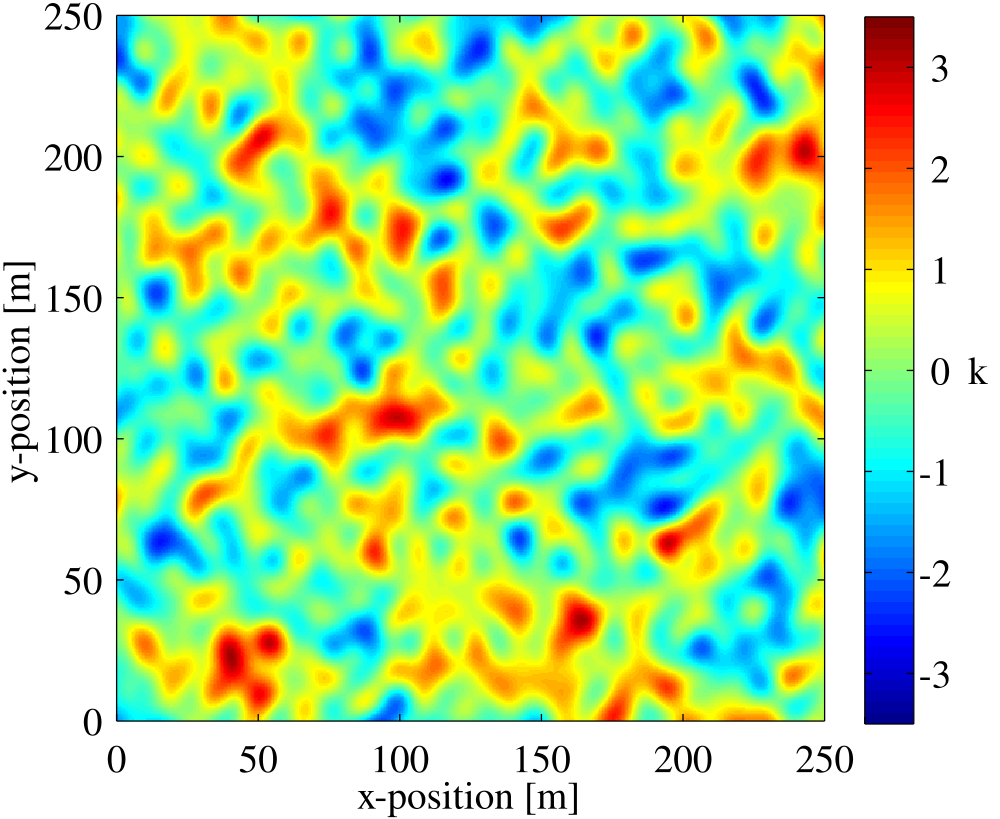
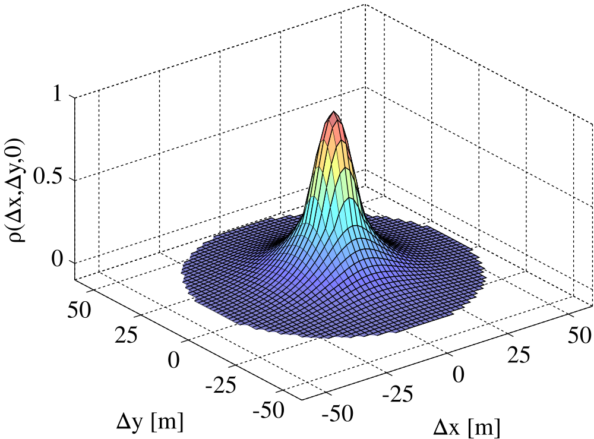
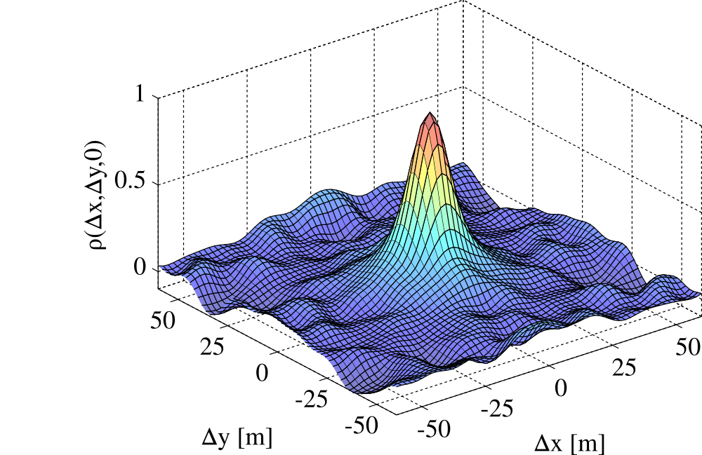
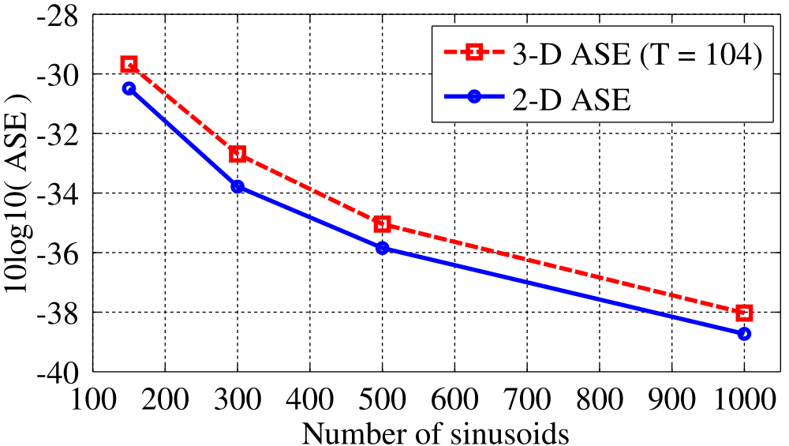
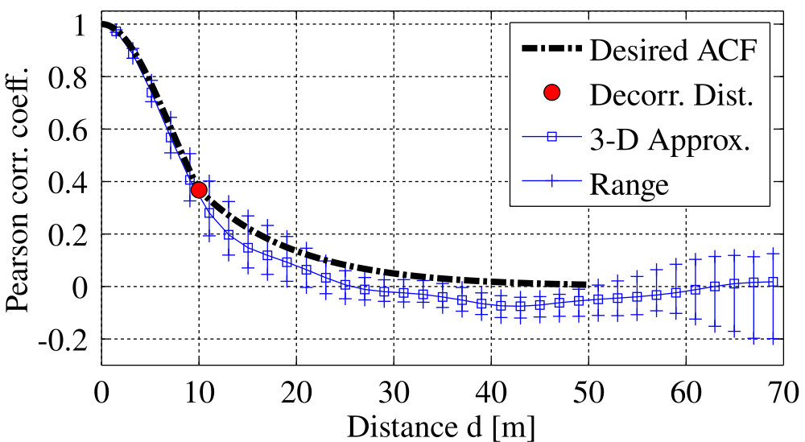
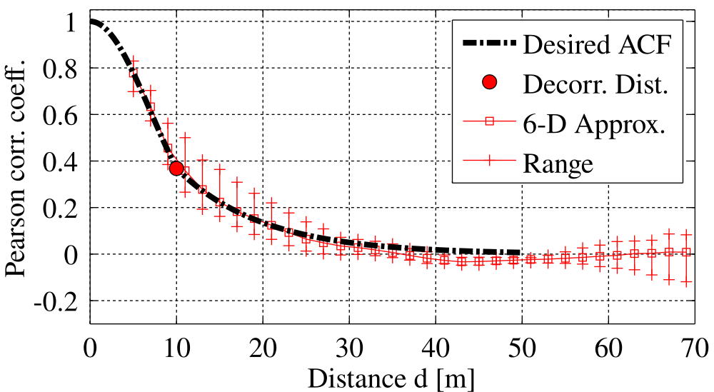
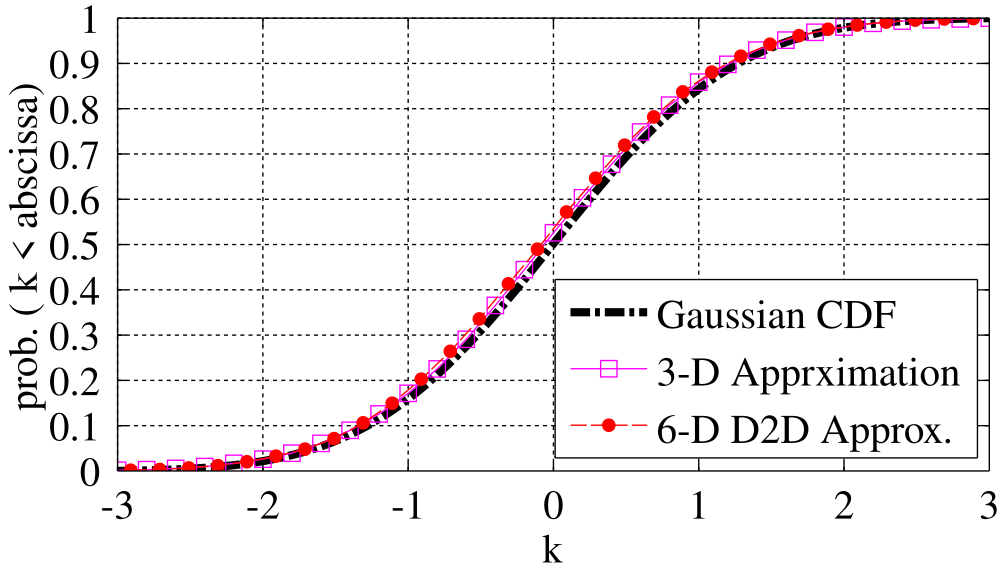
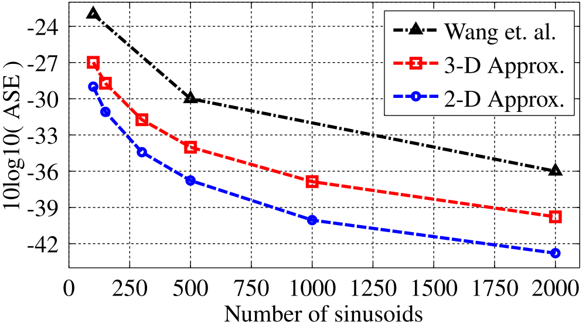
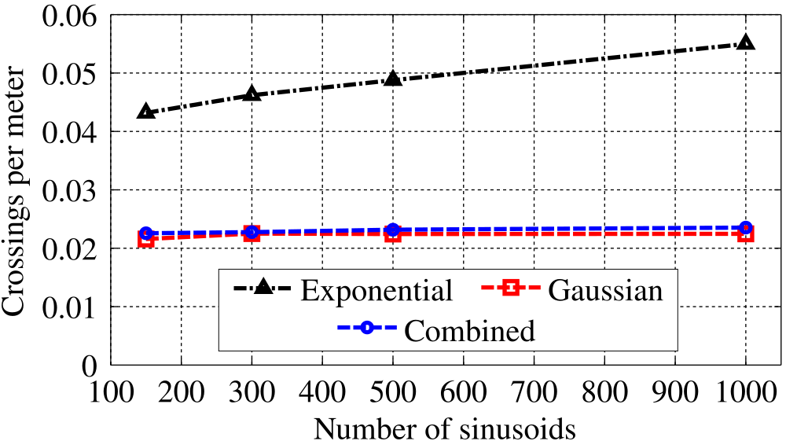
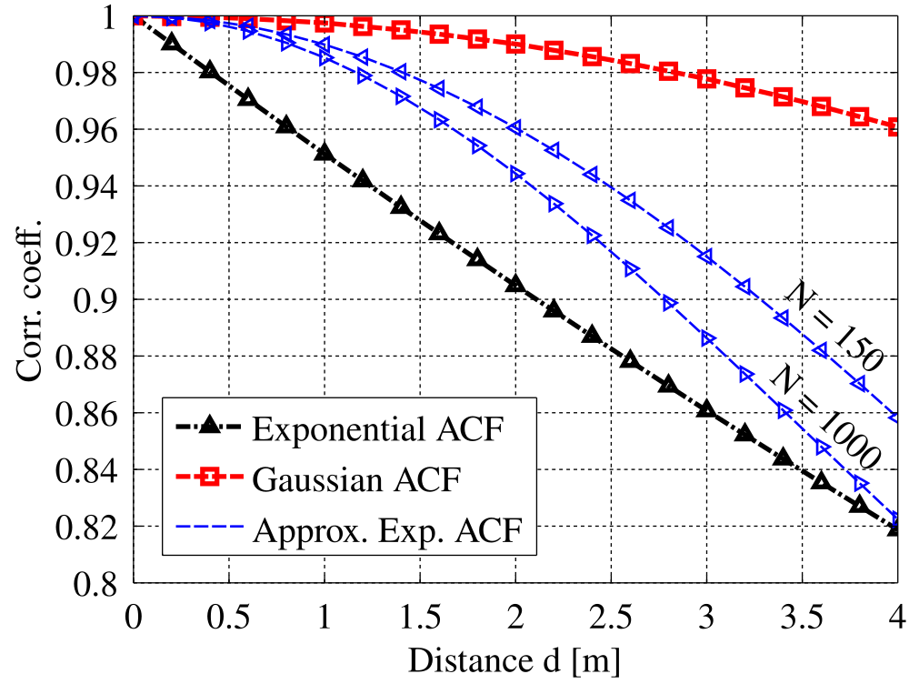

# Efficient Sum-of-Sinusoids-Based Spatial Consistency for the 3GPP New-Radio Channel Model

**Stephan Jaeckel**¹, **Leszek Raschkowski**¹, **Frank Burkhardt**² and **Lars Thiele**¹

¹ Fraunhofer Heinrich Hertz Institute, Berlin, Germany, stephan.jaeckel@hhi.fraunhofer.de  
² Fraunhofer Institute for Integrated Circuits, Erlangen, Germany

## Abstract

Spatial consistency was proposed in the 3GPP TR 38.901 channel model to ensure that closely spaced mobile terminals have similar channels. Future extensions of this model might incorporate mobility at both ends of the link. This requires that all stochastic processes in the model must be correlated in 3 (single-mobility) and up to 6 spatial dimensions (dual-mobility). Existing filtering methods cannot be used due to the large requirements of memory and computing time. The sum-of-sinusoids model promises to be an efficient solution. To use it in the 3GPP channel model, we extended the existing model to a higher number of spatial dimensions and propose a new method to calculate the sinusoid coefficients in order to control the shape of the autocorrelation function. The proposed method shows good results for 2, 3, and 6 dimensions and achieves a four times better approximation accuracy compared to the existing model. This provides a very efficient implementation of the 3GPP proposal and enables the simulation of many propagation scenarios that were thought to be impossible to realize with geometry-based stochastic channel models.

**Keywords:** Channel model, propagation, shadowing, spatial correlation, sum of sinusoids.

## I. Introduction

Channel models are an essential requirement for the development of new wireless communication protocols and systems. Standardized channel models can be used to evaluate and compare the different proposals against each other. For the upcoming fifth generation (5G) of wireless cellular communications, a new channel model was proposed by the 3rd generation partnership project (3GPP) [[1]](#ref1). An open-source implementation of this model is provided by the quasi deterministic radio channel generator (QuaDRiGa) [[2]](#ref2), [[3]](#ref3). An essential new feature that was introduced by 3GPP is *spatial consistency* which solves one major drawback of previous geometry-based stochastic channel models (GSCMs), namely the lack of realistic correlation in the small-scale-fading (SSF). Without spatial consistency, the positions of individual scattering clusters are generated randomly for each mobile terminal (MT) position. This contradicts the causality and the observations made in channel measurements [[4]](#ref4).

GSCMs consist of two main components: a stochastic part that generates a random propagation environment, and a deterministic part that lets transmitters and receivers interact with this environment. In order to make realistic predictions of the wireless system performance, the random environment must fulfill certain statistical properties which are determined by measurements. These properties are captured by the so-called large-scale fading (LSF) model. A subsequent SSF model then generates individual scattering clusters for each MT. The joint spatial correlation of the model parameters as well as the correlated positions of the scattering clusters result in similarities in the communication channels of closely spaced MTs, *i.e.*, two co-located terminals must observe the same channel. Since the MT positions are given in three-dimensional (3-D) Cartesian coordinates, all stochastic processes that determine the propagation environment need to be defined for 3-D coordinates as well. Many existing one-dimensional (1-D) correlations models (*e.g.*, [[5]](#ref5), [[6]](#ref6)), which are either a function of time or distance, must be extended to 3-D coordinates in order to be useful for GSCMs.

Large-scale parameters (LSPs) are more or less constant within an area of several meters. An example for this is the shadow fading (SF) which is caused by buildings or trees blocking a significant part of the signal. The so-called decorrelation distance of the SF, *i.e.*, the distance a MT must move to experience a significant change in the SF, is in the same order of magnitude as the size of the objects causing it. Thus, if a MT travels along a trajectory or if multiple MTs are closely spaced together, their LSPs are correlated. A common approach to model such correlation is by filtered Gaussian-distributed random numbers [[7]](#ref7). However, when it comes to spatial consistency, the positions of the scattering clusters must also be spatially correlated. The 3GPP proposal suggests that "spatially consistent powers/delays/angles of clusters are generated" [[1]](#ref1). However, this requires that all stochastic processes that determine the location of the scattering clusters are correlated. For a moderate scenario with 12 clusters and 20 sub-paths per cluster, this results in 2288 random variables[^1]. Compared to the 7 variables needed for the LSF model, the filtering approach therefore requires prohibitively large amounts of memory and computing time.

Another problem arises when incorporating so-called *vertical industries* into the 5G infrastructure which is not yet covered by the 3GPP new-radio model but discussed in several ongoing research projects and standardization activities. Such *verticals* could be vehicular networks, air-to-ground communications, industrial peer-to-peer (P2P) communications, or communication scenarios involving satellites in low-earth orbit. All of these examples have in common that both ends of the link are mobile. However, the simultaneous mobility of both communication partners is not supported by the classical cellular shadowing models. Therefore, an alternative method for the generation of the random propagation environment is needed [[8]](#ref8).

A computational efficient method to generate correlated stochastic processes has been introduced by Pätzold el. al. [[9]](#ref9) who approximated the filtered white Gaussian noise process by a finite sum of properly weighted sinusoids. This idea was further developed into a two-dimensional (2-D) shadowing model [[10]](#ref10). Wang et. al. then extended this 2-D method into a four-dimensional (4-D) method for device-to-device (D2D) channels [[11]](#ref11). A common problem for all these methods is finding the coefficients that best approximate a desired autocorrelation function (ACF) with a limited number of sinusoids.

In this paper, a new approximation method is presented that allows the efficient calculation of the sinusoid coefficients for an arbitrary ACF in 3-D space. It is shown how this translates directly into a six-dimensional stochastic process for D2D channels where both ends can be in different propagation environments, such as in air-to-ground channels. Compared to [[11]](#ref11), the proposed method also achieves a 6.5 dB better approximation average squared error (ASE) with the same number of sinusoids. An implementation of this model is available in MATLAB and Octave as part of the open-source QuaDRiGa channel model [[3]](#ref3).

## II. The Sum of Sinusoids Model

A spatially correlated Gaussian stochastic process generates normal distributed random numbers

$$
k(x,y,z) \sim \mathcal{N}(0,1), \tag{1}
$$

with zero mean and unit variance. The value $k$ is a function of the terminal location in 3-D Cartesian coordinates $(x,y,z)$. From these numbers, other types of distributions can be obtained, *e.g.*, uniform or log-normal distribution with a different mean or variance. The 1-D spatial autocorrelation function (ACF) describes how fast the local mean of $k(x,y,z)$ evolves as a terminal moves. The ACF is usually modeled as an exponential decay function

$$
\rho(d) = \exp\left(-\frac{d}{d_\lambda}\right), \tag{2}
$$

with $d$ as the distance between two positions and $d_\lambda$ as the so-called decorrelation distance, *i.e.*, the distance at which the correlation between two samples falls below $e^{-1}\approx 0.37$ [[5]](#ref5). However, other types of decay functions may be desirable. The sum-of-sinusoids (SOS) method outlined in [[9]](#ref9) approximates an 1-D Gaussian stochastic process $k(x)$ as a function of the position $x$ on an 1-D linear trajectory as

$$
\hat{k}(x) = \sum_{n=1}^{N} a_n \cos\left\{ 2\pi f_n x + \psi_n \right\} \tag{3}
$$

with $N$ sinusoids. The variables $a_n$, $f_n$, and $\psi_n$ denote the amplitude, the frequency, and the phase of a sinusoid, respectively. The amplitudes $a_n$ and the frequencies $f_n$ are determined in a way that $\hat{k}(x)$ has similar statistical properties as $k(x)$, *i.e.*, $\hat{k}(x)$ has the same approximate ACF and the cumulative distribution function (CDF) is close to Gaussian density if $N$ is sufficiently large. According to [[9]](#ref9), 6 to 30 sinusoids are sufficient for an 1-D approximation. The phases $\psi_n$ are randomly initialized in the range from $-\pi$ to $\pi$. Hence, exchanging the $\psi_n$ while keeping $a_n$ and $f_n$ fixed creates a new spatially correlated stochastic process at minimal computational cost. A straight-forward expansion to a 3-D Gaussian stochastic process follows from [[11]](#ref11) as

$$
\hat{k}(x,y,z) = \sum_{n=1}^{N} a_n \cos\left\{ 2\pi \left(f_{x,n}\, x + f_{y,n}\, y + f_{z,n}\, z\right) + \psi_n \right\}. \tag{4}
$$

Under the assumption that the fluctuations of $k(x,y,z)$ are wide sense stationary, the ACF only depends on the distance between two terminal positions. Hence, the 3-D spatial ACF of $\hat{k}(x,y,z)$ can be expressed as [[11]](#ref11)

$$
\hat{\rho}(\Delta x,\Delta y,\Delta z) = \sum_{n=1}^{N} \frac{a_n^2}{2} \cos\left\{ 2\pi \left(f_{x,n}\, \Delta x + f_{y,n}\, \Delta y + f_{z,n}\, \Delta z\right) \right\}. \tag{5}
$$

When a MT moves from one location to another, the correlation $\rho(\Delta x,\Delta y,\Delta z)$ between the generated values $k(x,y,z)$ depends not only on the distance, but also on the direction of movement. In 3-D space, the traveling direction can be expressed by pitch and yaw. The pitch angle $\theta$ describes the vertical (tilt) angle relative to the horizontal plane. Positive rotation is up. The bearing or yaw angle $\phi$ describes the orientation on the ground. Here, it is defined in mathematic sense, *i.e.*, seen from above, a value of 0 points to the east and the angles increase counter-clockwise. In order to extend the existing 1-D approximations methods (*e.g.*, the $L_p$-norm method used in [[6]](#ref6)) to 3 dimensions, we propose to assign a random direction $(\theta_n,\phi_n)$ to each of the $N$ sinusoids. There is no direct relationship between the direction $(\theta, \phi)$ in which the MT moves and the directions $(\theta_n, \phi_n)$ of the sinusoids. However, the sinusoid directions have to be chosen such that all possible movement directions of the MT are sufficiently covered, *e.g.*, by generating equidistributed points on the surface of a sphere as described in [[12]](#ref12). The resulting 3-D approximation of the Gaussian stochastic process (4) is then independent of the MT movement direction.

The directivity of the sinusoid frequencies is expressed as

$$
f_{x,n}\, \Delta x = f_n \cdot d \cdot \cos\phi_n \cdot \cos\theta_n, \tag{6}
$$

$$
f_{y,n}\, \Delta y = f_n \cdot d \cdot \sin\phi_n \cdot \cos\theta_n, \tag{7}
$$

$$
f_{z,n}\, \Delta z = f_n \cdot d \cdot \sin\theta_n, \tag{8}
$$

where $f_n$ is the $n$-th root-frequency and $d$ is the distance. Pätzold et. al. [[9]](#ref9) proposed four methods to determine the amplitudes $a_n$ and frequencies $f_n$ in a SOS model. All of them show different performance in terms of average squared error (ASE) vs. the number of sinusoids, and computational complexity. They have in common that the approximated ACF is an exponential decay function (2). However, this is not always desirable since other types of decay functions might be needed. Hence, in the next section, a numeric approximation method is presented that calculates the sinusoid coefficients for arbitrary ACFs.

## III. 3-D Approximation of Arbitrary ACFs

The approximation method is derived from the Monte Carlo method [[13]](#ref13), [[9]](#ref9). The sinusoid frequencies $f_n$ are generated by an iterative optimization method that minimizes the error between the desired ACF and the approximate ACF for a given number of sinusoids. This method requires that the ACF is discretely sampled at $s = 1 \ldots S$ sampling distances. This is done by defining a vector $\mathbf{d}$ that contains the sampling distances in increasing order.

$$
\mathbf{d} = \begin{pmatrix} d_1 & d_2 & \ldots & d_S \end{pmatrix}^T \tag{9}
$$

Then, the sampled ACF $\rho(\mathbf{d})$ is obtained. The first distance value $d_1$ must be 0 and the first correlation value $\rho_1$ must be 1, *i.e.*, at zero-distance the generated values $\hat{k}(x,y,z)$ are identical. The $N$ root-frequencies are randomly initialized to

$$
f_n \sim \frac{1}{d_S} \cdot \mathcal{U}(-\pi,\pi), \tag{10}
$$

where $\mathcal{U}(-\pi,\pi)$ describes an uniform distribution with values between $-\pi$ and $\pi$, and $d_S$ the maximum distance for which the ACF is defined. The directional components $f_{x,n}$, $f_{y,n}$, and $f_{z,n}$ are calculated according to (6), (7), and (8) with $d=\Delta x=\Delta y=\Delta z=1$, respectively.

The iterative optimization is done by updating the $n$-th root frequency while keeping all other $N-1$ frequencies fixed. Then, the ASE is calculated for the overall 3-D space. Cai and Giannakis [[10]](#ref10) introduced the ASE as a performance measure of the approximation. It is defined as the average squared error between the desired ACF $\rho(\mathbf{d})$ and the approximate ACF $\hat{\rho}(\Delta x,\Delta y,\Delta z)$. Here it is calculated as

$$
\mathrm{ASE} = \frac{1}{S\,T}\sum_{t=1}^{T}\sum_{s=1}^{S} \left\{ \rho(d_s) - \frac{1}{N}\sum_{n=1}^{N} \cos\left( \frac{2\pi}{d_S}\, f_{t,n}\, d_s \right) \right\}^2. \tag{11}
$$

Since the approximate ACF depends on the direction, the ASE calculation must take the directivity into account. Hence, the evaluation is done for $t = 1\ldots T$ randomly chosen *test* directions $(\theta_t,\phi_t)$. The corresponding *test* frequencies $f_{t,n}$ are

$$
f_{t,n} = \left( f_{x,n} \cos\phi_t + f_{y,n} \sin\phi_t \right) \cos\theta_t + f_{z,n} \sin\theta_t. \tag{12}
$$

The ASE is used as a cost function for the *iterative refinement* of the sinusoid frequencies. If the ASE improves for a newly estimated root-frequency, the three sinusoid frequencies are replaced by the newly estimated ones, otherwise the new values are discarded. The iteration stops when no further improvement can be achieved for any of the $N$ sinusoid components.

A new root-frequency is obtained by solving

$$
f_n = \frac{1}{d_S} \arg\min_{f} \sum_{s=1}^{S} \left\{ \rho(d_s) - \hat{\rho}(d_s) - \frac{1}{N} \cos\left( \frac{2\pi}{d_S}\, f\, d_s \right) \right\}^2, \tag{13}
$$

where $\rho(d_s)$ is the desired ACF and $\hat{\rho}(d_s)$ is the approximate ACF constructed from all $N-1$ components from the previous iteration. The amplitudes of all sinusoids are set to $a_n^2 = \frac{2}{N}$ and standard numerical methods can be applied to find the values $f$. However, (13) can only be used to approximate an 1-D stochastic process such as (3). For a 3-D stochastic process (4) it is necessary to obtain the three sinusoid components $f_{x,n}$, $f_{y,n}$, and $f_{z,n}$. This can be done by performing the estimation along one of the three axes of the coordinate system. The estimation direction (*i.e.*, the coordinate system axis) is chosen according to

$$
\hat{\rho}(d_s) =
\begin{cases}
\hat{\rho}(\Delta x), & \text{for } \Delta x \geq \Delta y \text{ and } \Delta x \geq \Delta z; \\
\hat{\rho}(\Delta y), & \text{for } \Delta y > \Delta x \text{ and } \Delta y \geq \Delta z; \\
\hat{\rho}(\Delta z), & \text{for } \Delta z > \Delta x \text{ and } \Delta z > \Delta y,
\end{cases} \tag{14}
$$

where $\Delta x$, $\Delta y$, and $\Delta z$ are calculated according to (6), (7), and (8) with $d=1$, respectively. Then, one of the following calculation options is used:

**Estimation in $x$-direction** is performed by combining (6) and (5) while setting $\Delta y = \Delta z = 0$. This leads to a directional ACFs in $x$-direction

$$
\hat{\rho}(\Delta x) = \frac{1}{N}\sum_{n=1}^{N} \cos\big( 2\pi \cdot \Delta x \cdot \underbrace{f_n \cos\phi_n \cos\theta_n}_{=f_{x,n}} \big). \tag{15}
$$

This function is sampled at the sampling distances (9) and used instead of $\hat{\rho}(d_s)$ in (13) to get an update of the $n$-th root frequency $f_{n}$. Due to the linear dependency, $f_{x,n}$, $f_{y,n}$, and $f_{z,n}$ are calculated from (6), (7), and (8).

**Estimation in $y$-direction** is performed by combining (7) and (5) while setting $\Delta x = \Delta z = 0$. This leads to a directional ACFs in $y$-direction

$$
\hat{\rho}(\Delta y) = \frac{1}{N}\sum_{n=1}^{N} \cos\big( 2\pi \cdot \Delta y \cdot \underbrace{f_n \sin\phi_n \cos\theta_n}_{=f_{y,n}} \big). \tag{16}
$$

The $n$-th root frequency $f_{n}$ is obtained and the directional components are calculated from (6)-(8).

**Estimation in $z$-direction** is performed by combining (8) and (5) while setting $\Delta x = \Delta y = 0$. This leads to a directional ACFs in $z$-direction

$$
\hat{\rho}(\Delta z) = \frac{1}{N}\sum_{n=1}^{N} \cos\big( 2\pi \cdot \Delta z \cdot \underbrace{f_n \sin\theta_n}_{=f_{z,n}} \big). \tag{17}
$$

The $n$-th root frequency $f_{n}$ is obtained and the directional components are calculated from (6)-(8).

The behavior of the approximated ACF is controlled in the overall 3-D space by calculating the ASE (11) for a large number of test directions and updating the directional sinusoid frequencies only if there is an overall improvement. The output of the approximation method are the sinusoid frequencies that can be used in (4) to generate spatially correlated normal-distributed random numbers with an arbitrary ACF and for arbitrary movements of the MT. It is possible to adjust the decorrelation distance $d_\lambda$ and the distribution function of the stochastic process without having to recalculate the sinusoid frequencies. Doubling the distances in (9) is equal to halving the frequencies in (4). For example, if the approximation was done for $d_\lambda = 10$ m, but a stochastic process is needed for 20 m decorrelation distance, then simply dividing the frequencies by 2 creates the correct results. Uniform distribution can be achieved by a transformation from normal to uniform samples[^2]. In the next section, it is shown how the SOS method can be used to generate correlated stochastic processes for P2P links where both ends of the communication channel are mobile.

## IV. Device-to-Device Extension

It was found in [[11]](#ref11) that the MT movement at each end of the P2P link has an independent and equal effect on the correlation coefficient and that the joint correlation function (JCF) can be decomposed into two independent ACFs

$$
\rho(\Delta x_t,\Delta y_t,\Delta z_t,\Delta x_r,\Delta y_r,\Delta z_r) = \rho(\Delta x_t,\Delta y_t,\Delta z_t) \cdot \rho(\Delta x_r,\Delta y_r,\Delta z_r). \tag{18}
$$

The locations of the transmitting and receiving terminal are given in 3-D Cartesian coordinates as $(x_t,y_t,z_t)$ and $(x_r,y_r,z_r)$, respectively. [[11]](#ref11) proposes to approximate a combined ACF. However, with six dimensions this results in a prohibitively large number of sinusoid coefficients and computing time. A simpler approach is to combine two independent Gaussian stochastic processes, one for the transmitter and one for the receiver into

$$
k(x_t,y_t,z_t,x_r,y_r,z_r) = \frac{k_t(x_t,y_t,z_t) + k_r(x_r,y_r,z_r)}{\sqrt{2}}. \tag{19}
$$

The approximated six-dimensional Gaussian process is

$$
\hat{k}(x_t,y_t,z_t,x_r,y_r,z_r) = \sum_{n=1}^{2N} \frac{a_n}{\sqrt{2}} \cos\left\{ 2\pi \cdot \mathbf{f}_n^T \cdot \begin{bmatrix} x_t & y_t & z_t & x_r & y_r & z_r \end{bmatrix}^T + \psi_n \right\}, \tag{20}
$$

where the sinusoid frequencies are obtained independently for the transmitting and receiving side.

$$
\mathbf{f}_n =
\begin{cases}
\begin{bmatrix} f_{x_t,n} & f_{y_t,n} & f_{z_t,n} & 0 & 0 & 0 \end{bmatrix}^T, & \text{for } n \leq N; \\
\begin{bmatrix} 0 & 0 & 0 & f_{x_r,n} & f_{y_r,n} & f_{z_r,n} \end{bmatrix}^T, & \text{for } n > N.
\end{cases} \tag{21}
$$

The scaling by $\sqrt{2}$ in (19) accounts for doubling the number of SOS components in (20).

## V. Numeric Results

In the following, we present numerical results for the proposed estimation method. To demonstrate the approximation of an arbitrary ACFs, we study the performance of the model for a combination of a Gaussian and an exponential ACF which has the same decorrelation distance as (2) with closely spaced samples showing a higher correlation.

$$
\rho(d) =
\begin{cases}
\exp\left(-\dfrac{d^2}{d_\lambda^2}\right), & \text{for } d < d_\lambda; \\
\exp\left(-\dfrac{d}{d_\lambda}\right), & \text{for } d \geq d_\lambda
\end{cases} \tag{22}
$$

Results for the exponential ACF (2) are presented at the end of this section. The decorrelation distance $d_\lambda$ was set to 10 meters and the ACF was sampled in intervals of 0.25 meters ranging from 0 to 49.75 meters. Hence, $\rho(d_s)$ contains 200 values. A 2-D plot of this function is shown in [Fig. 2](#fig2) (top). This function was approximated using the method outlined in [Sec. III](#iii-3-d-approximation-of-arbitrary-acfs) with a varying number of sinusoid coefficients. The number of test directions for the iterative search was set to 28 and the entire estimation process was repeated 5000 times with different initial values for the directions $(\theta_n,\phi_n)$ and the initial root-frequencies. [Fig. 2](#fig2) (bottom) shows the best result of an approximation using 300 sinusoids. An example of the 2-D stochastic process resulting from this approximation is shown in [Fig. 1](#fig1). The output was generated by defining $x,y$-positions on a 250 $\times$ 250 m² grid with 0.5 m spacing. The $z$-position was set to 0 m and no D2D extension was used.

**Fig. 1.** Example of a spatially correlated 2-D process

**Fig. 2.** Desired 2-D ACF on the $x-y$ plane (top) and approximated ACF using 300 sinusoids (bottom)

### ACF approximation accuracy

The achievable ASE as a function of the number of sinusoids is shown in [Fig. 3](#fig3) (lower values are better). The red dashed curve shows the ASE calculation using (11) whereas the blue, solid line compares the 2-D ACFs on the $x-y$, $x-z$, and $y-z$ plane with the one shown in [Fig. 2](#fig2) (taking only the disk-shaped area covered by the ACF into account). Both methods estimate similar values for the ASE. The curves indicate that when doubling the number of coefficients, the ASE improves by roughly 3 dB. However, this also comes at the cost of doubling the computation time for the generation of the random numbers.

**Fig. 3.** Achievable ASE vs. number of sinusoids for the combined ACF

### Random number generation

[Fig. 4](#fig4) compares the desired ACF (thick dashed line) with the output of the stochastic process using 300 sinusoids. For the upper plot, 6000 positions were randomly chosen within a cube of 56 m edge length. Then, spatially correlated normal distributed random numbers were generated for each position using (4). The distance between each pair of positions was calculated and pairs with similar distance were grouped, *i.e.*, positions with a distance between 0 and 2 meters of each other belong to group 1, positions with a distance between 2 and 4 meters belong to group 2, and so on. The Pearson correlation coefficient was calculated for the samples within each group. The entire process was repeated 10 times to obtain an average ACF (blue squares) and the spread for different initializations (bars showing the minimum and maximum values of the 10 initializations). For the lower part of the figure, 3000 positions were randomly chosen for the transmitter and 3000 were chosen for the receiver. Then, spatially correlated values were generated using (19). The grouping was done for the transmitter positions under the constraint that the receiver does not move faster than the transmitter. For example, group 3 contains all pairs where the transmitters have a distance between 4 and 6 meters and the receivers have a distance between 0 and 6 meters of each other. Both curves indicate that the given ACF can be approximated with good accuracy.

**Fig. 4.** Estimated ACF from spatially correlated random values

[Fig. 5](#fig5) shows that the CDF of the stochastic process is close to Gaussian density. For this, $10^4$ random positions were generated in a cube of $1000 \times 1000 \times 50$ m³ edge length and spatially correlated random numbers were generated using (4) and (19). There is no notable difference between the distribution of the generated values and the Gaussian CDF.

**Fig. 5.** CDF of the output values vs. the Gaussian CDF

### Complexity considerations

As mentioned in the introduction, the state-of-the-art alternative for the generation of correlated random numbers is by filtering white noise [[7]](#ref7). Here, the filter approach is compared with the SOS model in terms of memory requirements, initialization time, time to generate the output values, and the restrictions on the MT placement. The results are summarized in [Table I](#tab1).

**Table I.** Performance comparison of filter-based and SOS model

|                   | Filter approach                    | Sum-of-sinusoids               |
|:------------------|:----------------------------------:|:------------------------------:|
| Required memory   | $N^D$ elements                     | $(D+1)\cdot N$ elements        |
| Initialization    | $\approx D \cdot S \cdot N^D$ op.  | $\approx N$ operations         |
| Output generation | $2D^2 + 5D$ op.                    | $\approx N\cdot (2D+15)$ op.   |
| MT placement      | inside map area                    | no restriction                 |

For the filter approach, the parameter $N$ in [Tab. I](#tab1) refers to the *edge length* of the sampled area and $D$ refers to the number of dimensions. The sample resolution needs to be high enough to captures the variation in the random process. With $d_\lambda=10$ m, we assume that a resolution of 2.5 m is sufficient. With $N=300$ and $D=2$, the filtered map covers an area of $750 \times 750$ m² and requires 360 kilobytes of memory[^3]. Without increasing $N$ or lowering the resolution, all MTs must be located within this area. In comparison, the SOS method requires only 3.6 kilobytes of memory for the sinusoid coefficients and there are no restrictions on the MT positions.

Initializing the random number generator means that a new map must be generated, *i.e.*, for the filter approach, generating $N^D$ random numbers and processing each number with $D$ finite impulse response filters[^4] of order $S$. For the SOS method, only the $N$ phases $\psi_n$ must be randomly initialized in (4). The sinusoid frequencies can be precalculated and stored in a table. This makes the SOS method very efficient when many random variables are needed, such as for the spacial consistency model from 3GPP [[1]](#ref1). The downside of the SOS method resides in the commutation time required to generate the correlated output values. Calculating the cosine in (4) is computationally expensive[^5] and the sum over all $N$ sinusoids must be calculated for each output value. With $N=300$ and $D=2$, approximately 5700 operations are needed to generate one output value. For the filter approach, the map only needs to be interpolated to obtain the output value at the MT position. This requires 18 operations using bilinear interpolation. Hence, the filter approach might be preferred when the output value generation is the dominating factor in the overall computing time.

### Exponential ACF approximation

The achievable ASE performance is compared with the results from Wang et. al. [[11]](#ref11), where an exponential ACF was approximated by different methods using 100, 500, and 2000 sinusoids. With the Monte Carlo method, [[11]](#ref11) reported an ASE for a 2-D approximation of $-23$ dB, $-30$ dB, and $-36$ dB, respectively. The other proposed methods performed similarly. Our iterative approximation method achieved $-29$ dB, $-36.8$ dB, and $-42.7$ dB for the 2-D approximation of the exponential ACF using the same number of sinusoids, respectively. This is an average improvement of $6.5$ dB. Results are shown in [Fig. 6](#fig6). The 3-D approximation has an average performance loss of 2.7 dB compared to 2-D[^6]. However, this is still a significant improvement compared to [[11]](#ref11).

**Fig. 6.** Achievable ASE vs. number of sinusoids for the exponential ACF

### Zero-crossing rate

The zero-crossing rate (ZCR) is the rate of sign-changes along a signal, *i.e.*, the rate at which a signal changes from positive to negative or back. It is a function of the second derivative $\ddot{\rho}(0)$ of the ACF. Giancristofaro [[14]](#ref14) has pointed out that the exponential ACF (2) has an indefinite second derivative in the origin and, hence, the ZCR of a continuous process characterized by such an ACF would not be calculable. This drawback might become serious for a large number is sinusoids. However, the SOS approximation (5) has a definite second derivative in the origin and, hence, its ZCR can be calculated. Here, the ZCR is evaluated as a function of the number of sinusoids for the approximation of three different ACFs: the exponential ACF (2), the Gaussian ACF, and the combination of the two (22). The decorrelation distance $d_\lambda$ was set to 20 m as suggested by [[14]](#ref14). Results are shown in [Fig. 7](#fig7). The ZCR obtained from the approximated Gaussian and combined ACFs does not depend on the number of sinusoids. However, this is not the case for the exponential ACF where the ZCR increases with increasing number of sinusoids. When the exponential ACF is approximated by a limited number of sinusoids in 3-D coordinates, it is not possible to perfectly capture the slope of the ACF close to the $y$-axis. This is illustrated in [Fig. 8](#fig8) for the approximation with 150 and 1000 sinusoids. The gap between the black and the blue curves decreases with increasing number of sinusoids. This is the reason for the increasing ZCR in [Fig. 7](#fig7).

**Fig. 7.** Zero-crossing rate vs. the number of sinusoids, $d_\lambda = 20$

**Fig. 8.** Autocorrelation function, $d_\lambda = 20$

## VI. Conclusions

The proposed iterative approximation method can obtain the sinusoid coefficients for arbitrary autocorrelation functions with better accuracy compared to previous results. It is possible to change the decorrelation distance and the distribution of the spatially correlated random process without recalculating the sinusoid frequencies. They can be precomputed and stored in a table for fast access. Therefore, generating spatially correlated random numbers, even for a large number of positions, can be done by simply calculating a weighted sum. The performance scales linearly with the number of sinusoids and the number of positions. Furthermore, memory requirements are negligible. This provides a very efficient implementation of the 3GPP proposal for spatial consistency. The scheme can be used with minimal adjustments to support a system where both ends of a link are mobile.

## Acknowledgement

The authors thank the Celtic Office and national funding authorities BMBF in Germany, Business Finland, and MINETAD in Spain for supporting this research and development through the ReICOvAir project. The project benefits also from the valuable technical contributions from GHMT AG, CETECOM GmbH, and Qosmotec GmbH in Germany; Trimek S.A. and SQS S.A. in Spain; Verkotan Ltd., Kaltio Technologies, Sapotech, and the Centre for Wireless Communications at the University of Oulu in Finland.

## References

[1] 3GPP TR 38.901 v14.1.0, "Study on channel model for frequencies from 0.5 to 100 GHz," Tech. Rep., 2017.

[2] S. Jaeckel, "Quasi-deterministic channel modeling and experimental validation in cooperative and massive MIMO deployment topologies," Ph.D. dissertation, TU Ilmenau, 2017. [Online]. Available: https://www.db-thueringen.de

[3] [Online]. Available: http://www.quadriga-channel-model.de

[4] M. Narandzic, M. Käske, S. Jäckel, G. Sommerkorn, C. Schneider, and R. S. Thomä, "Variation of estimated large-scale MIMO channel properties between repeated measurements," *Proc. IEEE VTC '11 Spring*, 2011.

[5] M. Gudmundson, "Correlation model for shadow fading in mobile radio systems," *IET Electron Lett.*, vol. 27, no. 23, pp. 2145–2146, November 1991.

[6] M. Pätzold, N. Avazov, and V. D. Nguyen, "Design of measurement-based correlation models for shadow fading," *The 2010 International Conference on Advanced Technologies for Communications*, pp. 112–117, Oct 2010.

[7] K. Bakowski and K. Wesolowski, "Change the channel," *IEEE Veh. Technol. Mag.*, vol. 6, pp. 82–91, 2011.

[8] T. Jamsa and P. Kyosti, "Device-to-device extension to geometry-based stochastic channel models," *Antennas and Propagation (EuCAP), 2015 9th European Conference on*, pp. 1–4, April 2015.

[9] M. Patzold, U. Killat, and F. Laue, "A deterministic digital simulation model for Suzuki processes with application to a shadowed Rayleigh land mobile radio channel," *IEEE Transactions on Vehicular Technology*, vol. 45, no. 2, pp. 318–331, May 1996.

[10] X. Cai and G. B. Giannakis, "A two-dimensional channel simulation model for shadowing processes," *IEEE Trans. Veh. Technol.*, vol. 52, no. 6, pp. 1558–1567, 2003.

[11] Z. Wang, E. Tameh, and A. Nix, "A sum-of-sinusoids based simulation model for the joint shadowing process in urban peer-to-peer radio channels," *Proc. IEEE VTC '05 Fall*, vol. 3, pp. 1732–1736, Sept 2005.

[12] M. Deserno, "How to generate equidistributed points on the surface of a sphere," Max-Planck-Institut für Polymerforschung, Tech. Rep., 2004.

[13] P. Hoeher, "A statistical discrete-time model for the WSSUS multipath channel," *IEEE Transactions on Vehicular Technology*, vol. 41, no. 4, pp. 461–468, 1992.

[14] D. Giancristofaro, "Correlation model for shadow fading in mobile radio channels," *Electronics Letters*, vol. 32, no. 11, pp. 958–959, May 1996.

[^1]: In the 3GPP new-radio model, scattering is based on the LOS / NLOS state (1 variable); LSPs (7 variables: delay spread, shadow fading, 4 angular spreads, K-factor); delays, powers, per-cluster angles ($10\cdot 12$ variables); random coupling of sub-paths ($4 \cdot 12 \cdot 20$ variables); Cross polarization power ratios ($12 \cdot 20$ variables); Initial random phases ($4 \cdot 12 \cdot 20$ variables).

[^2]: Given a standard Gaussian stochastic process $k \sim \mathcal{N}(0,1)$, then remapping the probability density to $u \sim \mathcal{U}(0,1)$ is done using the complementary error function as $u = 0.5\cdot\mathrm{erfc}( -k / \sqrt{2} )$.

[^3]: Assuming single-precision floating point accuracy.

[^4]: The filter order $S$ corresponds to the length of the sampled ACF.

[^5]: Calculating the cosine requires approximately 15 floating point operations, depending on the implementation and the value of the argument.

[^6]: The performance loss can be explained by the additional degree of freedom added by the mobility in $z$-direction in (8), where the scaling of the resolution in the $x,y$-direction follows from $\int_{-\pi/2}^{\pi/2}\cos^2\theta \, d\theta \,\big/ \int_{-\pi/2}^{\pi/2} d\theta = \frac{1}{2}$.
