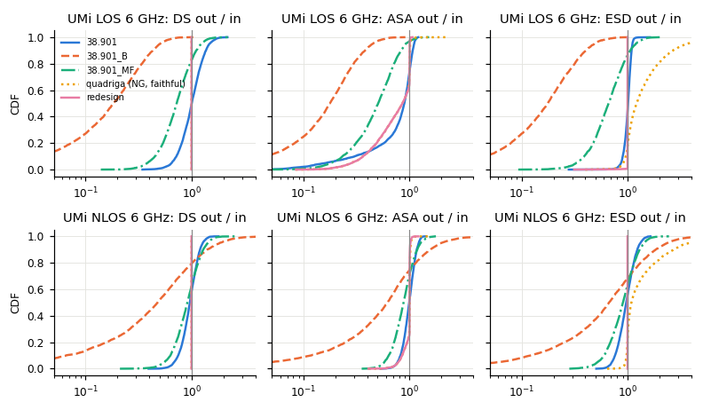
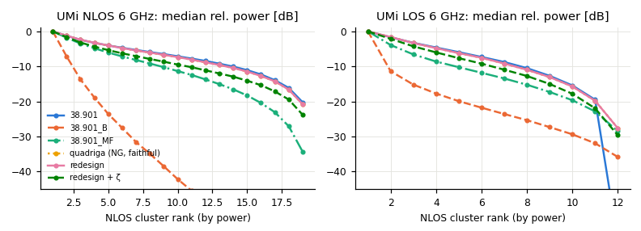
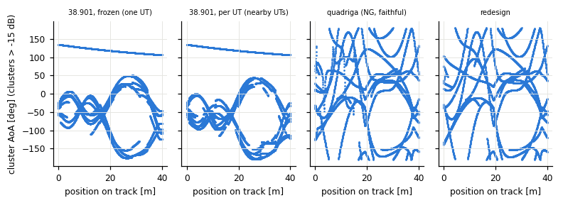
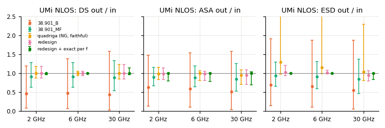

# R0: comparison of the cluster-level methods (TR 38.901 v19.5.0 steps 5–7)

Working document of the SSF series (deleted before the merge). Every number below comes from a run of the scratch
prototype in `/home/stephan/quadriga-lib-agents/scratch/ssf_r0/` (Python/NumPy, LSPs and random fields from the
library built from this branch, v0.12.4). Labels A/N/D refer to `md/ssf_analysis.md` and `md/ssf_plan.md`.

## 1. Setup

**What is compared.** Five ways to turn the large-scale parameters of a link (DS, ASD, ASA, ZSD = ESD, ZSA = ESA, K)
into cluster delays, powers and angles. Output per link: slot 0 = LOS ray (zero power in NLOS), then N NLOS clusters
(D4: N + 1 slots; the v19 LOS files were read as if they held N + 1). Spreads are measured on that output with the
library definitions (`calc_delay_spread`; `calc_angular_spreads_sphere` without wrapping: circular mean, wrapped
deviations, power-weighted, LOS slot included; the NumPy copy matches the library to 1e-14).

**Scenarios and links.** UMi (BS 10 m, UT 1.5 m, d2D 10–150 m) and UMa (BS 25 m, d2D 35–300 m), LOS and NLOS files
of v19, 6 and 30 GHz; multi-frequency 2/6/30 GHz on UMi (UMa uses fc = 6 GHz below 6 GHz, so 2 and 6 GHz are equal
there). Drop statistics: 4000 links per case (8 LSF seeds × 500 UTs; `lsf_init_phases` without bias removal,
`lsf_draw`, `lsp_generate`). Normalized cluster inputs: one N(0,1) or U(0,1) value per cluster and variable (delay U,
shadowing Z per frequency, 4 angle fields, 4 sign fields), seed 11, mapped per method (U = Φ(N) where a method needs
a uniform). Continuity: 30 straight tracks of 40 m per case, step 0.05 m and 0.01 m, inputs from the library SOS
generators (`sos.preset("Comb256", SC_lambda)`, `sos.val`, 2D). D2D: 2000 pairs, mirrored fields from the two-device
modes of `sos.val`, mirrored LSPs.

**Candidates.**
1. `38.901` — 7.5 steps 5–7 with D5: C_τ in LOS, C_φ/C_θ interpolated (tables exact for N = 12, 19, 20 used here),
   −25 dB removal as zero power without renormalisation, μ_offset,ZOD (from `eod_offset_deg`) in NLOS, signs X_n and
   jitter Y_n from the sign/angle fields, zenith wrap for ZOA and ZOD. Cluster identity is kept (the sort of 7.5-2 only
   decides the "first" cluster), which is the most continuous reading.
2. `38.901_B` — Procedure B: uniform delays/angles on 2·10^(μ+σ) (largest μ+σ over the frequencies), Laplacian
   power terms with the √(1+K/2), √(1+K) substitution in LOS, cluster 1 at zero delay and angle in LOS, offset in ZOD.
   Decorrelation distances on tracks per D6: delay/AOD/ZOD 2c·10^(μlgDS+σlgDS) = 54–392 m, AOA/ZOA 50 m, Z at
   SF_lambda.
3. `38.901_MF` — 7.6.5.1 with anchor 2 GHz, r = 1.5, no offset, no O2I rule, LOS scaling by √(1+K) after the wrap
   (as written).
4. `quadriga` — faithful port of NG `gen_ssf_parameters` (HEAD `9a2beeb`, QuaDRiGa path, cluster level): −ln U delays,
   (U − ½)π angles, power product with g = r_τ−1 / 0.56 / 0.76 (paper fits for several frequencies), analytic DS
   scaling and the iterative linear AS loop (averaged over frequencies, capped at 3 / 1.5), pole mirror, 3-D rotation to
   the LOS direction, satellite EoA fade (N11), GR power split, no ZOD offset (N4). "NG today" is the same with the
   committed LOS files (N − 1 NLOS clusters in LOS, N3).
5. `redesign` — `quadriga` with three changes, chosen by the ablation in 2.6: (a) LOS direction applied additively in
   azimuth and elevation (pole fold as NG) instead of the 3-D rotation; (b) μ_offset,ZOD added to the NLOS departure
   elevations; (c) no satellite EoA fade. Delays and powers are the faithful ones (same code path).

**Choices I had to make.** Procedure B in LOS: whether the power of cluster 1 uses τ'_1 or the zeroed τ_1 (TR
ambiguous); I use τ_1 = 0, the other reading gives spreads 0.26–0.34 of the input instead of 0.18 (UMi/UMa LOS 6 GHz),
the conclusion does not change. 7.6.5.1 in single-frequency runs uses its 2 GHz anchor LSPs. O2I ZOA (90°) and abs TOA
are coded in the prototype paths that the TR names but not exercised (no O2I scenario in the list). GR is off except in
2.7.

## 2. Results

### 2.1 Spread fidelity (output / input per link, median and 10th percentile)

Input medians: UMi LOS 6 GHz DS 36 ns, ASD 15°, ASA 40°, ESD 0.7°, ESA 5°; UMi NLOS 89 ns, 21°, 53°, 0.8°, 7.7°;
UMa LOS 70 ns, 8°, 57°, 2.2°, 9.5°; UMa NLOS 264 ns, 12.5°, 69°, 2.9°, 17°.

| Case | Method | DS | ASD | ASA | ESD | ESA |
|---|---|---|---|---|---|---|
| UMi LOS 6 | 38.901 | 1.00 (0.72) | 0.95 (0.70) | 0.89 (0.30) | 1.01 (0.90) | 1.01 (0.89) |
| | 38.901_B | 0.18 (0.04) | 0.18 (0.06) | 0.18 (0.04) | 0.18 (0.05) | 0.17 (0.04) |
| | 38.901_MF | 0.72 (0.45) | 0.65 (0.39) | 0.51 (0.23) | 0.66 (0.39) | 0.64 (0.38) |
| | quadriga | 1.00 (1.00) | 1.00 (0.71) | 0.86 (0.36) | **1.22** (0.96) | 1.04 (0.89) |
| | redesign | 1.00 (1.00) | 1.00 (0.71) | 0.86 (0.36) | 1.00 (1.00) | 1.00 (1.00) |
| UMi NLOS 6 | 38.901 | 0.96 (0.75) | 1.02 (0.86) | 0.99 (0.82) | 0.97 (0.76) | 0.97 (0.76) |
| | 38.901_B | 0.48 (0.07) | 0.72 (0.15) | 0.62 (0.12) | 0.67 (0.12) | 0.70 (0.13) |
| | 38.901_MF | 0.91 (0.63) | 0.94 (0.69) | 0.88 (0.64) | 0.91 (0.60) | 0.91 (0.60) |
| | quadriga | 1.00 (1.00) | 1.00 (1.00) | 1.00 (0.85) | **1.09** (0.98) | 1.02 (0.96) |
| | redesign | 1.00 (1.00) | 1.00 (1.00) | 1.00 (0.85) | 1.00 (1.00) | 1.00 (1.00) |
| UMa LOS 6 | 38.901 | 1.02 (0.74) | 1.00 (0.84) | 0.80 (0.15) | 1.04 (0.94) | 1.03 (0.93) |
| | 38.901_B | 0.19 (0.04) | 0.17 (0.05) | 0.16 (0.04) | 0.19 (0.04) | 0.14 (0.03) |
| | 38.901_MF | 0.77 (0.48) | 0.75 (0.51) | 0.44 (0.22) | 0.71 (0.44) | 0.66 (0.40) |
| | quadriga | 1.00 (1.00) | 1.00 (0.99) | **0.59** (0.30) | 1.01 (0.95) | 1.02 (0.84) |
| | redesign | 1.00 (1.00) | 1.00 (1.00) | 0.59 (0.30) | 1.00 (1.00) | 1.00 (0.88) |
| UMa NLOS 6 | 38.901 | 0.97 (0.76) | 1.02 (0.86) | 0.99 (0.83) | 0.98 (0.78) | 0.99 (0.78) |
| | 38.901_B | 0.52 (0.07) | 0.73 (0.16) | 0.55 (0.08) | 0.72 (0.14) | 0.64 (0.08) |
| | 38.901_MF | 0.93 (0.64) | 0.94 (0.72) | 0.90 (0.69) | 0.92 (0.66) | 0.92 (0.65) |
| | quadriga | 1.00 (1.00) | 1.01 (1.00) | 1.00 (0.86) | 1.00 (0.98) | 1.00 (1.00) |
| | redesign | 1.00 (1.00) | 1.00 (1.00) | 1.00 (0.86) | 1.00 (1.00) | 1.00 (1.00) |

30 GHz gives the same picture (UMi LOS: quadriga ESD 1.17, ASA 0.93; MF 0.44–0.62; B 0.16–0.18). Procedure B puts
DS = 0 (one cluster carries all power) on 1–2 of 4000 NLOS links.

**K-dependent cap (LOS, ASA out/in median per K bin < 6 / 6–12 / ≥ 12 dB; share of links below 0.9).**

| Case (links per bin) | 38.901 | 38.901_MF | quadriga = redesign |
|---|---|---|---|
| UMi LOS 6 (1086/1817/1097) | 1.00 / 0.93 / 0.69; 51 % | 0.59 / 0.51 / 0.39; 94 % | 0.99 / 0.90 / 0.60; 54 % |
| UMa LOS 6 (783/2434/783) | 1.02 / 0.83 / 0.30; 59 % | 0.58 / 0.44 / 0.27; 96 % | 0.88 / 0.61 / 0.37; 77 % |

A LOS ray of K/(K+1) at one angle bounds the azimuth spread whatever the method; 38.901 gets closer than the
QuaDRiGa structure at moderate K in UMa LOS (0.83 vs 0.61), the QuaDRiGa structure is closer at K ≥ 12 dB.

**ESD inflation** (3-D rotation of the paper, N10/paper section III): quadriga ESD median ratio 1.22 (UMi LOS 6),
1.09 (UMi NLOS 6), 1.00 (UMa, where ESD is 2–3°); the additive LOS application gives 1.00 everywhere.

### 2.2 Cluster power profile and relations (NLOS clusters; medians over links)

| Case | Method | within 10/20/25 dB | ρ(delay, power) | ρ(\|AOA offset\|, power) | AOA kurtosis |
|---|---|---|---|---|---|
| UMi NLOS 6 (N = 19) | 38.901 | 13 / 18 / 19 | −0.74 | −0.84 | 2.09 |
| | 38.901_B | 2 / 4 / 5 | −0.30 | −0.30 | 8.6 |
| | 38.901_MF | 8 / 15 / 17 | −0.35 | −0.36 | 3.09 |
| | quadriga = redesign | 13 / 18 / 19 | −0.71 | −0.33 | 2.37 |
| | quadriga + ζ | 10 / 18 / 19 | −0.62 | −0.29 | 2.47 |
| UMi LOS 6 (N = 12) | 38.901 | 7 / 11 / 11 | −0.87 | −0.48 | 2.75 |
| | 38.901_B | 1 / 5 / 7 | −0.52 | −0.46 | 17 |
| | 38.901_MF | 4 / 10 / 11 | −0.50 | −0.34 | 3.93 |
| | quadriga = redesign | 7 / 11 / 11 | −0.85 | −0.25 | 2.57 |
| | NG today (N − 1) | 6 / 10 / 10 | −0.85 | −0.27 | 2.62 |
| UMa NLOS 6 (N = 20) | 38.901 | 13 / 19 / 20 | −0.78 | −0.80 | 2.19 |
| | quadriga = redesign | 13 / 19 / 20 | −0.76 | −0.31 | 2.42 |

ρ: per-link Spearman rank correlation. Kurtosis of the power-weighted AOA offsets: Gaussian 3, Laplacian 6,
uniform 1.8. The 38.901 profile ends at −45 dB in LOS because the −25 dB rule zeroes the weakest cluster.

**Mean direction of the NLOS power** (power-weighted circular mean minus the LOS elevation; EoD minus the TR offset):

| Case | 38.901 EoD / EoA | 38.901_MF EoD | quadriga EoD / EoA | redesign EoD / EoA |
|---|---|---|---|---|
| UMi NLOS 6 | +0.0° / −0.0° | −1.9° | −1.3° / −2.1° | +0.0° / +0.0° |
| UMi LOS 6 | +0.0° / −0.0° | +0.0° | +1.4° / −4.5° | −0.0° / +0.0° |
| UMa NLOS 6 | +0.0° / −0.1° | −3.0° | −2.7° / −7.3° | +0.0° / +0.1° |

The quadriga shifts come from the rotation (clusters at large azimuth offsets are pulled towards the horizon) and,
in UMa NLOS, from the satellite fade (Δh = 23.5 m > 20 m switches the EoA rotation off: −7.3° with the fade, −4.4°
without it but with the rotation, +0.1° in the redesign).

### 2.3 Continuity along tracks (jumps per metre)

A jump: within one step, a cluster within 20 dB of the strongest changes an angle by > 10°, its delay by > DS/4 or
its power by > 3 dB. A rate that stays when the step shrinks from 0.05 m to 0.01 m is a true discontinuity; one that
vanishes is a steep but continuous change. Rates at 0.01 m (0.05 m in brackets where different):

| Method | UMi LOS | UMi NLOS | UMa LOS | UMa NLOS |
|---|---|---|---|---|
| 38.901, signs/jitter frozen at the track start (one UT moving, D5) | 0.106 | 0.000 (0.007) | 0.033 | 0.000 |
| 38.901, signs/jitter at each position (nearby UTs) | 1.26 | 1.46 | 0.47 | 0.51 |
| 38.901 −25 dB on/off toggles (below −20 dB, not counted above) | 0.193 | 0.046 | 0.026 | 0.034 |
| 38.901_B | 0 | 0 | 0 | 0 |
| 38.901_MF | 0.069 (0.36) | 0 | 0.047 | 0 |
| quadriga | 0.051 (0.21) | 0.005 (0.013) | 0.000 (0.027) | 0.009 |
| redesign | 0 | 0 | 0 | 0 |
| redesign + exact wrapped AS solve (s ≤ 3) | 0.081 | 0.067 | 0.028 | 0.022 |

The 0.05 m delay "jumps" of 38.901 and quadriga in UMi LOS (2.0–2.1 /m) vanish at 0.01 m: steep, not discontinuous.
True 38.901 discontinuities: in LOS the "first" cluster (smallest delay, 7.5-12/-17) changes and all angles move by
the jitter difference; between nearby UTs the signs flip (D5 freezes them only along one UT's track); the −25 dB rule
switches clusters on and off. MF: the √(1+K) scaling of an angle that was wrapped before (A4) jumps when the angle
crosses ±180°. Residual quadriga events: azimuth near the poles after the rotation.

### 2.4 Multi-frequency (UMi 2/6/30 GHz)

Frequency stability: 38.901 run per frequency moves the delays by 244 ns (NLOS) / 313 ns (LOS) and the angles by 92° /
50° (median over links of the largest change), against 7.6.5; all other methods give identical delays and angles at
all frequencies (UMi LOS has a frequency-independent K, so the A4 effect of 7.6.5.1 does not show here).

| Method | DS out/in at 2 / 6 / 30 GHz, median (p10–p90) | ESD at 2 / 6 / 30 GHz, median (p90) | share within ±5 %, DS at 2/6/30 | power corr. 2↔30 GHz |
|---|---|---|---|---|
| 38.901_B | 0.47 / 0.47 / 0.43 (0.03–1.58 at 30) | 0.70 / 0.66 / 0.55 | 3 / 3 / 3 % | 0.94 |
| 38.901_MF | 0.91 / 0.92 / 0.89 (0.54–1.34 at 30) | 0.94 / 0.91 / 0.85 | 14 / 13 / 11 % | 0.76 |
| quadriga | 1.00 / 1.00 / 1.01 (0.85–1.23 at 30) | 1.30 (3.31) / 1.16 (2.92) / 1.04 (2.30) | 37 / 74 / 31 % | 0.86 |
| redesign | 1.00 / 1.00 / 1.01 (same) | 1.03 (1.21) / 1.01 (1.08) / 0.96 (1.07) | 37 / 74 / 31 % | 0.86 |
| redesign + exact per frequency | 1.00 / 1.00 / 1.00 (0.97–1.14 at 30) | 1.00 / 1.00 / 1.00 | 90 / 95 / 75 % | 0.67 |
| redesign + ζ per frequency | 1.00 / 1.00 / 1.02 (0.80–1.32 at 30) | 1.05 / 1.02 / 0.96 | 25 / 31 / 21 % | 0.70 |

UMi NLOS shown; UMi LOS is similar (redesign DS within ±5 %: 37 / 95 / 29 %; exact per frequency 96 / 100 / 71 %; MF
LOS 0.63–0.77; B LOS 0.18). The averaged scale of NG leaves ±15–20 % (p10–p90) per-frequency DS error at the outer
frequencies; ASA keeps its cap in either variant.

### 2.5 D2D swap reciprocity

Link A→B and the swapped link B→A with mirrored fields (delay and Z one map two devices; AOD/AOA, ZOD/ZOA and the sign
fields on swapped map pairs; field check exact) and mirrored LSPs, offset 0. Every method gives identical delays and
powers and AoD↔AoA, EoD↔EoA to < 1e-10 (ns, dB, deg) (UMi LOS and NLOS, heights 1.5/1.5 m and 1.5/25 m), with one exception:
**quadriga in NLOS with 1.5/25 m** differs on all links (up to 66° in elevation), because the satellite fade acts on
the EoA only. The redesign is reciprocal in all four cases. A non-zero μ_offset,ZOD (a BS term, D2) breaks reciprocity
in 38.901, B and the redesign by construction.

### 2.6 Faithful vs redesign: ablation, distance from NG, distance from 38.901

Each element switched on alone on top of the faithful port (UMi NLOS 6 / UMi LOS 6 / UMa NLOS 6). KS: mean over the
five spreads of the Kolmogorov–Smirnov distance of the output distributions; per-link: median |Δlg| of the worst
spread against "NG today".

| Element | Effect measured | KS to 38.901 output | KS to NG today |
|---|---|---|---|
| none (faithful) | ESD 1.09 / 1.22 / 1.00; mean EoA −2.1 / −4.4 / −7.3° | 0.061 / 0.081 / 0.032 | 0.000 / 0.005 / 0.000 |
| additive LOS application (new) | ESD and ESA exactly 1.00; mean EoA 0.0 / 0.0 / −7.3° (fade still on); no residual jumps | 0.025 / 0.031 / 0.030 | 0.042 / 0.057 / 0.006 |
| ZOD offset (rotation) | mean EoD error +0.2 / +1.4 / +0.1° (LOS: offset 0, rotation bias); ESD 1.03 (UMi NLOS) | 0.050 / 0.081 / 0.030 | 0.018 / 0.005 / 0.004 |
| ZOD offset (additive, with the above) | offset error 0.0°; ESD 1.00 | 0.025 / 0.031 / 0.030 | 0.042 / 0.057 / 0.006 |
| no satellite fade | UMa NLOS mean EoA −7.3 → −4.4° (0.1° with additive); D2D reciprocity restored | unchanged | 0.011 (UMa NLOS) |
| per-cluster shadowing ζ | within 10 dB 13 → 10 (TR 13); ρ(delay, power) −0.71 → −0.62 (TR −0.74); ASA p10 0.85 → 0.82 | 0.068 / 0.079 / 0.036 | 0.011 / 0.008 / 0.009 |
| Gaussian / Laplacian initial values (r = 1.5) | ASA cap worse: UMi LOS median 0.86 → 0.64, NLOS p10 0.85 → 0.71; kurtosis 2.37 → 2.96 (TR 2.09) | 0.096 / 0.097 / 0.071 | 0.041 / 0.060 / 0.050 |
| exact wrapped AS solve, s ≤ 3 | no gain (UMi LOS ASA 0.86 → 0.84), jumps 0.02–0.08 /m | 0.071 / 0.081 / 0.043 | 0.015 / 0.005 / 0.015 |
| exact wrapped AS solve, s ≤ 8 (earlier prototype state, 2000 links) | UMi LOS ASA 0.83 → 0.96, UMa LOS 0.62 → 0.72; jumps 0.15–1.45 /m | — | — |
| exact per frequency (MF only) | 2.4: DS within ±5 % 37/74/31 → 90/95/75 %; power corr. 0.86 → 0.67 | — | — |
| TR GR instead of NG split | 2.7 | — | — |

The redesign (additive + additive offset + no fade) against **NG today** (what NG's default output changes at the
integration): delays and powers unchanged except the D4 effect (+1 NLOS cluster in LOS files: within 10 dB 6 → 7 in
UMi LOS, KS 0.005); ESD median ratio 1.22 → 1.00 (UMi LOS), 1.09 → 1.00 (UMi NLOS), ESA 1.04 → 1.00; MF ESD at 2 GHz
1.30 (p90 3.31) → 1.03 (p90 1.21); NLOS arrival centre moves up by 2.1° (UMi NLOS), 4.5° (UMi LOS), 7.3° (UMa NLOS);
NLOS departure centre moves by the TR offset (median 1.9° UMi NLOS, 3.0° UMa NLOS); per-link worst-spread change
median 0.004–0.093 in lg (largest: ESD in UMi LOS); KS 0.006–0.058. Against **38.901** the redesign is closer than
the faithful port in every case (KS 0.024–0.053 vs 0.03–0.08) and closer to the input than 38.901 itself in NLOS
(KS to input 0.008–0.042 vs 0.03–0.06). What stays different from 38.901: the angle–power relation (ρ −0.31…−0.34 vs
−0.80…−0.89 NLOS) and the ASA at moderate K in UMa LOS (0.61 vs 0.83).

### 2.7 Ground reflection (LOS 6 GHz, permittivity from `lsp_generate`, median ε 12.6 − 1.1j)

| Variant | total power (median, p90) | DS | ESD | ESA (out/in medians, UMi LOS) |
|---|---|---|---|---|
| 38.901 without GR | 0.00 dB | 1.00 | 1.01 | 1.01 |
| 38.901 + TR GR (7.6-32, additive, no rescaling) | +1.62 dB (+1.94) | 0.85 | 1.36 | 1.35 |
| quadriga + NG GR (power split, rescaled) | 0.00 dB | 1.00 | 1.72 | 1.08 |
| redesign + NG GR | 0.00 dB | 1.00 | 1.08 | 1.07 |
| redesign + TR GR (additive, rescaled) | +1.62 dB | 1.00 | 1.07 | 1.06 (ASA 0.86 → 0.72) |

UMa LOS: TR GR +1.57 dB, 38.901 DS 0.86. The GR sits 2.7 dB (UMi) / 2.9 dB (UMa) below the LOS ray in the median,
so the TR form adds about half the LOS power (A14).

### 2.8 Cost

CPU time per link (UMi 6 GHz, 4000 links, one thread, median of 5, `flock /tmp/bench.lock`, load 1.83 at start,
1.86 at end): 38.901 3.4 / 1.4 µs (NLOS / LOS), 38.901_B 13.8 / 7.5, 38.901_MF 8.0 / 4.4, quadriga 20.7 / 12.1,
redesign 17.9 / 10.3, redesign + wrapped solve 265 / 187. B and MF are dominated by the prototype's Python erfc
mapping. The exact per-frequency solve (coordinate bisection, 4 × 5 × 26 power
evaluations per frequency) was not timed; it is the slowest element. Prototype lines (non-blank): 38.901 59, B 35,
MF 49, quadriga with all switches 203 (faithful path and redesign share it), wrapped solve 34, exact per
frequency 41. The redesign drops the rotation of the NLOS clusters and the fade and adds the additive application
and the offset; I did not count the net difference separately.

## 3. Findings

- **38.901** is the statistical reference by construction: medians 0.95–1.04 of the input except LOS ASA (K cap),
  wide per-link scatter (p10 0.70–0.86), strong angle–power coupling (ρ −0.8). Single frequency only (delays move
  244–313 ns between 2 and 30 GHz). Continuous along one UT's track except in LOS (first-cluster switch 0.03–0.11 /m,
  −25 dB toggles 0.03–0.19 /m); between nearby UTs the sign flips give 0.5–1.5 jumps per metre of separation.
  Reciprocal in D2D with mirrored fields and zero offset.
- **38.901_B** is continuous and frequency-stable, but far from the 7.5 statistics: spreads 0.47–0.74 of the input in
  NLOS and 0.14–0.19 in LOS, two clusters within 10 dB of 19–20, kurtosis 7–17. The five multiplied Laplacian terms
  on ranges of 2·10^(μ+σ) concentrate the power; in LOS cluster 1 (all angles 0, delay 0) dominates the NLOS part as
  well, so the √(1+K) substitution cannot restore the spreads. Its decorrelation distances (54–392 m) are long.
- **38.901_MF** is continuous in NLOS and frequency-stable, 0.83–0.95 of the input in NLOS, 0.42–0.77 in LOS, 8 of 19
  clusters within 10 dB; no ZOD offset (mean EoD 1.9–3.0° off the TR). In LOS it has genuine jumps (0.05–0.07 /m)
  from scaling wrapped angles.
- **quadriga (faithful)** hits DS exactly and ASD/ASA/ESA within a few per cent in NLOS, matches the 38.901 power
  profile without ζ (13/18/19 within 10/20/25 dB) and is nearly continuous. Defects with respect to the TR: ESD
  inflated 9–22 % (MF at 2 GHz: median 30 %, p90 3.3×), NLOS arrival centre 2–7° below the LOS elevation, no ZOD
  offset, D2D reciprocity broken by the satellite fade whenever Δh > 10 m in NLOS, ASA capped harder than 38.901 in
  UMa LOS at moderate K.
- **redesign** keeps everything the faithful port gets right and removes those defects, with less code; it is the
  only candidate that is at the same time continuous (0 jumps in all 4 cases at both step sizes), frequency-stable,
  reciprocal and at medians 1.00 for DS, ASD, ESD, ESA (ASA at the K cap). It does not reproduce the TR's
  angle–power coupling (ρ −0.33 vs −0.84) or 38.901's ASA at moderate K in UMa LOS.
- **Elements that should not be done:** per-cluster ζ (moves the power profile away from the TR: within 10 dB 13 → 10,
  ρ(delay, power) −0.71 → −0.62; with several frequencies it lowers the power correlation 0.86 → 0.70 and widens
  the per-frequency DS error), Gaussian/Laplacian initial values (lower ASA caps, profile further from the TR), an
  exact wrapped AS solve (no gain within the cap; beyond it, a discontinuous solution). The ZOD offset is better
  applied additively than as a rotation (rotation keeps the rotation's own biases).
- **Open:** exact spreads per frequency (+21…+53 points of links within ±5 % for DS, at the cost of
  an iterative solve and lower cross-frequency power correlation); the LOS ASA cap (a K-dependent limit on the
  angle scale might recover 38.901's 0.83 at moderate K, but the version I measured was not continuous).

## 4. Recommendation

### 4.1 Default method

**What is decided:** which method `ssf_clusters` uses when the caller does not name one (D1), with D2 fixed: `38.901`
single frequency only, SC allowed with documented jumps.

**Physics.** The cluster level must reproduce the TR's drop statistics (calibration target of 7.8.2), and, for
mobility, several frequencies and D2D, give channels that change smoothly with position, keep delays and angles
equal across frequencies, and swap under Tx↔Rx. 7.5 does the first; it cannot do the second (signs, first cluster,
frequency scaling).

**Options.**
- (a) `38.901` default. TR-literal, the calibration reference; drop-based users get exactly what 3GPP calibrated.
  Users of tracks, MF or D2D must choose the consistent method explicitly (MF raises an error, D2).
- (b) The consistent method default. Exact DS/ASD/ESD/ESA, continuous, MF and D2D ready; differs from the TR in the
  angle–power coupling (affects antenna-level metrics, unmeasured here) and in UMa LOS ASA; a user who runs a 3GPP
  calibration must switch to `38.901`.
- (c) No default (method required). Clear, but the API becomes heavier for the common drop case.

**What would be correct:** the default should be the method whose statistics are the published reference; the
consistent method reaches that reference in the spreads but not in every cluster relation, and the antenna-level
consequences are not measured yet (they need the ray step).

**Recommendation: (a) `38.901` default.** Revisit when the ray series can compare coupling loss and singular values
(7.8.2) between `38.901` and the consistent method; if they agree there, (b) becomes attractive.

### 4.2 D3: faithful, redesign or both

**What is decided:** what the consistent method in the library is, and what NG's default output does at integration.

**Options.**
- (a) Faithful port only. Parity test with NG possible; keeps ESD inflation (up to 22 %, 3.3× p90 in MF), the 2–7°
  arrival-centre bias, no ZOD offset, and the non-reciprocal fade; code like NG (rotation and fade included).
- (b) Redesign only (faithful structure + additive LOS application + additive ZOD offset in NLOS + no fade). NG's
  default output changes at integration: delays, powers, DS, ASD, ASA unchanged; ESD −18 % median in UMi LOS (−8 % UMi
  NLOS), ESA up to −4 %; NLOS arrival centre +2…+7°, NLOS departure centre by the TR offset (+1.9…+3.0°); D4 adds one
  NLOS cluster in the v19 LOS files. Slightly less code than (a) (no NLOS rotation, no fade). Parity with NG only as a documented list of these
  differences; property tests (exact spreads, continuity, reciprocity) instead.
- (c) Both. Users can reproduce old NG results; costs the fade, the rotation and a second test set (R2c towards its
  upper size, 500 lines), and two near-identical methods to explain.

**What would be correct:** the redesign's changes each remove a measured deviation from the TR or from reciprocity;
none of them makes a statistic worse. The faithful behaviour is not a reference anyone calibrated against.

**Recommendation: (b), under the name `quadriga`** (it is NG's method with three fixes; no separate faithful method).
Not included: ζ, Gaussian/Laplacian initial values, exact wrapped solve. Exact per-frequency scaling: not in this
series (iterative, lowers the cross-frequency power correlation); the averaged scale stays, its ±15–20 % per-frequency
DS scatter documented. GR: the NG power split in `quadriga` (exact DS, unit power), TR 7.6.8 in the TR methods.

### 4.3 Findings that bear on the plan and the decisions

- **D1, Procedure B.** As written it delivers 0.47–0.74 of the input spreads in NLOS and 0.14–0.19 in LOS, with 1–2
  dominant clusters. Options: keep it TR-literal and state these numbers in the method table (R2b as planned), or
  drop it from the series (saves part of R2b, about 120 code + 300 test lines by the estimate of analysis 8.2). I lean to keeping it literal and
  documented, since it is the only TR-sanctioned SC + MF procedure, but the user should know it does not reproduce
  7.5.
- **D1/A4, 7.6.5.1.** Spreads 0.83–0.95 (NLOS) and 0.42–0.77 (LOS) of the input; LOS jumps because the angles are
  wrapped before the √(1+K) scaling. The spec must state the order (as written: wrap, then scale) and whether the
  library keeps it.
- **D2/D5, 38.901 under SC.** The spec and docs should give the measured jump sources: sign flips between UTs
  (0.5–1.5 per metre of separation), first-cluster change in LOS along a track (0.03–0.11 /m), −25 dB toggles
  (0.03–0.19 /m).
- **D6, Procedure B distances** come out at 54–392 m for delay/AOD/ZOD at 6 GHz (UMi LOS … UMa NLOS).
- **D2, D2D.** With mirrored fields and symmetric parameters all TR methods are reciprocal at 1e-11; the spec can
  promise reciprocity for every method when the offset is 0 and the link is not O2I.
- **A14, TR GR** adds +1.6 dB median (+1.9 dB p90) to the link power and lowers DS by 15 % in 38.901; the spec must
  state that the TR methods do not renormalise.
- **NG input KF in NLOS** is 1e-10 from `lsp_generate`, not 0; the spec should say that NLOS sets the LOS slot to
  zero power regardless (NG's fade test relies on KF < 1e-9).
- **Spec must state for `quadriga`:** the LOS direction applied additively (azimuth wrap, elevation pole fold as
  NG), the ZOD offset added to the NLOS EoD only, the scale caps 3 / 1.5 and the NG linear AS solve, the frequency
  averaging of the scales, the paper's g fits for several frequencies, the GR power split, and that ζ is unused.

## 5. Files

Prototype, logs and results: `/home/stephan/quadriga-lib-agents/scratch/ssf_r0/` (`proto.py` methods, `common.py`
LSPs/fields/metrics, `run_drop.py`, `run_mf.py`, `run_track.py <step>`, `run_d2d.py`, `run_gr.py`, `run_time.py`,
`figs.py`; `res_*.json`); library build in `build/` there (Python module, MATLAB/Octave off). Run with
`PYTHONPATH=build:. OMP_NUM_THREADS=1 PYTHONDONTWRITEBYTECODE=1 python3 run_drop.py` from that folder.
