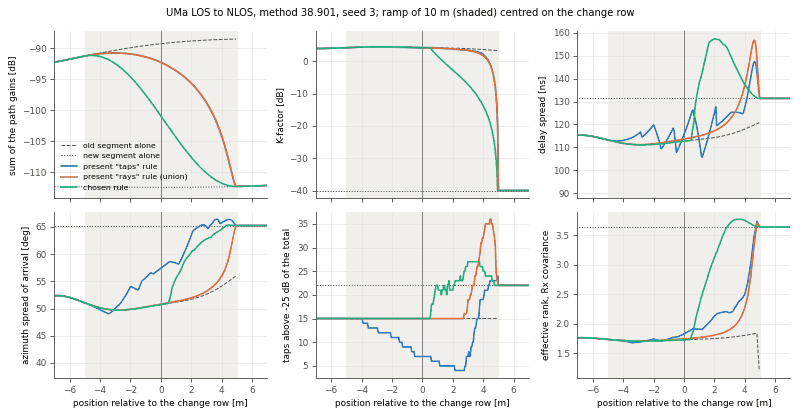
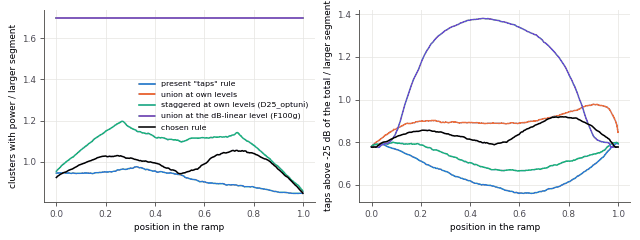
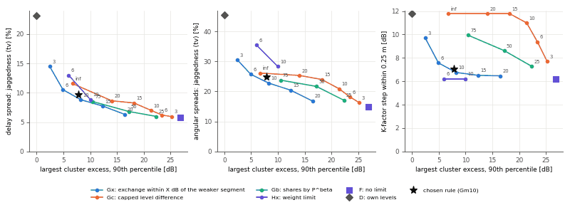
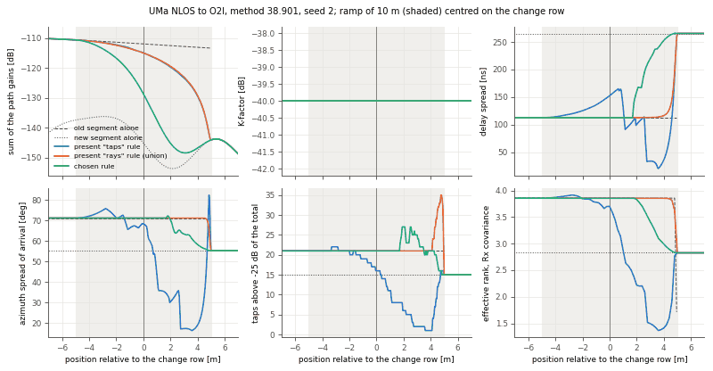
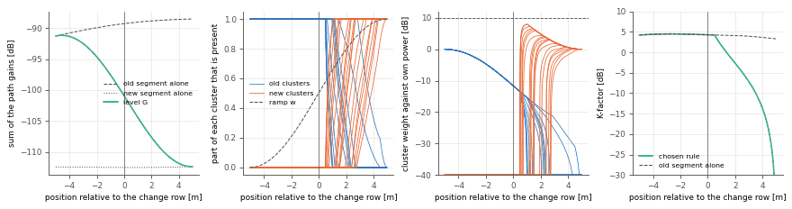

# Cross-fades between channel segments: literature, analysis of QuaDRiGa-NG, prototypes and the chosen rule

This study answers how the transition between two segments of a track (a change of scenario, LOS state or indoor state) should be built so that it is physically meaningful in all relevant metrics, for the output forms "taps" and "rays" of the library. It contains a literature scan, an analysis of the channel merger of QuaDRiGa-NG and of the present rule in `src/crossfade_segments.cpp`, measurements of 61 candidate schedules on 192 transitions generated with the library, the decisions taken, and the algorithm to implement. Appendix A holds the literature notes with the reading status of each source, appendix B the pooled scores of all schedules. The Python scripts in this folder reproduce all results (section 15). The results were produced with the library at commit fd8cbcab.

## 1. Summary

The library draws an independent set of clusters for each segment of a track and joins two segments over a ramp. In the tested transitions the mean power of the two cluster sets differs by 17 dB in the median. Every existing rule mixes the two sets at their own power, so the channel keeps the delay spread, the angular spreads and the K-factor of the stronger segment until the last metre or two of the ramp and then switches. The remedy is to interpolate the mean power in dB over the ramp and to exchange the clusters at that power, one after another, with a limit of 10 dB on how far a cluster may be raised above its own power. With the ramp centred on the row at which the state changes, the transition then lies at that row and all large-scale quantities move through it gradually.

**Terms used below.** *Level*: the local-mean power of a segment, the sum of its path gains. *Own-level rule*: each cluster keeps the power it has in its segment, times a fade weight between 0 and 1. *Union*: all old clusters with the weight 1 - w and all new ones with w (w: the ramp from 0 to 1); this is the present "rays" rule and the form of the soft LOS state of TR 38.901. *Staggered exchange*: each cluster fades at its own place in the ramp. *Thinning*: the number of taps that carry the channel falls below that of both segments. *Excess*: the largest factor by which a cluster is raised above its own power, in dB. *Excursion* ("out"): how far a spread leaves the range between the values of the two segments. *Jaggedness* ("tv"): the variation of a spread beyond a monotone change.

**Method.** 192 transitions: UMa LOS to NLOS, UMa NLOS to O2I, UMi NLOS to LOS and InF LOS to NLOS-DH, each with the method "38.901" (phase mobility) and "quadriga" (drift), 24 seeds each, at 3.5 GHz with 4x4 antennas, a ramp of 10 m and one snapshot per 2.5 cm. All schedules are applied to the same segment channels. The ports of the present library rule and of the merger of QuaDRiGa-NG were checked against the originals (section 3.2).

**Findings.**

1. **The level difference of the two segments decides, not the number of paths.** The levels differ by 17 dB in the median, 31 dB at the 90th percentile and up to 51 dB. With own-level weights the stronger segment dominates until the power cross-over in the last 10 to 20 % of the ramp. For the 144 transitions with a LOS change the K-factor then changes by 15.9 dB within 0.25 m in the median (values clipped at -30 dB).
2. **Replacing clusters one after another at their own level thins the channel out.** Near the end of the ramp one or two old clusters at full weight carry the channel. Taps above -25 dB of the total power fall to 0.75 of the smaller segment's count in the median and to 0.22 in the worst tenth for the present "taps" rule.
3. **The union is the smoothest own-level rule**, at 1.7 times the cluster count and with the late switch of finding 1.
4. **Narrowband fading does not depend on the schedule**; it follows the K-factor only.
5. **The delay-spread order of QuaDRiGa-NG helps the delay spread only** (excursion 8.5 % against 16.3 % for a random order; angular spreads 19 % either way), and its linear target cannot be reached when the levels differ.
6. **Interpolating the level in dB and exchanging the clusters at that level removes findings 1 and 2.** Without a limit, clusters of the weaker segment are raised above their own power by 13.9 dB in the median and by up to 46.6 dB.
7. **A limit of 10 dB on this excess keeps the benefits.** The exchange of clusters is confined to the part of the ramp where the level is within 10 dB of the weaker segment. Against the present "taps" rule the jaggedness of the delay spread falls from 75 % to about 10 %, that of the angular spreads from 88 % to about 24 %, the K-factor step at a LOS change from 15.9 to 7.8 dB, and no transition thins out.
8. **Centring the ramp on the row of the state change leaves the scores as they are** and puts the half-way point of the spreads within about a metre of that row instead of 4.4 m before it.

**Chosen rule** (section 12), one schedule per link for both output forms, computed per cluster from the "rays" channels:

- the level is interpolated in dB, so that it does not stay at the stronger segment until the end of the ramp;
- both cluster sets are scaled to that level, so that the weaker one is visible when it enters and the stronger one need not be thinned out to lower the power;
- the clusters are exchanged one after another, each over about a quarter of the exchange, so that the number of active clusters stays near that of the segments;
- the exchange takes place where the level is within 10 dB of the weaker segment, so that the weaker state cannot take over at the power of the stronger one;
- the fade order follows from a search that keeps the delay spread and the four angular spreads close to those of the superposition of both sets;
- the LOS path stays one path, its share interpolated like that of the clusters;
- the ramp is centred on the row of the state change.



*One UMa LOS to NLOS transition with the present "taps" rule, the present "rays" rule and the chosen rule, all with the ramp centred on the change row. With the present rules the level, the K-factor and the spreads keep the values of the old segment and switch at the end of the ramp; the "taps" rule also loses taps in between. The delay spread of the chosen rule passes through a maximum above both segments, because the two cluster sets differ in their mean delay (section 7.1).*

## 2. Decisions

| Topic | Decision |
|---|---|
| Level law | dB-linear: G = P_old^(1-w) P_new^w with the sine ramp w |
| Level and structure | separated: both cluster sets are scaled to the interpolated level (F family of section 6), and the excess of a cluster over its own power is bounded by X = 10 dB (rule Gx of section 8, with one exchange range per transition) |
| Modes | one rule only; the union at own levels is not kept as an option |
| Interface | `crossfade_segments` takes "rays" channels and has an output argument, "rays" or "taps"; taps are the sums of the weighted rays per tap. A new `par_data` entry `cluster`, written by `gbsm_single_link_channel` next to `tap` and `path_type`, gives the cluster index of each ray |
| Stagger | rho = 0.25, internal, not an argument: transitions of about 2 m per cluster on a 10 m ramp, 1.34 times the clusters of the larger segment (section 7.2) |
| Units | clusters: the sub-cluster taps and the rays of a cluster fade together |
| Ramp position | centred on the change row (the first row of the new segment), as `correct_overlap` of QuaDRiGa-NG achieves it (section 9) |
| Ramp length | the share `overlap` of the shorter of the two neighbouring segments, n_r = floor(overlap min(n(k-1), n(k)) + 0.5), so that two ramps never meet inside one segment |
| Arguments | `crossfade_segments` keeps the argument `n_overlap`: entry k is the number of ramp snapshots that segments k-1 and k share, of which the first half (rounded down) lies before the first snapshot of segment k. This is a preference; the implementation may deviate if it turns out to be ambiguous |
| Path count | the largest number of taps with power is about 1.3 times that of the larger segment; a constant path count per channel object is the concern of the user of the output |
| Fixed numbers | X = 10 dB (knee of excess against smoothness, section 8.3) and rho = 0.25 are the only two constants of the rule |
| Independent cluster sets per state | kept, as in TR 38.901; sharing clusters between the states of one scenario is not pursued |

## 3. Test set-up and metrics

### 3.1 Cases

| Case | Old segment | New segment | BS height, start distance | Remark |
|---|---|---|---|---|
| UMa_LOS_NLOS | UMa_LOS | UMa_NLOS | 25 m, 144 m | level of the new segment against the old one in the ramp: median -21 dB (38.901), -24 dB (quadriga) |
| UMa_NLOS_O2I | UMa_NLOS | UMa_NLOS_O2I | 25 m, 144 m | median -22 dB and -19 dB, down to -51 dB |
| UMi_NLOS_LOS | UMi_NLOS | UMi_LOS | 10 m, 58 m | median +16 dB and +19 dB |
| InF_LOS_NLOS | InF_LOS | InF_NLOS_DH | 8 m, 29 m | d_clutter 10 m, r 0.5, h_c 6 m; median -3 dB and 0 dB, range -19 to +12 dB |

Each case with method "38.901" and mobility "phase", and with method "quadriga" and mobility "drift" (scatterers solved), 24 master seeds: 8 x 24 = 192 transitions. Track: straight, 20 m in the old segment, 10 m in the new one, one snapshot per 0.025 m (0.29 wavelengths at 3.5 GHz); overlap 0.5, so the ramp is 10 m long (400 snapshots). In sections 6 and 7 it ends at the change row, the first row of the new segment, as in the present library; section 8 centres it on the change row. Antennas: 4-element horizontal ULA of isotropic elements, half-wavelength spacing, at both ends.

### 3.2 How the segment channels were obtained

`get_gbsm_channels` returns the joined channel only. The two segment channels over the shared snapshots come from two single-segment layouts with the same master seed (`cf_segments.py`): layout A has the old scenario on all rows; layout B has the new scenario on all rows and one extra first row at the start of the new segment (time before the first snapshot), so that its rays are drawn there, as in the two-segment layout. Check against the two-segment layout: the pure parts agree to 5e-8 relative (the O2I case to 5 %, because the O2I random values are taken at the first row of the track). The port of the present library rule agrees with the library output (rays: 1e-7 relative; taps: exact up to snapshot 662 of 800, then 0.4 % in power from the order of two weak taps); the port of `merge_coeff.m` of QuaDRiGa-NG agrees with the original run in Octave (1e-7). All schedules work on the "rays" channels and the tap index of each ray; taps are the sums of the rays of a tap, so both output forms are evaluated from one set of weights.

### 3.3 Metrics

All "local-mean" quantities use the path gains of the output (no fast fading). Notation: X is the curve of a method over the ramp, X_old and X_new the curves of the two segments alone at the same snapshots.

| Metric | Definition |
|---|---|
| Level | sum of the path gains, in dB; "power dev": largest deviation from (1 - w) P_old + w P_new in the ramp; "level step": largest change within 0.25 m |
| K-factor | LOS path gain over the sum of the others; "KF step": largest change within 0.25 m over the ramp and the step to the new segment behind it, with the K-factor clipped at -30 dB. The value depends on this clip, and it is 0 for transitions without a LOS path with power (the O2I case); section 8.2 gives it for the transitions with a LOS change alone |
| DS | RMS delay spread from path gains and delays |
| ASD, ESD, ASA, ESA | circular spread of TR 38.901 Annex A.1, sqrt(-2 ln(abs(sum P exp(j phi)) / sum P)), from path gains and path angles. Every column "AS" of the tables is the mean of the four spreads' scores per transition, of which the median or percentile is then taken |
| out | largest excursion of X outside [min(X_old, X_new), max(X_old, X_new)], relative to the mean of X_old and X_new over the ramp; 0 for a curve that stays between the two segments |
| tv | total variation of the curve [X_old at the first ramp snapshot, X over the ramp, X_new at the last ramp snapshot] minus the absolute difference of its two ends, same normalisation; 0 for a monotone curve, a measure of jaggedness. The steps into and out of the ramp are included, so a late switch counts |
| devu | RMS deviation from the curve of the full superposition of the same family (C_union, or F100g for the F family) |
| Excess | largest power weight of a cluster relative to its own power in its segment, in dB, over all clusters and ramp snapshots of a transition; 0 dB for rules that never raise a cluster above its own power |
| Active paths | paths, taps and clusters with weight above 0; "significant taps": taps above -25 dB of the total; participation number N_eff = (sum p)^2 / sum p^2 of the tap powers; "min ratio": smallest value in the ramp over the smaller of the two segments' values |
| Fast fading | narrowband coefficient per antenna pair, normalised by its incoherent local mean, over the ramp: amount of fading AF = var/mean^2 of the power (1 for Rayleigh), P(power below -10 and -20 dB of the mean), level crossing rate at -10 dB per wavelength, coherence distance (autocorrelation 0.5) |
| Frequency correlation | coherence bandwidth (0.5) from the power delay profile; wideband power = sum of the tap powers: AF and standard deviation in dB (diversity of the taps) |
| Spatial correlation | effective rank exp(entropy of the normalised eigenvalues) of the local-mean Rx and Tx covariance; median singular-value spread of the 4x4 narrowband matrix; capacity at 10 dB SNR |
| Size | paths in the ramp relative to the union; largest number of taps with power (= slots needed for a constant path count) |

The scores are medians over the 192 transitions, "p90" and "p10" the 90th and 10th percentile. Means over the transitions are: the fading tables, "clusters max / max(N_old, N_new)", "taps max", "paths in ramp / union" and "N_eff mean".

## 4. Literature

The full notes with citations and reading status (in full, partly, via extract, abstract only) are in appendix A; the status below is "partly" (named sections) unless marked. Numbers were taken only where they could be found in the source.

| Model | What fades | Gain function | Region size | Cluster count | Kept smooth |
|---|---|---|---|---|---|
| COST 259 macrocell (Asplund, Glazunov, Molisch, Pedersen, Steinbauer, "The COST 259 Directional Channel Model - Part II: Macrocells", IEEE Trans. Wireless Commun. 2006) | presence of far clusters and of the LOS path, each with its own visibility area | amplitude A = 1/2 - (1/pi) arctan(2 sqrt(2) (L_C + d - R_C) / sqrt(lambda L_C)), a knife-edge approximation | R_C 100 m urban, 300 m rural, L_C 20 m; LOS 30 / 100 m, L_L 20 m | variable; measured 1 to 3 large clusters, average 1.06 to 2.18 | cluster power, LOS power |
| COST 2100 (Liu, Oestges, Poutanen, Haneda, Vainikainen, Quitin, Tufvesson, De Doncker, "The COST 2100 MIMO channel model", IEEE Wireless Commun. 2012; Verdone and Zanella (eds.), Springer 2012, ch. 3) | far clusters and LOS; the local cluster is always on | same arctan function | Zhu, Eriksson, Tufvesson (IEEE TWC 2013, 300 MHz outdoor): R_C 24.5 to 32.8 m, transition 11.3 to 14.4 m, about 6 far clusters; Flordelis, Li, Edfors, Tufvesson (arXiv:1905.04931, 2.6 GHz): 10 m / 2 m outdoor, 5 m / 0.5 m indoor; Poutanen et al. (EuCAP 2011, indoor): R_C about 2 to 4 m, 2 to 6 clusters | variable (Poisson) | cluster power, LOS power |
| WINNER II D1.1.2 (Kyösti et al. 2007, clause 3.4.1; proposed, not implemented) | clusters pairwise, one after another | linear power ramp per pair | distance between segments in max(N1, N2) sub-intervals | about constant; pairs coupled by power, weakest unpaired | power only |
| QuaDRiGa (Jaeckel, Raschkowski, Börner, Thiele, IEEE TAP 2014, section II-G; documentation v2.8.1 section 3.8) | NLOS paths pairwise; one LOS path, "only power and phase are adjusted" | power sin^2(pi/2 w_lin) per pair | overlap 0.5 of segments of about 20 m (LOS) to 45 m (NLOS); min(N1, N2) sub-intervals | about constant | power; DS through the pairing order against a linear target; AS not targeted |
| TR 38.901 procedure A (clause 7.6.3.2) | nothing; fixed cluster set, delays, angles and powers updated | none | steps of at most 1 m | constant | all, no new clusters ever |
| TR 38.901 procedure B | cluster powers recomputed per position from smooth delays, angles, DS and AS (eq. 7.6-17) | implicit | correlation distances 10 to 60 m | constant N, clusters weaken and strengthen | power, DS and all AS by construction |
| TR 38.901 soft LOS state (clause 7.6.3.3, eq. 7.6-18, 7.6-19; read in full in the local copy; same in ITU-R M.2412) | two complete realisations, LOS and NLOS, each with its own path loss, superposed | amplitudes LOS_soft and sqrt(1 - LOS_soft^2), LOS_soft = 1/2 + (1/pi) arctan(sqrt(20/lambda) (G + F(d))) | set by the 50 m field G and sqrt(20/lambda): short | union, N_LOS + N_NLOS | total power; "soft indoor/outdoor states are not modelled" |
| ITU-R P.526-14, "Propagation by diffraction" (2018), clause 4.1, eq. 26 to 31 (read) | the field behind one knife edge | loss J(nu) = 6.9 + 20 lg(sqrt((nu - 0.1)^2 + 1) + nu - 0.1) dB for nu > -0.78, nu = h sqrt(2 (1/d1 + 1/d2) / lambda), h the depth below the line of sight | 6 dB at the shadow boundary; the loss grows with the logarithm of the depth | not a cluster model | the level of one path across a shadow boundary |
| ITU-R P.1411-8, "Propagation data and prediction methods for the planning of short-range outdoor radiocommunication systems ..." (2015), clause 4.1.2.2, eq. 18 to 20 and Fig. 4 (read); clause on 1-turn NLOS, eq. 63 (read) | path loss along a street behind a corner, 2 to 16 GHz, antennas below roof-top | corner loss L_c = L_corner lg(x - w/2) / lg(1 + d_corner), x the distance into the side street, w the width of the LOS street | L_corner 20 dB (urban) or 30 dB (residential) building up over d_corner = 30 m; for 430 MHz to 4.86 GHz the loss in the corner interval is interpolated | not a cluster model | level only; measurement-based |
| mmMAGIC D2.2 (2017, clause 3.6.1) | death and birth at the same instant to keep N, weakest first; or the N strongest of the 4N clusters of the nearest grid points | Poisson timing, no ramp given | grid = consistency distance | constant by design | power |
| Wu, Wang, Aggoune, Alwakeel, You (IEEE Trans. Commun. 2018, via extract); Wang et al. 6GPCM (arXiv:2206.02442, via extract) | clusters, Markov birth-death | Wu: linear power scaling within 1 ms; 6GPCM none | P_surv = exp(-lambda_R displacement / D_c), lambda_G 80/m, lambda_R 4/m, D_c 10 to 100 m | variable, mean 20 | total power by renormalisation |
| Czink, Zemen, Nuutinen, Ylitalo, Bonek (EURASIP JWCN 2009) | clusters with drawn lifetimes | linear in dB over 10 dB, then switched | measured lifetime interval | variable | power partly |
| NYUSIM 2.0 (Ju, Kanhere, Xing, Rappaport, arXiv:1908.09762, via extract) | time clusters, WINNER style | ramp, shape not verified | segments 10 to 15 m, snapshots every 1 m, at most one cluster per snapshot | about constant | power |

Measurements of lifetimes: clusters change one or two at a time and lifetimes are roughly exponential, with long-lived LOS and dominant reflectors (Czink et al., EuCAP 2007); MPC lifetimes 0.5 to 3 m, shorter for weak MPCs (Mahler et al., VTC-Fall 2015); early paths are more stable (COST 2100 book).

What the literature gives for this study:

- Two families exist: one-by-one replacement at about constant count (WINNER II, QuaDRiGa, NYUSIM, mmMAGIC) and the full superposition (TR 38.901 soft LOS, the most widely used standard). No publication was found that analyses DS, AS or MIMO statistics during either; the only stated criticisms are qualitative.
- Visibility-region models fade each cluster over a transition that is short against its lifetime (2 to 20 m outdoors against radii of 10 to 100 m). A ramp of 5 to 30 m is of the size of one transition region, so staggered per-cluster transitions inside it match these models better than one common weight, and better than switching a cluster within centimetres.
- Every model keeps one LOS path with its own gain. No model superposes two LOS paths.
- Only QuaDRiGa controls a spread during the transition (DS), only TR 38.901 procedure B has all spreads smooth (by making them the inputs of the cluster powers). No model controls angular spreads through the exchange order.
- No model treats a level difference of the two cluster sets explicitly. COST gains act on clusters of one environment; the soft LOS state superposes at own levels; QuaDRiGa interpolates the stored path gain separately but merges coefficients at own levels.
- The two ITU-R models describe how the level changes at a LOS to NLOS boundary: in dB, gradually, starting at the boundary (6 dB at a knife edge), over metres to tens of metres (section 11.1).
- Not obtained: measurements of the channel along a walk into a building, as a reference for the O2I transition; Sionna (believed to have no mobility procedures, not verified), ns-3 behaviour at a state change, the rates of Zwick et al. (IEEE JSAC 2000) and Chong et al. (IEEE TWC 2005).

## 5. The QuaDRiGa-NG approach and the present library rule

Files of QuaDRiGa-NG: `@qd_channel/merge.m`, `private/merge_coeff.m`, `merging_cost_fcn.m`, `merging_avg_ds.m`, `find_overlapping_snapshots.m`, `@qd_track/correct_overlap.m`.

- **Geometry.** Each segment is computed with the snapshots of the preceding one before its `initial_position`. The merge interval is the last `overlap` part of them (`t2o_start = floor(t2o_end - (t2o_end - 1) overlap + 0.1)`); `correct_overlap` shifts the segment starts so that the scenario change lies in the middle of the interval.
- **Units.** NG paths are clusters (one tap per cluster, sub-paths summed); the same code serves both of NG's forms.
- **Pairing and order.** n_sub = min(L1 NLOS, L2 NLOS, S) sub-intervals of floor(S / n_sub) snapshots. In sub-interval l the old path o1(l) ramps down and the new path o2(l) ramps up. The orders o1, o2 come from two passes in which each path is moved to the position with the smallest cost (`merging_cost_fcn`): the DS per sub-interval (weights 1, 0.5, 0 for paths before, in and after their sub-interval; LOS, GR and unpaired paths with the full ramp) against a linear target between the mean DS of the two segments, as 10 lg of the relative squared error, plus the largest power deviation in dB. The function header still says "coupled based on their power", the code optimises the DS.
- **Ramp.** Power 0.5 (1 + sin((x - 0.5) pi)) with x = i / (n + 1), amplitudes sqrt(1 - ramp) and sqrt(ramp), per sub-interval for pairs and over the whole interval for paths without partner.
- **Delays, angles.** Each path keeps its own delay; nothing is interpolated. FBS and LBS positions follow their path. A new path takes the slot of a path that has ramped down (`ip = -1` first), so the output has about max(L1, L2) + 1 paths.
- **LOS.** `cf1 (1 - ramp) + cf2 ramp`: a coherent, amplitude-linear mix. GR likewise when both segments have one.
- **Cluster lifetime.** A cluster lives from its sub-interval in one merge interval to its sub-interval in the next: the segment length plus or minus half an overlap, 10 to 30 m for 20 m segments. Its own transition is S / n_sub snapshots: 0.43 m in the test set-up (10 m ramp, 17 to 25 taps), independent of its power.

Measured against the union and the other rules (192 transitions, B_ng in the tables): the DS stays within the range of the two segments about as well as with the library rule (5.0 % against 8.0 %); the AS leave it by 39 % in the median and 118 % at p90; the level deviates from the ramp by 3.3 dB in the median and up to 16 dB. Causes found:

1. The amplitude-linear LOS mix gives the LOS power (1 - ramp)^2 where the new segment has no LOS, e.g. -20 dB instead of -10 dB at ramp = 0.9; with two LOS coefficients of different phase it fades further (the known fault). The K-factor therefore falls early, which also raises the spreads above those of both segments.
2. A pair exchanges two paths of different power over the same sub-interval, so the level moves in steps; only the penalty term of the cost limits this.
3. The linear DS target ignores the level difference (section 7.1).
4. Known faults confirmed in the code: `merge.m:358-359` reads `tx_position` for the Tx orientation; `merge_coeff.m` tests `dl1 - dl1` for the LOS delay, so the LOS delays are never interpolated.

**The library's present rule** (`src/crossfade_segments.cpp`, A_lib in the tables). "rays": union of the NLOS rays with sqrt(1 - w), sqrt(w). "taps": NG's order search (same cost), then the taps fade one after another, each over the part of the ramp that matches its power share, so the level follows the ramp (0.10 dB median, 1.3 dB maximum, from powers taken from the fading coefficients). LOS and GR: one path, power (1 - w) P_old + w P_new. Differences to NG: the level is right, the LOS is right, and the transition of a tap is as long as its power share: 0.35 m in the median, below one wavelength (8.6 cm) for 14 % of the taps, 2.5 cm (one snapshot) for the weakest. A weak tap is switched, not faded. The units are sub-cluster taps for the TR methods, so the three taps of one cluster fade at different places.

## 6. Candidate methods

All candidates are weight schedules on the same data: a power weight per old and new unit and ramp snapshot; LOS as one path. `cf_schedules.py` holds them.

| Name | Rule |
|---|---|
| A_lib | library "taps" rule: units are taps, NG order, sequential, timed by power share (port, checked against the library) |
| B_ng | NG literal: units are taps, NG order, equal sub-intervals with sine ramps, coherent LOS mix (port, checked against `merge_coeff.m` in Octave) |
| C_union | all old units with 1 - w, all new with w: the library "rays" rule and the form of TR 38.901 eq. 7.6-19 |
| D<rho>_<order> | visibility-region family at own levels, units are clusters (sub-cluster taps and rays of a cluster share one weight). Unit m of the fade order has the window [(1 - rho) F(m-1), (1 - rho) F(m) + rho] of a parameter v in [0, 1], F = cumulative power share in fade order; its faded part rises linearly over the window; v(x) is the monotone function for which the summed power is exactly (1 - w(x)) P_old (old units) or w(x) P_new (new units). rho = 0 is the weight rule of A_lib, rho = 1 is C_union. Orders: rand (seeded permutation), ng (NG cost), delay (both by delay), power (weakest first), pw2 (old: weakest dies first, new: strongest born first), optds / optall (NG search on the actual weights, linear target for DS / DS and 4 AS), optuni (same search, target = DS and 4 AS of the union), optuni_tap (units are taps), optuni_coef (powers from the fading coefficients) |
| E25_free, E25_norm | independent birth and death points, uniform in the ramp, per-unit sine ramp of a quarter of the ramp; "norm" scales each segment to the ramp |
| G and H families | blends of F and D at the dB-linear level, rho = 0.25, order search with the target of the same shares; defined in section 8.1 |
| F<rho>g_<order> | level and structure separated: level G = P_old^(1-w) P_new^w (dB-linear) from the local-mean powers of the segments per snapshot; old units (G / P_old) times the D weights, new units (G / P_new) times the D weights; LOS power G ((1 - w) g_old / P_old + w g_new / P_new); order search on the segments scaled to unit power, target = DS and 4 AS of F100g. F<rho>l uses G = (1 - w) P_old + w P_new |

Per-unit transition length (10 to 90 % of the power) on a 10 m ramp, 12 transitions:

| Method | median [m] | 10th percentile [m] | shortest [m] | share of units below one wavelength (0.086 m) | median of the 3 strongest units per segment [m] |
|---|---|---|---|---|---|
| A_lib | 0.35 | 0.08 | 0.025 | 14 % | 0.53 |
| B_ng | 0.43 | 0.40 | 0.400 | 0 % | 0.43 |
| C_union | 5.93 | 5.93 | 5.925 | 0 % | 5.93 |
| D0_optuni | 0.38 | 0.08 | 0.025 | 13 % | 0.78 |
| D10_optuni | 1.25 | 0.93 | 0.625 | 0 % | 1.55 |
| D25_optuni | 2.33 | 1.98 | 1.650 | 0 % | 2.55 |
| D50_optuni | 4.25 | 3.96 | 3.525 | 0 % | 4.53 |

For comparison: measured transition regions 2 to 14 m outdoors and 0.5 m indoors, MPC lifetimes 0.5 to 3 m (section 4).

## 7. Results: own-level rules and the level/structure separation

### 7.1 Why the linear target and the own-level weights fail together

With power weights (1 - w) and w at own levels, the old segment holds the share alpha = (1 - w) P_old / ((1 - w) P_old + w P_new) of the power. For the union, DS^2 = alpha DS_old^2 + (1 - alpha) DS_new^2 + alpha (1 - alpha) (m_old - m_new)^2 with the mean delays m, and the same for the AS with the mean directions. With P_new 18 dB below P_old, alpha is above 0.9 until w = 0.87, i.e. over 77 % of the ramp length. Every own-level rule is therefore the old channel until shortly before the end. NG's target asks for a DS half-way at mid-ramp; the search can only approach it by removing the old clusters that do not fit, which distorts the other spreads. Example: for the UMa LOS to NLOS transition of seed 3 the search with the linear target (D25_optall) takes the ASA down to 20° where the segments have 50° and 65°. Targeting the union's own spreads (optuni) removes the conflict: at rho = 0.25 the deviation from the union falls from 13.0 % (linear target) and 7.7 % (random order) to 2.1 % in the DS, and from 10.4 % and 8.7 % to 3.1 % in the AS.

RMS deviation from the full superposition of the same family, medians:

| Method | DS [%] | AS (mean of 4) [%] | effective rank of the Rx and Tx covariance [%] |
|---|---|---|---|
| A_lib | 17.1 | 12.1 | 4.7 |
| B_ng | 29.4 | 26.6 | 15.7 |
| D0_rand | 10.6 | 11.2 | 4.4 |
| D0_ng | 17.0 | 11.5 | 4.7 |
| D0_optuni | 4.6 | 5.5 | 3.8 |
| D10_optuni | 3.4 | 4.3 | 3.3 |
| D25_rand | 7.7 | 8.7 | 3.2 |
| D25_optall | 13.0 | 10.4 | 3.6 |
| D25_optuni | 2.1 | 3.1 | 2.7 |
| D25_optuni_tap | 1.9 | 2.7 | 2.3 |
| D25_optuni_coef | 2.5 | 4.9 | 2.7 |
| D50_optuni | 1.3 | 2.0 | 1.6 |
| F0g_optuni | 5.0 | 4.4 | 3.9 |
| F10g_optuni | 3.0 | 2.9 | 3.3 |
| F25g_rand | 9.3 | 6.9 | 3.5 |
| F25g_optuni | 1.7 | 1.8 | 2.7 |
| F50g_optuni | 1.1 | 1.0 | 1.5 |

The order search is worth a factor of 3 to 5 over a random order at the same weights. Units of clusters instead of taps cost nothing (D25_optuni against D25_optuni_tap). Powers taken from the fading coefficients instead of the path gains are slightly worse and miss the level by up to 0.8 dB (D25_optuni_coef), so the schedule belongs where the ray data are.

### 7.2 All methods, all cases

| Method | clusters max / max(N_old, N_new) | taps max | paths in ramp / union | power dev median, max [dB] | DS out [%] | DS out p90 [%] | DS tv [%] | AS out [%] | AS out p90 [%] | AS tv [%] | significant taps, min ratio (median / p10) | level step [dB] | KF step [dB] |
|---|---|---|---|---|---|---|---|---|---|---|---|---|---|
| A_lib | 1.17 | 26.9 | 0.54 | 0.10, 1.3 | 8.0 | 58.8 | 74.9 | 19.8 | 51.6 | 88.4 | 0.75 / 0.22 | 1.1 | 11.8 |
| B_ng | 1.08 | 24.7 | 0.61 | 3.34, 16.0 | 5.0 | 49.2 | 60.1 | 39.2 | 117.5 | 132.7 | 0.80 / 0.50 | 1.2 | 5.0 |
| C_union | 1.70 | 40.4 | 1.00 | 0.00, 0.0 | 0.2 | 26.1 | 6.2 | 1.7 | 33.2 | 25.3 | 1.00 / 0.86 | 1.1 | 11.8 |
| D0_rand | 1.14 | 27.4 | 0.54 | 0.00, 0.0 | 16.3 | 90.7 | 86.5 | 19.7 | 54.6 | 83.5 | 0.70 / 0.22 | 1.1 | 11.8 |
| D0_ng | 1.15 | 27.5 | 0.54 | 0.00, 0.0 | 8.5 | 59.3 | 72.6 | 18.9 | 51.4 | 82.6 | 0.75 / 0.22 | 1.1 | 11.8 |
| D0_optuni | 1.11 | 26.6 | 0.52 | 0.00, 0.0 | 10.8 | 50.8 | 85.4 | 13.8 | 46.1 | 80.6 | 0.75 / 0.22 | 1.1 | 11.8 |
| D10_optuni | 1.19 | 28.7 | 0.57 | 0.00, 0.0 | 7.6 | 38.6 | 36.4 | 9.5 | 41.9 | 55.4 | 0.79 / 0.33 | 1.1 | 11.8 |
| D25_rand | 1.36 | 32.6 | 0.65 | 0.00, 0.0 | 9.7 | 53.3 | 37.5 | 12.8 | 43.8 | 51.9 | 0.80 / 0.33 | 1.1 | 11.8 |
| D25_power | 1.50 | 34.5 | 0.64 | 0.00, 0.0 | 16.5 | 86.2 | 42.2 | 17.3 | 42.9 | 53.5 | 0.82 / 0.22 | 1.1 | 11.8 |
| D25_pw2 | 1.10 | 27.5 | 0.47 | 0.00, 0.0 | 17.5 | 62.2 | 51.2 | 17.6 | 46.1 | 55.1 | 0.67 / 0.22 | 1.1 | 11.8 |
| D25_optall | 1.39 | 32.6 | 0.68 | 0.00, 0.0 | 1.7 | 30.2 | 18.5 | 6.2 | 31.7 | 38.4 | 0.83 / 0.43 | 1.1 | 11.8 |
| D25_optuni | 1.32 | 31.9 | 0.64 | 0.00, 0.0 | 4.4 | 30.5 | 23.2 | 7.9 | 35.5 | 45.5 | 0.81 / 0.38 | 1.1 | 11.8 |
| D50_optuni | 1.69 | 40.3 | 0.77 | 0.00, 0.0 | 3.2 | 30.2 | 17.6 | 6.1 | 34.6 | 40.7 | 0.92 / 0.47 | 1.1 | 11.8 |
| E25_free | 1.31 | 31.3 | 0.62 | 0.76, 30.7 | 12.3 | 65.8 | 38.6 | 16.6 | 49.6 | 61.1 | 0.73 / 0.22 | 1.2 | 11.8 |
| F100g | 1.70 | 40.4 | 1.00 | 6.64, 39.3 | 0.3 | 27.9 | 2.1 | 1.9 | 30.7 | 14.3 | 1.00 / 0.91 | 0.7 | 6.2 |
| F0g_optuni | 1.12 | 27.0 | 0.53 | 6.64, 39.3 | 4.5 | 31.8 | 40.2 | 4.6 | 33.4 | 29.3 | 1.00 / 0.94 | 0.7 | 6.2 |
| F10g_optuni | 1.21 | 29.2 | 0.59 | 6.64, 39.3 | 2.7 | 32.3 | 14.7 | 2.8 | 30.9 | 16.6 | 1.00 / 1.00 | 0.7 | 6.2 |
| F25g_rand | 1.36 | 32.6 | 0.65 | 6.64, 39.3 | 4.3 | 29.1 | 14.1 | 4.1 | 34.1 | 18.1 | 1.00 / 1.00 | 0.7 | 6.2 |
| F25g_optuni | 1.34 | 32.2 | 0.65 | 6.64, 39.3 | 1.3 | 29.6 | 5.8 | 2.8 | 30.6 | 14.8 | 1.00 / 1.00 | 0.7 | 6.2 |
| F50g_optuni | 1.69 | 40.3 | 0.77 | 6.64, 39.3 | 0.8 | 28.3 | 3.8 | 2.1 | 30.8 | 14.3 | 1.00 / 1.00 | 0.7 | 6.2 |

The column "KF step" is pooled over all 192 transitions; the 48 O2I transitions have no LOS path and score 0. Section 8.2 gives it for the transitions with a LOS change alone (own-level rules 15.9 dB, F25g_optuni 6.5 dB).

Reading:

- **A_lib, B_ng** (present rules): lowest count, largest excursions and jaggedness, thinning of the significant taps.
- **D family**: more overlap of the per-cluster transitions buys smoothness. With the union-target order, rho = 0.25 reaches the excursions of rho = 0.5 with a random order. The thinning stays (0.81 median, 0.38 at p10) and so does the late switch (KF step 11.8 dB).
- **power, pw2** (the orders suggested by lifetime measurements: weak clusters change first, strong ones live longest): no gain in the spreads; pw2 thins the ramp further (0.47 of the union's paths, singular-value spread +5 dB, capacity -0.4 bit/s/Hz in the TR cases).
- **E family** (independent birth and death points without power timing): the level misses the ramp by up to 31 dB at the ends, where all old clusters can be gone before the ramp ends; scaling cannot repair this (weights above 1, no clusters left to scale). Power timing is needed.
- **F family**: against the union at own levels the jaggedness is lower (DS tv 5.8 % against 6.2 %, AS tv 14.8 % against 25.3 %) and the level and K-factor steps are about halved, with no thinning and at the cluster count of the D family. The excursions are similar and slightly larger (DS out 1.3 % against 0.2 %, AS out 2.8 % against 1.7 %, DS out p90 29.6 % against 26.1 %). The column "power dev" is the distance between the dB-linear and the power-linear level and is by design.
- **p90 columns**: about 30 % for the DS and the AS for every smooth method including both unions. This remainder is the term alpha (1 - alpha) (m_old - m_new)^2: two independent cluster sets with different mean delay or direction have a larger spread together than either alone. It belongs to every rule that follows the superposition of the two sets. An order search whose target leaves this term out (D25_optmix in appendix B) lowers the DS excursion at p90 from 30.5 % to 23.7 % (AS: 35.5 % to 34.8 %) at own levels; this target was not combined with the level separation.



*Mean over the 192 transitions, ramp ending at the change row; counts relative to the larger of the two segments. Left: the staggered rules stay near the cluster count of the larger segment, the unions hold 1.7 times as many. Right: at own levels the taps that matter thin out in the ramp (present "taps" rule, D25_optuni); with both sets at one level the union shows up to 1.4 times the taps of the larger segment (F100g); the chosen rule stays between 0.8 and 0.9, like the union at own levels.*

### 7.3 Per case

**UMa NLOS to O2I, method 38.901**. Old segment alone / new segment alone, mean over the ramp: clusters 19.4 / 11.7, taps 24.4 / 16.7, paths 389 / 235, participation number of the taps 15.4 / 10.2.

| Method | clusters max / max(N_old, N_new) | power dev median, max [dB] | DS out [%] | DS out p90 [%] | DS tv [%] | AS out [%] | AS out p90 [%] | AS tv [%] | N_eff min ratio (median / p10) | significant taps min ratio (median / p10) | level step [dB] | KF step [dB] |
|---|---|---|---|---|---|---|---|---|---|---|---|---|
| A_lib | 1.16 | 0.30, 1.0 | 32.0 | 92.9 | 144.6 | 25.3 | 56.6 | 140.4 | 0.12 / 0.09 | 0.31 / 0.06 | 2.8 | 0.0 |
| B_ng | 1.10 | 2.94, 6.2 | 1.9 | 19.0 | 69.4 | 24.1 | 80.5 | 142.9 | 0.21 / 0.14 | 0.80 / 0.52 | 4.4 | 0.0 |
| C_union | 1.60 | 0.00, 0.0 | 0.0 | 0.3 | 0.0 | 0.0 | 3.2 | 0.6 | 1.03 / 1.00 | 1.00 / 1.00 | 2.9 | 0.0 |
| D25_optuni | 1.26 | 0.00, 0.0 | 5.8 | 21.1 | 26.8 | 13.3 | 29.2 | 56.4 | 0.23 / 0.12 | 0.60 / 0.19 | 2.9 | 0.0 |
| F100g | 1.60 | 12.06, 33.5 | 0.0 | 0.3 | 0.0 | 0.0 | 3.3 | 0.0 | 1.00 / 1.00 | 1.00 / 1.00 | 1.4 | 0.0 |
| F25g_optuni | 1.30 | 12.06, 33.5 | 0.3 | 1.4 | 0.9 | 0.5 | 4.5 | 2.2 | 1.00 / 1.00 | 1.00 / 1.00 | 1.4 | 0.0 |

**UMa LOS to NLOS, method 38.901**. Old / new: clusters 11.5 / 19.2, taps 16.5 / 24.2, paths 231 / 384, participation number 1.3 / 14.6.

| Method | clusters max / max(N_old, N_new) | power dev median, max [dB] | DS out [%] | DS out p90 [%] | DS tv [%] | AS out [%] | AS out p90 [%] | AS tv [%] | N_eff min ratio (median / p10) | significant taps min ratio (median / p10) | level step [dB] | KF step [dB] |
|---|---|---|---|---|---|---|---|---|---|---|---|---|
| A_lib | 1.16 | 0.04, 0.3 | 8.8 | 39.3 | 37.7 | 12.0 | 27.1 | 53.6 | 1.00 / 0.98 | 0.50 / 0.28 | 1.8 | 22.0 |
| B_ng | 1.12 | 5.65, 13.7 | 8.5 | 63.6 | 65.1 | 56.7 | 149.5 | 173.2 | 0.98 / 0.95 | 0.59 / 0.46 | 1.5 | 7.9 |
| C_union | 1.60 | 0.00, 0.0 | 3.0 | 15.5 | 20.7 | 0.4 | 10.8 | 34.4 | 1.00 / 1.00 | 0.92 / 0.82 | 1.8 | 22.0 |
| D25_optuni | 1.24 | 0.00, 0.0 | 4.8 | 15.7 | 25.2 | 5.2 | 11.3 | 35.9 | 1.00 / 1.00 | 0.59 / 0.34 | 1.8 | 22.0 |
| F100g | 1.60 | 9.89, 23.8 | 0.4 | 14.6 | 2.5 | 0.6 | 12.0 | 9.3 | 1.00 / 1.00 | 1.00 / 0.89 | 0.8 | 6.6 |
| F25g_optuni | 1.24 | 9.89, 23.8 | 2.0 | 16.3 | 7.3 | 0.8 | 12.2 | 9.2 | 1.00 / 1.00 | 1.00 / 1.00 | 0.8 | 6.6 |

**UMi NLOS to LOS, method quadriga, drift**. Old / new: clusters 19.0 / 12.0, taps 20.0 / 13.0, paths 381 / 241, participation number 9.9 / 1.5.

| Method | clusters max / max(N_old, N_new) | power dev median, max [dB] | DS out [%] | DS out p90 [%] | DS tv [%] | AS out [%] | AS out p90 [%] | AS tv [%] | N_eff min ratio (median / p10) | significant taps min ratio (median / p10) | level step [dB] | KF step [dB] |
|---|---|---|---|---|---|---|---|---|---|---|---|---|
| A_lib | 1.18 | 0.05, 0.3 | 12.5 | 130.8 | 46.8 | 41.4 | 73.9 | 107.6 | 1.00 / 0.94 | 0.75 / 0.35 | 1.4 | 18.0 |
| B_ng | 1.05 | 5.06, 16.0 | 22.2 | 133.0 | 95.1 | 90.0 | 157.1 | 225.4 | 0.96 / 0.71 | 0.65 / 0.44 | 1.1 | 6.8 |
| C_union | 1.63 | 0.00, 0.0 | 1.8 | 58.1 | 17.6 | 19.0 | 63.0 | 64.7 | 1.00 / 1.00 | 1.00 / 0.86 | 1.4 | 18.1 |
| D25_optuni | 1.29 | 0.00, 0.0 | 11.9 | 56.7 | 32.2 | 23.9 | 64.4 | 79.4 | 1.00 / 0.99 | 0.73 / 0.41 | 1.4 | 18.1 |
| F100g | 1.63 | 8.29, 25.7 | 2.3 | 56.5 | 6.8 | 18.0 | 59.7 | 53.2 | 1.00 / 1.00 | 1.00 / 0.86 | 0.7 | 6.5 |
| F25g_optuni | 1.34 | 8.29, 25.7 | 3.1 | 56.6 | 10.7 | 18.4 | 60.3 | 55.1 | 1.00 / 1.00 | 1.00 / 1.00 | 0.7 | 6.5 |

**InF LOS to NLOS-DH, method 38.901**. The level difference is small here (median -3 dB), so the D and F families nearly coincide. Old / new: clusters 23.3 / 23.2, taps 28.3 / 28.2, paths 467 / 465, participation number 2.5 / 16.5.

| Method | clusters max / max(N_old, N_new) | power dev median, max [dB] | DS out [%] | DS out p90 [%] | DS tv [%] | AS out [%] | AS out p90 [%] | AS tv [%] | N_eff min ratio (median / p10) | significant taps min ratio (median / p10) | level step [dB] | KF step [dB] |
|---|---|---|---|---|---|---|---|---|---|---|---|---|
| A_lib | 1.17 | 0.10, 0.4 | 5.4 | 35.1 | 83.5 | 5.4 | 23.5 | 63.5 | 1.00 / 1.00 | 0.93 / 0.77 | 0.5 | 7.0 |
| B_ng | 1.09 | 1.49, 4.1 | 6.8 | 29.9 | 67.4 | 14.6 | 39.8 | 92.8 | 1.00 / 0.95 | 0.98 / 0.80 | 0.6 | 3.5 |
| C_union | 1.95 | 0.00, 0.0 | 10.3 | 43.9 | 24.9 | 3.3 | 11.5 | 40.9 | 1.00 / 1.00 | 0.96 / 0.89 | 0.5 | 7.0 |
| D25_optuni | 1.47 | 0.00, 0.0 | 10.7 | 43.4 | 24.8 | 4.4 | 9.2 | 39.7 | 1.00 / 1.00 | 1.00 / 0.89 | 0.5 | 7.0 |
| F100g | 1.95 | 0.75, 4.6 | 8.3 | 56.2 | 21.3 | 4.4 | 11.8 | 30.0 | 1.00 / 1.00 | 1.00 / 0.87 | 0.4 | 6.6 |
| F25g_optuni | 1.47 | 0.75, 4.6 | 6.7 | 54.8 | 17.2 | 4.3 | 11.4 | 30.3 | 1.00 / 1.00 | 1.00 / 1.00 | 0.4 | 6.6 |

The O2I case shows the thinning most clearly: with the library "taps" rule the participation number falls to 12 % of the smaller segment's value in the median, the Rx covariance loses rank (3.9 to 1.8 in the example), and the ASA drops to 20° between segments of 71° and 55°. The UMi NLOS to LOS case has the largest unavoidable remainder (AS out 18 % for every method): the LOS segment's mean direction differs from that of the NLOS clusters.

The pooled scores of all 41 schedules of this section are in appendix B; the tables per case are written by `cf_analyse.py`. Phase and drift mobility give the same ranking; with drift the DS and AS of the segments change along the ramp, which the scores take into account through the per-snapshot references.

### 7.4 Fast fading, frequency and spatial correlation

Over the ramp, all cases, method 38.901 (phase):

| Channel | AF | P(< -10 dB) | P(< -20 dB) | LCR(-10 dB) per λ | d_coh [λ] | AF wideband | std wideband [dB] | SV spread [dB] | capacity [bit/s/Hz] |
|---|---|---|---|---|---|---|---|---|---|
| pure old | 0.629 | 0.0552 | 0.00553 | 0.165 | 0.500 | 0.031 | 0.63 | 37.4 | 7.95 |
| pure new | 0.797 | 0.0743 | 0.00776 | 0.207 | 0.655 | 0.050 | 0.89 | 42.7 | 7.67 |
| A_lib | 0.601 | 0.0524 | 0.00527 | 0.150 | 0.751 | 0.052 | 0.83 | 37.5 | 7.62 |
| B_ng | 0.696 | 0.0634 | 0.00637 | 0.183 | 0.662 | 0.058 | 0.95 | 35.5 | 7.97 |
| C_union | 0.610 | 0.0528 | 0.00521 | 0.154 | 0.651 | 0.023 | 0.59 | 36.0 | 7.77 |
| D0_optuni | 0.607 | 0.0533 | 0.00541 | 0.153 | 0.638 | 0.056 | 0.84 | 38.1 | 7.65 |
| D25_optuni | 0.610 | 0.0530 | 0.00546 | 0.153 | 0.620 | 0.042 | 0.74 | 37.2 | 7.68 |
| D25_pw2 | 0.596 | 0.0524 | 0.00527 | 0.139 | 0.996 | 0.040 | 0.74 | 42.5 | 7.27 |
| F100g | 0.787 | 0.0728 | 0.00735 | 0.213 | 0.691 | 0.031 | 0.75 | 32.0 | 8.23 |
| F25g_optuni | 0.788 | 0.0732 | 0.00755 | 0.214 | 0.678 | 0.037 | 0.81 | 32.7 | 8.21 |

Method quadriga (drift):

| Channel | AF | P(< -10 dB) | P(< -20 dB) | LCR(-10 dB) per λ | d_coh [λ] | AF wideband | std wideband [dB] | SV spread [dB] | capacity [bit/s/Hz] |
|---|---|---|---|---|---|---|---|---|---|
| pure old | 0.650 | 0.0569 | 0.00573 | 0.153 | 1.019 | 0.053 | 0.80 | 38.5 | 7.70 |
| pure new | 0.804 | 0.0740 | 0.00773 | 0.199 | 0.781 | 0.089 | 1.15 | 44.1 | 7.52 |
| A_lib | 0.598 | 0.0509 | 0.00509 | 0.135 | 0.991 | 0.067 | 0.94 | 39.8 | 7.43 |
| B_ng | 0.671 | 0.0602 | 0.00625 | 0.163 | 0.934 | 0.077 | 1.12 | 38.6 | 7.69 |
| C_union | 0.597 | 0.0505 | 0.00506 | 0.135 | 1.009 | 0.040 | 0.72 | 38.1 | 7.51 |
| D0_optuni | 0.591 | 0.0510 | 0.00515 | 0.136 | 0.900 | 0.059 | 0.89 | 39.7 | 7.48 |
| D25_optuni | 0.594 | 0.0513 | 0.00540 | 0.136 | 0.985 | 0.052 | 0.83 | 39.0 | 7.52 |
| D25_pw2 | 0.590 | 0.0508 | 0.00516 | 0.127 | 1.155 | 0.090 | 1.07 | 44.1 | 7.16 |
| F100g | 0.775 | 0.0718 | 0.00723 | 0.201 | 0.966 | 0.054 | 0.95 | 34.7 | 7.94 |
| F25g_optuni | 0.773 | 0.0721 | 0.00729 | 0.202 | 0.956 | 0.062 | 1.02 | 35.2 | 7.92 |

- Within the own-level rules (A, C, D) the narrowband statistics are equal within noise. More paths do not change the envelope distribution, the level crossing rate or the coherence distance. B_ng differs because its K-factor is lower (LOS mix), the F family because the K-factor falls over the whole ramp instead of at its end; its values lie between those of the two segments.
- The coherence distance of the TR phase channels is shorter in the old segment alone (0.50 wavelengths) than in the ramps (0.62 to 0.75, pw2: 1.0); it follows the angular spread at the terminal and the K-factor, not the method.
- Wideband power: the union at own levels fluctuates least (0.59 dB, below both segments), the sequential rules most (0.83 dB), staggered rules in between. The effect of the path count exists and is a few tenths of a dB.
- pw2 (few strong clusters in mid-ramp) is the only schedule with a clear spatial effect at own levels: singular-value spread 42.5 dB against 37 dB, coherence distance 1.0 against 0.65 wavelengths.
- The coherence bandwidth and the effective rank follow the DS and AS scores (columns "Bc out", "rank out" in appendix B): 3.4 and 3.6 % for A_lib, 0.6 and 0.5 % for the union, 1.1 and 1.1 % for F25g_optuni.

### 7.5 Size and path count

| | A_lib | B_ng | C_union | D25_optuni | F25g_optuni |
|---|---|---|---|---|---|
| Largest number of clusters with power / larger segment | 1.17 | 1.08 | 1.70 | 1.32 | 1.34 |
| Tap slots for a constant count (mean of the largest number of taps with power; segments 21.6 and 19.8) | 26.9 | 24.7 | 40.4 | 31.9 | 32.2 |
| Paths in the ramp / union ("rays" output) | 0.54 | 0.61 | 1.00 | 0.64 | 0.65 |

A_lib and B_ng are evaluated with tap units; applied to "rays" as they are, they give the path counts of the table. With rho = 0.10 the F family needs 29.2 slots and 0.59 of the union's paths at slightly larger jaggedness (DS tv 14.7 % against 5.8 %).

Cost of the order search: about 1200 evaluations of the cost per transition for 20 clusters per segment, each with 16 ramp points and sums over all clusters, in the order of 1e7 floating-point operations. The library's present "taps" path already runs a search of the same structure.

## 8. Blends between the separated and the own-level rule

### 8.1 The excess and the variants

With the level and the structure separated (F), a cluster of the weaker segment that has entered carries its share of the interpolated level G, which early in the ramp is close to the level of the stronger segment. Its power weight relative to its own power is G / P_weak, up to the full level difference. Over the 192 transitions the largest weight is 13.9 dB in the median, 26.9 dB at the 90th percentile and 46.6 dB at most; 30 % of all clusters exceed their own power by more than 3 dB at some point. The own-level rules (D) have no excess and the defects of section 7.

All variants below keep the level G = P_old^(1-w) P_new^w, rho = 0.25, cluster units and the order search with the target of the full superposition at the same shares. They differ in the structure share q of the new segment: the new clusters together hold G q, the old ones G (1 - q), and the exchange of clusters progresses with q (the weights of section 6 with q in place of w). F is q = w.

| Variant | Rule |
|---|---|
| Gc<cap> | shares as if the level difference were at most cap dB: q = w r / ((1 - w) + w r), r = 10^(clip(d, -cap, cap) / 10), d = 10 lg(P_new / P_old). cap = 0 is F; cap = inf has the shares of the own-level rules at the level G |
| Gb<beta> | shares by the powers to the exponent beta: r = (P_new / P_old)^beta; beta = 0 is F, beta = 1 is Gcinf |
| Hx<X> | F, then the weight of every cluster limited to X dB above its own power; the power cut from one segment is given to the clusters of the other by one common factor. The exchange still progresses with w |
| Hold0 | as Hx with X = 0 for the old clusters only: fading-in clusters may exceed their power, fading-out clusters may not |
| Gx<X> | the exchange is confined to the part of the ramp where the level G is within X dB of the weaker segment: f = min(X / abs(d), 1); q = clamp((w - (1 - f)) / f, 0, 1) if the new segment is the weaker one, q = clamp(w / f, 0, 1) otherwise. Before (after) that part the stronger segment is complete and scaled to G. For abs(d) <= X this is F |

### 8.2 Results

Ramp ending at the change row, all 192 transitions. "excess" is the largest weight of a cluster over its own power per transition.

| Method | excess median [dB] | excess p90 [dB] | excess max [dB] | DS out [%] | DS out p90 [%] | DS tv [%] | AS out [%] | AS out p90 [%] | AS tv [%] | KF step [dB] | level step [dB] | level dev from G, max [dB] | significant taps min ratio (median / p10) |
|---|---|---|---|---|---|---|---|---|---|---|---|---|---|
| A_lib | 0.0 | 0.0 | 0.0 | 8.0 | 58.8 | 74.9 | 19.8 | 51.6 | 88.4 | 11.8 | 1.1 | 39.5 | 0.75 / 0.22 |
| D25_optuni | 0.0 | 0.0 | 0.0 | 4.4 | 30.5 | 23.2 | 7.9 | 35.5 | 45.5 | 11.8 | 1.1 | 39.3 | 0.81 / 0.38 |
| F25g_optuni | 13.9 | 26.9 | 46.6 | 1.3 | 29.6 | 5.8 | 2.8 | 30.6 | 14.8 | 6.2 | 0.7 | 0.0 | 1.00 / 1.00 |
| Gc3 | 12.6 | 25.2 | 44.2 | 1.5 | 27.3 | 5.9 | 2.7 | 30.6 | 16.2 | 7.7 | 0.7 | 0.0 | 1.00 / 1.00 |
| Gc6 | 10.8 | 23.4 | 42.6 | 1.4 | 27.1 | 6.2 | 2.7 | 33.0 | 18.2 | 9.4 | 0.7 | 0.0 | 1.00 / 1.00 |
| Gc10 | 8.4 | 21.4 | 41.5 | 1.4 | 26.5 | 7.0 | 2.8 | 32.6 | 20.9 | 11.0 | 0.7 | 0.0 | 1.00 / 1.00 |
| Gc15 | 5.6 | 18.2 | 38.2 | 1.4 | 26.5 | 8.3 | 2.8 | 33.4 | 24.0 | 11.8 | 0.7 | 0.0 | 1.00 / 1.00 |
| Gc20 | 3.8 | 14.0 | 29.3 | 1.2 | 25.7 | 8.6 | 2.4 | 33.9 | 25.3 | 11.8 | 0.7 | 0.0 | 1.00 / 1.00 |
| Gcinf | 3.4 | 6.7 | 15.6 | 1.6 | 26.8 | 11.6 | 2.4 | 34.0 | 26.1 | 11.8 | 0.7 | 0.0 | 1.00 / 1.00 |
| Gb25 | 11.8 | 22.3 | 36.0 | 1.5 | 27.2 | 6.0 | 2.4 | 30.8 | 17.1 | 7.3 | 0.7 | 0.0 | 1.00 / 1.00 |
| Gb50 | 9.2 | 17.2 | 25.9 | 1.3 | 26.2 | 6.8 | 2.4 | 32.3 | 21.7 | 8.6 | 0.7 | 0.0 | 1.00 / 1.00 |
| Gb75 | 6.3 | 10.5 | 23.4 | 1.6 | 26.7 | 8.5 | 2.5 | 32.3 | 23.8 | 9.9 | 0.7 | 0.0 | 1.00 / 1.00 |
| Hx6 | 6.0 | 6.0 | 10.8 | 3.8 | 61.5 | 13.0 | 10.9 | 72.5 | 35.5 | 6.2 | 0.8 | 15.7 | 1.00 / 1.00 |
| Hx10 | 10.0 | 10.0 | 10.0 | 2.0 | 53.4 | 8.9 | 6.3 | 50.2 | 28.3 | 6.2 | 0.8 | 15.7 | 1.00 / 1.00 |
| Hold0 | 7.9 | 26.7 | 46.6 | 1.2 | 58.2 | 5.9 | 3.2 | 100.2 | 17.2 | 6.2 | 0.8 | 9.9 | 1.00 / 1.00 |
| Gx3 | 2.4 | 2.5 | 2.5 | 1.6 | 27.0 | 14.5 | 2.5 | 31.7 | 30.5 | 9.7 | 0.7 | 0.0 | 1.00 / 1.00 |
| Gx6 | 4.7 | 4.9 | 5.0 | 1.4 | 25.8 | 10.5 | 2.4 | 30.9 | 25.7 | 7.6 | 0.7 | 0.0 | 1.00 / 1.00 |
| Gx10 | 7.8 | 8.2 | 8.3 | 1.4 | 27.0 | 8.8 | 2.4 | 30.6 | 22.8 | 6.8 | 0.7 | 0.0 | 1.00 / 1.00 |
| Gx15 | 11.5 | 12.4 | 12.5 | 1.5 | 29.3 | 7.7 | 2.7 | 30.6 | 20.4 | 6.5 | 0.7 | 0.0 | 1.00 / 1.00 |
| Gx20 | 13.9 | 16.5 | 16.8 | 1.4 | 29.6 | 6.3 | 2.7 | 30.6 | 16.8 | 6.5 | 0.7 | 0.0 | 1.00 / 1.00 |

| Method | clusters more than 3 dB above own power [%] / largest LOS excess [dB] | DS dev from F100g [%] | AS dev from F100g [%] | N_eff min ratio (median / p10) | clusters max / max(N_old, N_new) | paths in ramp / union |
|---|---|---|---|---|---|---|
| A_lib | 0 / 0.0 | 34.3 | 36.0 | 1.00 / 0.18 | 1.17 | 0.54 |
| D25_optuni | 0 / 0.0 | 33.3 | 35.0 | 1.00 / 0.32 | 1.32 | 0.64 |
| F25g_optuni | 30 / 3.8 | 1.7 | 1.8 | 1.00 / 1.00 | 1.34 | 0.65 |
| Gc3 | 23 / 1.8 | 9.9 | 8.6 | 1.00 / 1.00 | 1.34 | 0.64 |
| Gc6 | 17 / 0.0 | 18.3 | 15.5 | 1.00 / 1.00 | 1.34 | 0.63 |
| Gc10 | 10 / 0.0 | 25.5 | 23.4 | 1.00 / 1.00 | 1.33 | 0.62 |
| Gc15 | 5 / 0.0 | 32.4 | 29.7 | 1.00 / 1.00 | 1.33 | 0.60 |
| Gc20 | 3 / 0.0 | 32.8 | 33.6 | 1.00 / 1.00 | 1.33 | 0.59 |
| Gcinf | 2 / 0.0 | 33.0 | 34.3 | 1.00 / 1.00 | 1.32 | 0.58 |
| Gb25 | 19 / 1.6 | 11.0 | 11.9 | 1.00 / 1.00 | 1.34 | 0.64 |
| Gb50 | 10 / 0.0 | 20.6 | 21.3 | 1.00 / 1.00 | 1.33 | 0.62 |
| Gb75 | 5 / 0.0 | 27.7 | 28.7 | 1.00 / 1.00 | 1.33 | 0.60 |
| Hx6 | 33 / 3.8 | 11.4 | 12.6 | 1.00 / 1.00 | 1.34 | 0.65 |
| Hx10 | 31 / 3.8 | 4.2 | 4.4 | 1.00 / 1.00 | 1.34 | 0.65 |
| Hold0 | 21 / 3.8 | 2.4 | 2.4 | 1.00 / 1.00 | 1.34 | 0.65 |
| Gx3 | 0 / 0.0 | 35.0 | 32.2 | 1.00 / 1.00 | 1.34 | 0.54 |
| Gx6 | 15 / 0.3 | 25.4 | 24.3 | 1.00 / 1.00 | 1.34 | 0.57 |
| Gx10 | 23 / 2.0 | 15.8 | 16.6 | 1.00 / 1.00 | 1.34 | 0.59 |
| Gx15 | 26 / 3.8 | 5.2 | 6.3 | 1.00 / 1.00 | 1.34 | 0.62 |
| Gx20 | 28 / 3.8 | 2.5 | 2.5 | 1.00 / 1.00 | 1.34 | 0.63 |



*Each point is one variant, pooled over the 192 transitions; the numbers at the points are X, the cap or beta. The Gx family reaches a given excess at the lowest jaggedness; the star is the chosen form with one exchange range per transition (section 8.3).*

Reading:

- **Thinning.** No variant at the level G thins the channel out (significant taps 1.00 at the 10th percentile for all, against 0.38 for D25_optuni). The thinning of the own-level rules comes from tying the removal of clusters to the power ramp; with the level set separately it disappears, also for cap = inf.
- **Gc and Gb** lower the excess slowly and do not bound it: the excess is set by the moment the first clusters of the weaker segment enter, which these rules only shift a little. Gc10 still has 21 dB at the 90th percentile and 41.5 dB at most; Gb50 17 dB and 26 dB. At the same time the K-factor step returns towards the own-level value (11.0 dB for Gc10).
- **Hx** bounds the excess of the limited clusters, but the exchange still runs over the whole ramp, so the stronger segment gives up clusters while it has to carry the power: the DS and AS leave the range of the two segments more often than with any other variant (DS out p90 61 %, AS out p90 73 % for X = 6), the receiving clusters exceed their own power (10.8 dB at most), and where no cluster is left to take the cut power the level is missed (up to 15.7 dB).
- **Hold0** (asymmetric) leaves the excess of the fading-in clusters as it is and inherits the excursions of Hx (AS out p90 100 %). A rule that depends on the kind of change (LOS or O2I) is not needed: Gx adapts through the level difference, and is F where the difference is below X (InF case).
- **Gx** bounds the excess by construction (measured maxima 2.5, 5.0, 8.3, 12.5, 16.8 dB for X = 3, 6, 10, 15, 20) and keeps the excursions of F for every X. Jaggedness and K-factor step grow as X falls, because the exchange is squeezed into a shorter part of the ramp:

| X [dB] | median [m] | 10th percentile [m] | shortest [m] |
|---|---|---|---|
| 3 | 2.8 | 2.0 | 1.6 |
| 6 | 4.1 | 2.9 | 2.2 |
| 10 | 5.6 | 3.9 | 2.9 |
| 15 | 7.9 | 4.9 | 3.6 |
| 20 | 10.0 | 6.0 | 4.3 |

Per case, method 38.901 (UMa NLOS to O2I; UMa LOS to NLOS; InF LOS to NLOS-DH) and method quadriga (UMi NLOS to LOS):

**UMa NLOS to O2I, 38.901**

| Method | excess median [dB] | excess max [dB] | DS out [%] | DS out p90 [%] | DS tv [%] | AS out [%] | AS out p90 [%] | AS tv [%] | KF step [dB] | level step [dB] | significant taps min ratio (median / p10) | N_eff min ratio (median / p10) |
|---|---|---|---|---|---|---|---|---|---|---|---|---|
| A_lib | 0.0 | 0.0 | 32.0 | 92.9 | 144.6 | 25.3 | 56.6 | 140.4 | 0.0 | 2.8 | 0.31 / 0.06 | 0.12 / 0.09 |
| D25_optuni | 0.0 | 0.0 | 5.8 | 21.1 | 26.8 | 13.3 | 29.2 | 56.4 | 0.0 | 2.9 | 0.60 / 0.19 | 0.23 / 0.12 |
| F25g_optuni | 19.4 | 41.6 | 0.3 | 1.4 | 0.9 | 0.5 | 4.5 | 2.2 | 0.0 | 1.4 | 1.00 / 1.00 | 1.00 / 1.00 |
| Gc10 | 14.0 | 34.1 | 0.2 | 1.6 | 1.3 | 0.8 | 4.0 | 3.5 | 0.0 | 1.4 | 1.00 / 1.00 | 1.00 / 1.00 |
| Gb50 | 11.8 | 25.9 | 0.2 | 1.9 | 1.3 | 0.7 | 3.7 | 2.3 | 0.0 | 1.4 | 1.00 / 1.00 | 1.00 / 1.00 |
| Hx6 | 6.0 | 6.5 | 1.4 | 17.9 | 4.5 | 1.9 | 8.9 | 8.7 | 0.0 | 1.4 | 1.00 / 1.00 | 1.00 / 0.69 |
| Gx6 | 4.7 | 4.9 | 0.3 | 2.2 | 1.5 | 0.5 | 5.0 | 2.0 | 0.0 | 1.4 | 1.00 / 1.00 | 1.00 / 1.00 |
| Gx10 | 7.8 | 8.3 | 0.2 | 2.1 | 0.7 | 0.5 | 4.2 | 2.1 | 0.0 | 1.4 | 1.00 / 1.00 | 1.00 / 1.00 |
| Gx15 | 11.7 | 12.4 | 0.2 | 1.4 | 0.9 | 0.6 | 4.0 | 2.0 | 0.0 | 1.4 | 1.00 / 1.00 | 1.00 / 1.00 |

**UMa LOS to NLOS, 38.901**

| Method | excess median [dB] | excess max [dB] | DS out [%] | DS out p90 [%] | DS tv [%] | AS out [%] | AS out p90 [%] | AS tv [%] | KF step [dB] | level step [dB] | significant taps min ratio (median / p10) | N_eff min ratio (median / p10) |
|---|---|---|---|---|---|---|---|---|---|---|---|---|
| A_lib | 0.0 | 0.0 | 8.8 | 39.3 | 37.7 | 12.0 | 27.1 | 53.6 | 22.0 | 1.8 | 0.50 / 0.28 | 1.00 / 0.98 |
| D25_optuni | 0.0 | 0.0 | 4.8 | 15.7 | 25.2 | 5.2 | 11.3 | 35.9 | 22.0 | 1.8 | 0.59 / 0.34 | 1.00 / 1.00 |
| F25g_optuni | 16.5 | 32.8 | 2.0 | 16.3 | 7.3 | 0.8 | 12.2 | 9.2 | 6.6 | 0.8 | 1.00 / 1.00 | 1.00 / 1.00 |
| Gc10 | 11.2 | 27.7 | 2.8 | 16.2 | 12.3 | 1.0 | 11.6 | 18.4 | 13.0 | 0.8 | 1.00 / 1.00 | 1.00 / 1.00 |
| Gb50 | 11.1 | 19.3 | 1.6 | 16.1 | 7.2 | 1.0 | 11.5 | 20.8 | 13.4 | 0.8 | 1.00 / 1.00 | 1.00 / 1.00 |
| Hx6 | 6.0 | 6.0 | 8.9 | 72.5 | 20.1 | 29.0 | 54.2 | 64.0 | 6.6 | 0.8 | 1.00 / 1.00 | 1.00 / 1.00 |
| Gx6 | 4.7 | 5.0 | 3.0 | 16.8 | 25.7 | 0.6 | 11.7 | 31.5 | 9.6 | 0.8 | 1.00 / 1.00 | 1.00 / 1.00 |
| Gx10 | 8.0 | 8.3 | 2.7 | 16.9 | 12.0 | 1.1 | 11.6 | 26.3 | 8.4 | 0.8 | 1.00 / 1.00 | 1.00 / 1.00 |
| Gx15 | 12.0 | 12.5 | 2.7 | 16.2 | 10.8 | 0.6 | 12.1 | 22.1 | 7.0 | 0.8 | 1.00 / 1.00 | 1.00 / 1.00 |

**UMi NLOS to LOS, quadriga**

| Method | excess median [dB] | excess max [dB] | DS out [%] | DS out p90 [%] | DS tv [%] | AS out [%] | AS out p90 [%] | AS tv [%] | KF step [dB] | level step [dB] | significant taps min ratio (median / p10) | N_eff min ratio (median / p10) |
|---|---|---|---|---|---|---|---|---|---|---|---|---|
| A_lib | 0.0 | 0.0 | 12.5 | 130.8 | 46.8 | 41.4 | 73.9 | 107.6 | 18.0 | 1.4 | 0.75 / 0.35 | 1.00 / 0.94 |
| D25_optuni | 0.0 | 0.0 | 11.9 | 56.7 | 32.2 | 23.9 | 64.4 | 79.4 | 18.1 | 1.4 | 0.73 / 0.41 | 1.00 / 0.99 |
| F25g_optuni | 16.1 | 33.5 | 3.1 | 56.6 | 10.7 | 18.4 | 60.3 | 55.1 | 6.5 | 0.7 | 1.00 / 1.00 | 1.00 / 1.00 |
| Gc10 | 10.6 | 27.6 | 3.9 | 55.4 | 16.8 | 19.3 | 63.2 | 58.0 | 12.7 | 0.7 | 1.00 / 1.00 | 1.00 / 1.00 |
| Gb50 | 10.6 | 22.3 | 3.8 | 56.4 | 14.8 | 18.0 | 61.5 | 56.9 | 12.5 | 0.7 | 1.00 / 1.00 | 1.00 / 1.00 |
| Hx6 | 6.0 | 9.2 | 17.2 | 125.1 | 32.7 | 56.3 | 96.0 | 123.7 | 6.5 | 0.7 | 1.00 / 1.00 | 1.00 / 1.00 |
| Gx6 | 4.8 | 5.0 | 3.6 | 56.5 | 21.3 | 18.4 | 61.7 | 63.6 | 9.2 | 0.7 | 1.00 / 1.00 | 1.00 / 1.00 |
| Gx10 | 7.9 | 8.3 | 3.7 | 54.8 | 19.8 | 18.5 | 60.8 | 58.7 | 7.7 | 0.7 | 1.00 / 1.00 | 1.00 / 1.00 |
| Gx15 | 11.9 | 12.5 | 4.7 | 56.4 | 16.9 | 18.6 | 60.4 | 55.1 | 6.6 | 0.7 | 1.00 / 1.00 | 1.00 / 1.00 |

**InF LOS to NLOS-DH, 38.901**

| Method | excess median [dB] | excess max [dB] | DS out [%] | DS out p90 [%] | DS tv [%] | AS out [%] | AS out p90 [%] | AS tv [%] | KF step [dB] | level step [dB] | significant taps min ratio (median / p10) | N_eff min ratio (median / p10) |
|---|---|---|---|---|---|---|---|---|---|---|---|---|
| A_lib | 0.0 | 0.0 | 5.4 | 35.1 | 83.5 | 5.4 | 23.5 | 63.5 | 7.0 | 0.5 | 0.93 / 0.77 | 1.00 / 1.00 |
| D25_optuni | 0.0 | 0.0 | 10.7 | 43.4 | 24.8 | 4.4 | 9.2 | 39.7 | 7.0 | 0.5 | 1.00 / 0.89 | 1.00 / 1.00 |
| F25g_optuni | 4.0 | 9.3 | 6.7 | 54.8 | 17.2 | 4.3 | 11.4 | 30.3 | 6.6 | 0.4 | 1.00 / 1.00 | 1.00 / 1.00 |
| Gc10 | 2.4 | 4.4 | 10.9 | 47.3 | 25.4 | 3.8 | 10.2 | 37.5 | 7.0 | 0.4 | 1.00 / 1.00 | 1.00 / 1.00 |
| Gb50 | 3.2 | 6.4 | 9.1 | 52.3 | 22.0 | 4.0 | 11.0 | 32.0 | 6.5 | 0.4 | 1.00 / 1.00 | 1.00 / 1.00 |
| Hx6 | 4.0 | 6.0 | 14.4 | 54.8 | 22.8 | 4.4 | 20.2 | 31.1 | 6.6 | 0.4 | 1.00 / 1.00 | 1.00 / 1.00 |
| Gx6 | 3.9 | 5.0 | 6.7 | 53.5 | 19.8 | 3.7 | 11.4 | 36.6 | 6.9 | 0.4 | 1.00 / 1.00 | 1.00 / 1.00 |
| Gx10 | 4.0 | 8.3 | 6.7 | 54.8 | 17.2 | 4.3 | 11.4 | 30.3 | 6.6 | 0.4 | 1.00 / 1.00 | 1.00 / 1.00 |
| Gx15 | 4.0 | 9.3 | 6.7 | 54.8 | 17.2 | 4.3 | 11.4 | 30.3 | 6.6 | 0.4 | 1.00 / 1.00 | 1.00 / 1.00 |

Fast fading over the ramp, method 38.901 (columns as in section 7.4):

| Channel | AF | P(< -10 dB) | LCR(-10 dB) per λ | d_coh [λ] | std wideband [dB] | SV spread [dB] | capacity [bit/s/Hz] |
|---|---|---|---|---|---|---|---|
| old segment alone | 0.629 | 0.0552 | 0.165 | 0.500 | 0.63 | 37.4 | 7.95 |
| new segment alone | 0.797 | 0.0743 | 0.207 | 0.655 | 0.89 | 42.7 | 7.67 |
| A_lib | 0.601 | 0.0524 | 0.150 | 0.751 | 0.83 | 37.5 | 7.62 |
| C_union | 0.610 | 0.0528 | 0.154 | 0.651 | 0.59 | 36.0 | 7.77 |
| D25_optuni | 0.610 | 0.0530 | 0.153 | 0.620 | 0.74 | 37.2 | 7.68 |
| F25g_optuni | 0.788 | 0.0732 | 0.214 | 0.678 | 0.81 | 32.7 | 8.21 |
| Gx6 | 0.668 | 0.0604 | 0.175 | 0.669 | 0.72 | 38.3 | 7.85 |
| Gx10 | 0.708 | 0.0648 | 0.189 | 0.700 | 0.76 | 36.5 | 7.97 |
| Gx15 | 0.746 | 0.0692 | 0.202 | 0.670 | 0.78 | 34.5 | 8.09 |

The narrowband statistics of the Gx rules lie between those of the own-level rules and of F, in the order of X, because the K-factor falls over a longer or shorter part of the ramp.

The K-factor step of the tables above is pooled over all transitions, of which the 48 O2I transitions have no LOS path and score 0. For the 144 transitions with a LOS change alone, medians in dB (K-factor clipped at -30 dB; "-": not run with the centred ramp):

| Method | ramp ending at the change row: all LOS changes | LOS to NLOS (96) | NLOS to LOS (48) | ramp centred: all LOS changes | LOS to NLOS | NLOS to LOS |
| --- | --- | --- | --- | --- | --- | --- |
| C_union | 15.9 | 12.9 | 17.5 | 16.4 | 13.7 | 18.1 |
| A_lib | 15.9 | 12.9 | 17.5 | 16.4 | 13.7 | 18.1 |
| D25_optuni | 15.9 | 12.9 | 17.5 | 16.4 | 13.7 | 18.1 |
| F25g_optuni | 6.5 | 6.5 | 6.5 | 6.5 | 6.5 | 6.5 |
| Gc10 | 12.6 | 11.9 | 12.7 | - | - | - |
| Gb50 | 10.7 | 9.4 | 11.6 | - | - | - |
| Hx6 | 6.5 | 6.5 | 6.5 | - | - | - |
| Hx10 | 6.5 | 6.5 | 6.5 | - | - | - |
| Gx3 | 11.0 | 11.0 | 10.8 | - | - | - |
| Gx6 | 8.6 | 8.5 | 9.0 | 8.6 | 8.5 | 9.2 |
| Gx10 | 7.3 | 7.0 | 7.7 | 7.3 | 6.9 | 7.7 |
| Gx15 | 6.7 | 6.8 | 6.5 | 6.7 | 6.8 | 6.6 |
| Gx20 | 6.5 | 6.7 | 6.5 | - | - | - |

The gain over the own-level rules is larger than the pooled column shows: 15.9 dB against 6.5 dB (F) and 7.3 dB (Gx10).

### 8.3 Choice

**Gx with X = 10 dB.** Reasons:

- It is the only kind of blend that bounds the excess of every cluster. At a given excess it is at least as smooth as the others in the excursions and the jaggedness of DS and AS (figure above). The exception is the K-factor step, where Hx is lower (6.2 dB against 6.8 dB at X = 10), but Hx leaves the range of the two segments far more often and misses the level.
- X = 10 dB is the knee of the trade-off, not a physical constant. From X = 20 to 10 the excess halves (16.8 to 8.3 dB) while the DS jaggedness rises from 6.3 to 8.8 % and the K-factor step from 6.5 to 6.8 dB. Below 10 dB the cost rises faster: at X = 6 the UMa LOS to NLOS case has a DS jaggedness of 25.7 % (12.0 % at X = 10, 7.3 % for F) and a K-factor step of 9.6 dB (8.4 dB, 6.6 dB), and the exchange has 4.1 m of the 10 m ramp in the median and 2.2 m at least (5.6 m and 2.9 m at X = 10).
- The excess is reached by the first clusters that enter, at the start of the exchange, and decays with the level. At X = 10 dB, 23 % of all clusters are more than 3 dB above their own power at some point (F: 30 %); the length of that stretch was not measured.
- The LOS path is bounded by the same rule (largest LOS excess 2.0 dB at X = 10).

**Form of the share.** The bound holds per snapshot: while clusters of the weaker segment are present, the level G is within X dB of that segment. The level difference d changes along the ramp (the two segments have different path-loss and shadow-fading slopes), so three forms of the share were compared, all with X = 10 dB:

| Name | Share |
|---|---|
| Gx10 | f and q per snapshot from d at that snapshot. Bound strict; q can decrease where abs(d) grows along the ramp |
| Gz10 | Gx10, then made non-decreasing by a running maximum. The exchange is monotone; the bound is no longer strict |
| Gy10 | one f per transition from the ramp mean of d. Monotone; the bound is missed where abs(d) is above its mean |
| Gm10 | one f per transition from the largest abs(d) in the ramp, the side from the sign of the mean of d. Monotone and strict |

| Share rule | ramp | excess median [dB] | excess p90 [dB] | excess max [dB] | DS out [%] | DS out p90 [%] | DS tv [%] | AS out [%] | AS tv [%] | KF step, all transitions [dB] | significant taps min ratio (median / p10) |
|---|---|---|---|---|---|---|---|---|---|---|---|
| Gx10 | ends at the change row | 7.8 | 8.2 | 8.3 | 1.4 | 27.0 | 8.8 | 2.4 | 22.8 | 6.8 | 1.00 / 1.00 |
| Gz10 | ends at the change row | 7.8 | 8.2 | 8.3 | 1.4 | 27.0 | 8.8 | 2.4 | 22.8 | 6.8 | 1.00 / 1.00 |
| Gm10 | ends at the change row | 6.5 | 7.8 | 8.3 | 1.4 | 27.5 | 9.7 | 2.4 | 24.7 | 7.1 | 1.00 / 1.00 |
| Gy10 | ends at the change row | 7.7 | 9.0 | 13.9 | 1.5 | 29.5 | 8.6 | 2.4 | 22.6 | 6.8 | 1.00 / 1.00 |
| Gx10 | centred | 7.7 | 8.3 | 8.3 | 2.1 | 25.4 | 12.3 | 1.8 | 21.7 | 6.8 | 1.00 / 1.00 |
| Gz10 | centred | 7.7 | 8.3 | 9.3 | 2.1 | 25.4 | 10.9 | 1.8 | 21.3 | 6.8 | 1.00 / 1.00 |
| Gm10 | centred | 6.4 | 7.9 | 8.3 | 1.8 | 26.6 | 10.8 | 2.0 | 22.9 | 7.1 | 1.00 / 1.00 |

The running maximum changes q in 10 (ramp ending at the change row) and 15 (centred) of the 192 transitions, by up to 0.19. The level can then be above the weaker segment by more than X while clusters of it are present:

| Ramp | transitions in which the running maximum changes q | largest change of q | largest level of G above the weaker segment at a snapshot with clusters of it present, per-snapshot q [dB] | the same with the running maximum [dB] |
|---|---|---|---|---|
| ends at the change row | 10 of 192 | 0.170 | 10.00 | 12.21 |
| centred | 15 of 192 | 0.188 | 10.00 | 13.40 |

The measured excess of Gz10 stays below 10 dB (8.3 and 9.3 dB at most), because the clusters concerned are only partly present at those snapshots, but this is not guaranteed. Gy10 misses the bound (13.9 dB). Gm10 keeps the bound by construction and is monotone by construction, at a small cost: DS jaggedness 9.7 % against 8.8 % with the ramp ending at the change row and 10.8 % against 12.3 % centred, K-factor step 7.1 dB against 6.8 dB over all transitions and 7.8 dB against 7.3 dB over the LOS changes. **The chosen rule uses the form Gm10.** The other tables of sections 8 and 9 were computed with Gx10.

## 9. Ramp position

### 9.1 What changes

In the present library the ramp is the last part of the old segment and ends at the change row, the first row of the new segment. The state of the new segment (LOS, indoor, scenario) therefore applies fully at the change row and the transition lies entirely before it. QuaDRiGa-NG shifts the segment starts with `correct_overlap` so that the change lies in the middle of the merge interval. The same is reached in the library without moving rows:

- The ramp of n_r snapshots is centred on the first snapshot of the new segment: floor(n_r / 2) snapshots before it and the rest from it on.
- Stage 3 computes the channel of the old segment for its own snapshots and for the first n_r - floor(n_r / 2) snapshots of the new segment, and the channel of the new segment for the last floor(n_r / 2) snapshots of the old segment and for its own. Today every segment is computed for all snapshots of the preceding one, of which only the ramp part is used; with overlap 0.5 the centred form needs about 1.5 instead of 2 channel evaluations per snapshot.
- Two ramps must not meet inside one segment. With the ramp length taken from the shorter of the two segments, n_r(k) = round(overlap min(n(k-1), n(k))) with n the snapshots of a segment, half of the ramp before and half of the ramp after a segment never exceed overlap n(k) <= n(k) of its snapshots.
- The rays of each segment are still drawn at its first row, and the link gain, the K-factor ratio and the random environment height follow the same positions as now. The old segment's link gain and K-factor ratio are evaluated beyond its last row with its own draws; these are spatially consistent fields, so nothing special is needed.
- Distances from the position the rays refer to: the new segment is used from half a ramp before its first row (5 m in the test set-up) instead of a whole ramp (10 m); the old segment up to its length plus half a ramp (25 m instead of 20 m). The validity limits of the two mobility modes at the terminal, as `gbsm_single_link_channel` reports them, are below both for segments of this size:

| Case | Method | Segment | limit phase, Rx end [m] (median, range) | limit drift, Rx end [m] (median, range) |
|---|---|---|---|---|
| UMa_LOS_NLOS | 38.901 | old | 0.37 (0.24 to 0.48) | 6.71 (0.45 to 16.24) |
| UMa_LOS_NLOS | 38.901 | new | 0.79 (0.51 to 0.87) | 17.63 (8.50 to 53.57) |
| UMa_NLOS_O2I | 38.901 | old | 0.67 (0.56 to 1.00) | 13.64 (10.09 to 19.73) |
| UMa_NLOS_O2I | 38.901 | new | 0.71 (0.44 to 0.78) | 14.44 (4.75 to 16.94) |
| UMi_NLOS_LOS | quadriga | old | 0.50 (0.27 to 0.71) | 6.21 (5.33 to 9.73) |
| UMi_NLOS_LOS | quadriga | new | 0.46 (0.32 to 0.71) | 4.59 (0.83 to 9.68) |
| InF_LOS_NLOS | quadriga | old | 0.36 (0.24 to 0.54) | 2.52 (1.29 to 7.94) |
| InF_LOS_NLOS | quadriga | new | 0.36 (0.28 to 0.46) | 2.81 (1.66 to 3.95) |

Centring neither creates nor removes a validity problem; it moves 5 m of extrapolation from the new segment to the old one. With drift the new segment stays within its limit over the ramp in the UMa cases.

### 9.2 Measurements

The 192 transitions were run again with the ramp of 10 m centred on the change row (old segment extended by 5 m).

Ramp centred:

| Method | excess median [dB] | excess max [dB] | DS out [%] | DS out p90 [%] | DS tv [%] | AS out [%] | AS out p90 [%] | AS tv [%] | KF step [dB] | level step [dB] | significant taps min ratio (median / p10) | N_eff min ratio (median / p10) |
|---|---|---|---|---|---|---|---|---|---|---|---|---|
| A_lib | 0.0 | 0.0 | 9.2 | 63.5 | 74.0 | 19.2 | 50.4 | 86.2 | 12.2 | 1.2 | 0.75 / 0.25 | 1.00 / 0.19 |
| C_union | 0.0 | 0.0 | 0.3 | 25.7 | 9.9 | 1.4 | 30.1 | 23.3 | 12.2 | 1.2 | 1.00 / 0.83 | 1.00 / 1.00 |
| D25_optuni | 0.0 | 0.0 | 4.4 | 39.0 | 25.3 | 7.7 | 32.0 | 42.9 | 12.2 | 1.2 | 0.81 / 0.36 | 1.00 / 0.43 |
| F25g_optuni | 13.5 | 47.9 | 1.7 | 25.7 | 6.4 | 2.6 | 31.6 | 14.2 | 6.3 | 0.8 | 1.00 / 1.00 | 1.00 / 1.00 |
| Gx6 | 4.7 | 5.0 | 1.9 | 26.7 | 14.3 | 1.8 | 30.6 | 25.3 | 7.8 | 0.8 | 1.00 / 1.00 | 1.00 / 1.00 |
| Gx10 | 7.7 | 8.3 | 2.1 | 25.4 | 12.3 | 1.8 | 30.3 | 21.7 | 6.8 | 0.8 | 1.00 / 1.00 | 1.00 / 1.00 |
| Gx15 | 11.4 | 12.5 | 1.8 | 25.3 | 9.9 | 2.3 | 30.3 | 18.2 | 6.5 | 0.8 | 1.00 / 1.00 | 1.00 / 1.00 |

Ramp ending at the change row, same methods:

| Method | excess median [dB] | excess max [dB] | DS out [%] | DS out p90 [%] | DS tv [%] | AS out [%] | AS out p90 [%] | AS tv [%] | KF step [dB] | level step [dB] | significant taps min ratio (median / p10) | N_eff min ratio (median / p10) |
|---|---|---|---|---|---|---|---|---|---|---|---|---|
| A_lib | 0.0 | 0.0 | 8.0 | 58.8 | 74.9 | 19.8 | 51.6 | 88.4 | 11.8 | 1.1 | 0.75 / 0.22 | 1.00 / 0.18 |
| C_union | 0.0 | 0.0 | 0.2 | 26.1 | 6.2 | 1.7 | 33.2 | 25.3 | 11.8 | 1.1 | 1.00 / 0.86 | 1.00 / 1.00 |
| D25_optuni | 0.0 | 0.0 | 4.4 | 30.5 | 23.2 | 7.9 | 35.5 | 45.5 | 11.8 | 1.1 | 0.81 / 0.38 | 1.00 / 0.32 |
| F25g_optuni | 13.9 | 46.6 | 1.3 | 29.6 | 5.8 | 2.8 | 30.6 | 14.8 | 6.2 | 0.7 | 1.00 / 1.00 | 1.00 / 1.00 |
| Gx6 | 4.7 | 5.0 | 1.4 | 25.8 | 10.5 | 2.4 | 30.9 | 25.7 | 7.6 | 0.7 | 1.00 / 1.00 | 1.00 / 1.00 |
| Gx10 | 7.8 | 8.3 | 1.4 | 27.0 | 8.8 | 2.4 | 30.6 | 22.8 | 6.8 | 0.7 | 1.00 / 1.00 | 1.00 / 1.00 |
| Gx15 | 11.5 | 12.5 | 1.5 | 29.3 | 7.7 | 2.7 | 30.6 | 20.4 | 6.5 | 0.7 | 1.00 / 1.00 | 1.00 / 1.00 |

Position at which a quantity has moved half-way from the old to the new value, relative to the change row, by direction of the change. The K-factor is taken in dB, clipped at -30 dB; LOS to NLOS: the UMa and InF cases (96 transitions), NLOS to LOS: the UMi case (48), NLOS to O2I: 48.

| Ramp | Method | K-factor, LOS to NLOS | K-factor, NLOS to LOS | DS, LOS to NLOS | DS, NLOS to LOS | DS, NLOS to O2I | ASA, LOS to NLOS | ASA, NLOS to LOS | ASA, NLOS to O2I |
|---|---|---|---|---|---|---|---|---|---|
| ends at the change row | C_union | -0.5 (-2.8 to -0.1) | -9.7 (-9.9 to -9.2) | -2.6 (-8.9 to -0.5) | -7.9 (-9.7 to -4.8) | -0.5 (-2.6 to -0.1) | -2.4 (-8.0 to -0.2) | -8.7 (-9.7 to -5.7) | -0.6 (-4.2 to -0.0) |
| ends at the change row | A_lib | -0.5 (-2.8 to -0.1) | -9.7 (-9.9 to -9.2) | -4.9 (-8.3 to -0.6) | -7.1 (-9.1 to -4.8) | -2.3 (-7.4 to -0.1) | -2.4 (-8.2 to -0.2) | -8.8 (-9.7 to -5.6) | -3.4 (-8.1 to -0.2) |
| ends at the change row | D25_optuni | -0.5 (-2.8 to -0.1) | -9.7 (-9.9 to -9.2) | -2.6 (-9.0 to -0.4) | -8.0 (-9.7 to -4.8) | -0.7 (-2.9 to -0.1) | -2.3 (-8.1 to -0.3) | -8.7 (-9.6 to -5.7) | -1.5 (-4.8 to -0.2) |
| ends at the change row | F25g_optuni | -2.0 (-2.9 to -1.3) | -8.0 (-8.5 to -7.4) | -7.3 (-8.8 to -2.3) | -2.8 (-6.2 to -1.1) | -4.8 (-7.1 to -3.5) | -6.0 (-7.6 to -3.2) | -4.6 (-6.0 to -2.9) | -4.9 (-6.6 to -3.5) |
| ends at the change row | Gx6 | -1.3 (-3.0 to -0.9) | -8.8 (-9.2 to -8.2) | -3.6 (-8.4 to -2.3) | -6.4 (-8.0 to -5.2) | -2.5 (-4.4 to -1.8) | -3.4 (-7.5 to -2.2) | -6.9 (-8.2 to -4.4) | -2.6 (-5.1 to -1.4) |
| ends at the change row | Gx10 | -1.6 (-2.9 to -1.1) | -8.4 (-9.0 to -7.7) | -4.4 (-8.8 to -2.4) | -5.2 (-7.5 to -3.6) | -3.3 (-4.8 to -2.4) | -4.1 (-7.5 to -2.8) | -5.9 (-7.7 to -3.8) | -3.2 (-6.7 to -1.8) |
| ends at the change row | Gx15 | -1.8 (-2.9 to -1.3) | -8.1 (-8.7 to -7.5) | -5.6 (-8.8 to -2.6) | -3.7 (-6.6 to -1.6) | -3.7 (-5.4 to -2.9) | -4.9 (-7.6 to -3.2) | -5.1 (-7.2 to -3.1) | -3.9 (-6.7 to -2.1) |
| centred | C_union | 4.4 (1.7 to 5.0) | -4.7 (-5.0 to -4.3) | 2.6 (-3.4 to 4.6) | -3.4 (-4.8 to 1.2) | 4.3 (2.3 to 5.0) | 3.2 (-2.9 to 4.7) | -3.8 (-4.9 to 2.4) | 4.4 (-0.6 to 5.0) |
| centred | A_lib | 4.4 (1.7 to 5.0) | -4.7 (-5.0 to -4.3) | -0.3 (-3.5 to 4.4) | -2.6 (-4.5 to 0.8) | 2.9 (-2.0 to 4.9) | 3.0 (-3.3 to 4.7) | -3.9 (-4.8 to 0.3) | 1.9 (-1.6 to 4.9) |
| centred | D25_optuni | 4.4 (1.7 to 5.0) | -4.7 (-5.0 to -4.3) | 2.5 (-3.5 to 4.6) | -3.5 (-4.8 to 0.8) | 4.2 (1.7 to 4.9) | 3.2 (-2.9 to 4.7) | -3.8 (-4.9 to 2.0) | 3.3 (-1.2 to 4.8) |
| centred | F25g_optuni | 2.9 (2.1 to 3.6) | -3.0 (-3.5 to -2.3) | -2.3 (-3.7 to 2.5) | 2.4 (-2.9 to 3.4) | 0.5 (-2.1 to 1.6) | -1.1 (-2.8 to 1.5) | 0.6 (-1.7 to 3.0) | -0.0 (-2.4 to 1.4) |
| centred | Gx6 | 3.6 (2.0 to 4.2) | -3.8 (-4.2 to -3.4) | 1.6 (-3.4 to 2.7) | -1.7 (-3.7 to 0.8) | 2.6 (0.4 to 3.5) | 1.8 (-2.5 to 2.9) | -1.9 (-3.5 to 2.4) | 2.4 (-1.5 to 3.7) |
| centred | Gx10 | 3.3 (2.1 to 3.9) | -3.5 (-3.9 to -2.9) | 0.7 (-3.5 to 2.5) | -0.5 (-3.4 to 2.3) | 1.9 (-0.5 to 2.8) | 0.7 (-2.8 to 2.2) | -1.0 (-2.9 to 2.6) | 1.7 (-1.6 to 3.2) |
| centred | Gx15 | 3.2 (2.1 to 3.7) | -3.2 (-3.7 to -2.5) | -0.3 (-3.5 to 2.5) | 0.8 (-3.0 to 2.8) | 1.3 (-1.2 to 2.3) | 0.1 (-2.8 to 1.8) | -0.1 (-2.5 to 2.6) | 0.8 (-2.0 to 2.5) |

K-factor at the change row against the K-factor of the segment with the LOS path alone at the same snapshot:

| Ramp | Method | LOS to NLOS | NLOS to LOS |
|---|---|---|---|
| ends at the change row | C_union | gone | 0.0 |
| ends at the change row | A_lib | gone | 0.0 |
| ends at the change row | D25_optuni | gone | 0.0 |
| ends at the change row | F25g_optuni | gone | 0.0 |
| ends at the change row | Gx6 | gone | 0.0 |
| ends at the change row | Gx10 | gone | 0.0 |
| ends at the change row | Gx15 | gone | 0.0 |
| centred | C_union | -1.8 | -0.5 |
| centred | A_lib | -1.9 | -0.6 |
| centred | D25_optuni | -1.8 | -0.5 |
| centred | F25g_optuni | -10.1 | -9.9 |
| centred | Gx6 | -2.5 | 0.0 |
| centred | Gx10 | -4.5 | -0.7 |
| centred | Gx15 | -7.5 | -7.0 |

Fast fading over the centred ramp, method 38.901:

| Channel | AF | P(< -10 dB) | LCR(-10 dB) per λ | d_coh [λ] | std wideband [dB] | SV spread [dB] | capacity [bit/s/Hz] |
|---|---|---|---|---|---|---|---|
| old segment alone | 0.620 | 0.0542 | 0.161 | 0.490 | 0.62 | 37.7 | 7.90 |
| new segment alone | 0.810 | 0.0747 | 0.208 | 0.668 | 0.90 | 42.7 | 7.67 |
| C_union | 0.601 | 0.0503 | 0.146 | 0.615 | 0.57 | 36.1 | 7.70 |
| A_lib | 0.596 | 0.0504 | 0.144 | 0.683 | 0.85 | 37.9 | 7.54 |
| D25_optuni | 0.604 | 0.0504 | 0.146 | 0.638 | 0.73 | 37.2 | 7.65 |
| F25g_optuni | 0.781 | 0.0728 | 0.213 | 0.770 | 0.81 | 32.8 | 8.21 |
| Gx6 | 0.666 | 0.0587 | 0.171 | 0.698 | 0.73 | 38.7 | 7.82 |
| Gx10 | 0.710 | 0.0642 | 0.187 | 0.750 | 0.76 | 36.7 | 7.96 |
| Gx15 | 0.747 | 0.0685 | 0.200 | 0.754 | 0.79 | 34.4 | 8.09 |

Reading:

- **Scores.** Excursions, K-factor and level steps, the excess and the significant-tap ratio are the same within the spread of the two runs (Gx10: DS out 2.1 % against 1.4 %, DS tv 12.3 % against 8.8 %, AS tv 21.7 % against 22.8 %, K-factor step 6.8 dB in both; the form Gm10 in section 8.3). The ranking of the methods is unchanged. The fading statistics are unchanged.
- **Where the transition is.** With the ramp ending at the change row the DS and ASA of Gx10 are half-way 3.2 to 5.9 m before the change row, depending on the direction, and the transition is complete at it. Centred, they are half-way between -1.0 and +1.9 m in the median.
- **Level at the change row.** Centred, the level is half-way in dB between the two segments at the change row; this follows from w = 0.5 there and is not a finding. It is 8.3 dB above the new segment alone in the median. The own-level rules have done only 30 % of the level change in dB at that point.
- **LOS at the change row.** With the ramp ending at the change row the new state applies fully there: for a LOS to NLOS change the LOS path is gone at the change row, for a NLOS to LOS change it is fully present. Centred, the K-factor of Gx10 at the change row is 4.5 dB (LOS to NLOS) and 0.7 dB (NLOS to LOS) below that of the LOS segment alone. The K-factor is half-way 3.3 m behind the change row for LOS to NLOS and 3.5 m before it for NLOS to LOS: in both directions the LOS path fades on the side of the weaker (NLOS) segment. The own-level rules do the same, further out (4.4 m and 4.7 m), and the plain separated rule F closer in (2.9 m and 3.0 m).
- **Reversibility.** Because the exchange lies on the side of the weaker segment in both directions, a track driven from A to B and back from B to A has the transition at the same place when the ramp is centred.
- The figure in section 1 shows a LOS to NLOS transition with the centred ramp, the figure below a building entry.



*One UMa NLOS to O2I transition (level difference about 35 dB) with the ramp centred on the change row. The present "taps" rule thins the channel out to one or two taps before the switch; the chosen rule lowers the level in dB and exchanges the clusters where the level has come within 10 dB of the indoor segment.*

## 10. Common assumptions, tested

| Statement | Result |
|---|---|
| The union doubles the paths in the ramp | True for stored paths (1.70 times the larger segment, 2 times the mean) and for memory of the "rays" output. For taps above -25 dB of the total it is 0.9 of the larger segment on average and 1.5 for a short stretch at the power cross-over, because one segment is usually far weaker. With both segments at one level (F100g) the significant taps do rise to 1.4 times over most of the ramp: there the statement holds fully |
| More paths change the fading characteristics | Not the narrowband ones (section 7.4). The wideband power fluctuation falls by 0.1 to 0.3 dB |
| More paths change delay and angular spreads | No. The spreads of any cross-fade are those of the power-weighted mixture of the two sets; the union realises exactly this mixture and is the smoothest own-level rule. What is not smooth is the late switch caused by the level difference, and the remainder from different mean delays and directions |
| Pairing by delay spread approximates visibility regions and gives more reasonable results | The one-by-one exchange is the visibility-region picture and is supported by the literature. The DS order helps the DS (8.5 % against 16.3 % for a random order) and nothing else; at own levels the exchange thins the channel out towards the end of the ramp, which is less reasonable than the union. With the level separated, a staggered exchange with a search over DS and AS matches the union in the excursions and beats the own-level union in jaggedness, level and K-factor steps, at 0.65 of its paths |
| It is not just power; DS and AS must be smooth | Agreed, and this is the main result: it needs the level/structure separation, not a pairing rule |

## 11. Physical basis and what the rule does not model

### 11.1 Why the level is interpolated in dB

- **Knife-edge diffraction** (ITU-R P.526-14, clause 4.1): behind an edge the loss of the direct path is J(nu) = 6.9 + 20 lg(sqrt((nu - 0.1)^2 + 1) + nu - 0.1) dB, with nu proportional to the depth into the shadow. It is 6 dB at the shadow boundary and then grows with the logarithm of the depth. Evaluated here for 3.5 GHz, a transmitter 150 m from the edge and a terminal 10 m (30 m) behind it: 12.5 dB (10.2 dB) at 0.5 m into the shadow, 17.2 dB (13.7 dB) at 1 m, 22.8 dB (18.8 dB) at 2 m, 26.3 dB (22.1 dB) at 3 m, 30.8 dB (26.5 dB) at 5 m. A level difference of 20 dB is reached after 1.4 m (2.3 m).
- **Street corner** (ITU-R P.1411-8, clause 4.1.2.2, from measurements at 2 to 16 GHz): the corner loss of 20 dB (urban) or 30 dB (residential) builds up over 30 m behind the corner, in proportion to the logarithm of the distance.
- Both describe a LOS to NLOS change as a loss in dB that starts at the boundary and grows over metres to tens of metres. A power-linear mix of two levels 20 dB apart loses 3 dB by the middle of the ramp and the remaining 17 dB in its second half, most of it in the last tenth. The dB-linear level starts to fall at once. Neither is the diffraction curve, which is steepest at the boundary; the dB-linear level is the closer of the two and needs no geometry.
- Path loss and shadow fading are dB quantities in the model (the shadow fading is a Gaussian field in dB), so an interpolation in dB is also the natural one for the large-scale part.
- The analogy holds for the level. It does not hold for the K-factor: behind an edge the diffracted direct path falls against the scattered field at once, whereas the chosen rule keeps the K-factor of the LOS segment until the exchange starts and then lowers it with the share of the LOS segment (figure in section 12).
- TR 38.901 eq. 7.6-19 mixes in power. A channel made with the chosen rule therefore differs in level from a soft-LOS implementation by up to the distance between the geometric and the arithmetic mean of the two levels, about abs(d) / 2 - 3 dB at mid-ramp for a large level difference d. The documentation of the function has to say so.

### 11.2 Why a cluster above its own power matters

Both cluster sets are scaled as a whole, so the delay and angle profile of neither segment is distorted. The objection to an unlimited excess is a different one: the clusters of the weaker state appear, and with them its delay spread, angular spreads and K-factor, while the level is still close to that of the stronger state. Indoor clusters would be present at outdoor power in front of the building; the scattered paths of a shadowed street at the power of the free street. Physically the paths of the stronger state still dominate at those positions. The limit X keeps the structure of the stronger state until the level has come within X dB of the weaker one. X = 10 dB is a judgement on that effect from the measured trade-off (section 8.3).

### 11.3 What the rule does not model

- **Building entry.** A wall is an abrupt boundary. A ramp centred on the change row puts half of the level change in dB in front of the wall: at the change row the level is abs(d) / 2 below the outdoor level, 8.3 dB in the median over all cases and more for O2I. TR 38.901 does not model soft indoor and outdoor states at all. A short ramp for this kind of change would be closer to the physics; the rule has no such distinction.
- **Ramp length.** The length of the ramp follows from the segment length and the overlap, not from physics. The literature gives transitions of 2 to 14 m outdoors and 0.5 m indoors, the corner model 30 m, and the width of a diffraction transition grows with the square root of wavelength times distance. The ramp length is the main physical parameter that the rule leaves to the user of the layout.
- **Very short ramps.** The exchange uses the part 0.5 + asin(2 f - 1) / pi of the ramp, f = min(X / abs(d), 1): 44 % for a level difference of 25 dB, 29 % for 51 dB. On a ramp of 2 m and 20 clusters per segment this leaves about 0.15 m per cluster for the largest difference, less than two wavelengths at 3.5 GHz. With only a few snapshots in that part the rule degenerates into a switch of the structure during a level ramp.
- **Sequences of segments.** Each transition is scheduled on its own. A cluster that faded in last can fade out first in the next transition, and a segment that is not longer than its two half-ramps never shows its cluster set alone. Cluster lifetimes therefore have no lower bound.

## 12. The chosen algorithm



*The chosen rule on the transition of the figure in section 1. From left to right: the level G between the levels of the two segments; the part of each old and new cluster that is present (the exchange starts where G is within 10 dB of the weaker segment, here behind the change row); the power weight of each cluster against its own power (dashed: the limit of 10 dB); the K-factor.*

Requirements that the rule meets in the measurements: (1) every large-scale quantity (level, K-factor, DS, AS) moves continuously over the ramp; (2) clusters are exchanged with transitions of some metres at about constant count; (3) the channel stays as rich as the segments at every point; (4) the level is met exactly; (5) no cluster exceeds its own power by more than 10 dB.

```
crossfade_segments(segments, n_overlap, output)
  segments:  "rays" channels of one link at one frequency in track order, each with the par_data entries tap, path_type, cluster
  n_overlap: per segment k the number n_r(k) of ramp snapshots shared with segment k − 1 (0 for the first segment)
  output:    "rays" or "taps"

Snapshots (stage 3, get_gbsm_channels)
  n(k)   = snapshots of segment k (those whose row is in it)
  n_r(k) = floor(overlap · min(n(k−1), n(k)) + 0.5)            ramp of transition k (from segment k−1 to k)
  b(k)   = floor(n_r(k) / 2)                                    ramp snapshots before the first snapshot of segment k
  a(k)   = n_r(k) − b(k)                                        ramp snapshots from it on
  segment k is computed for: the last b(k) snapshots of segment k−1, its own n(k), the first a(k+1) of segment k+1
  rays, link gain, K-factor ratio: as now, referred to the first row of the segment
  both segments of a transition are given at the same ramp snapshots: positions and orientations are those of the snapshots,
  nothing is interpolated
  n_r = 0: no ramp, the segments are joined at the change row;  n_r = 1: one snapshot with w = 0.5

Per transition (old segment a, new segment b), ramp snapshots r = 1 … n_r
  w[r] = 0.5 (1 + sin((r / (n_r + 1) − 0.5) π))
  ρ = 0.25, X = 10 dB

1 Level
  P_a[r], P_b[r] = Σ path gains of all rays of the segment at snapshot r (LOS, GR and NLOS)
  if P_a[r] = 0 or P_b[r] = 0 at any ramp snapshot: this transition uses the fallback at the end
  G[r] = P_a[r]^(1 − w[r]) · P_b[r]^w[r]

2 Structure share of the new segment (one exchange range per transition)
  d[r] = 10 lg(P_b[r] / P_a[r]);  d_max = max_r |d[r]|;  d_mean = mean_r d[r]
  f = 1 if d_max ≤ X, else X / d_max
  q[r] = clamp((w[r] − (1 − f)) / f, 0, 1)   if d_mean < 0      (new segment weaker: exchange at the end of the ramp)
  q[r] = clamp(w[r] / f, 0, 1)               otherwise          (old segment weaker or equal: exchange at the start)

3 Cluster moments (per NLOS cluster c of each segment; means over the ramp snapshots, divided by the ramp mean of P of its segment)
  m0[c] = Σ pg, m1[c] = Σ pg τ, m2[c] = Σ pg τ², z_k[c] = Σ pg exp(j φ_k), k = AOD, EOD, AOA, EOA   (sums over the rays of c)
  det: the same four moments of the LOS path of the segment (and of its GR path)

4 Part of each cluster that is present, for one segment, a fade order O (a list of its clusters) and a share value t in [0, 1]
  (old segment: O[0] fades out first, t = q;  new segment: O[0] fades in first, t = q)
  s[i]  = m0[O[i]] / Σ_c m0[c],  i = 0 … N − 1                 (if Σ_c m0[c] = 0: the segment has no NLOS power, nothing to do)
  F1[i] = s[0] + … + s[i];  F0[i] = F1[i] − s[i]
  lo[i] = (1 − ρ) F0[i];  hi[i] = (1 − ρ) F1[i] + ρ             (hi − lo ≥ ρ > 0)
  e_i(v) = clamp((v − lo[i]) / (hi[i] − lo[i]), 0, 1)           (exchanged part of the cluster at position i)
  E(v)   = Σ_i s[i] e_i(v)                                      (piecewise linear, non-decreasing, E(0) = 0, E(1) = 1)
  v      = the smallest v with E(v) = t, by linear interpolation between the sorted breakpoints {0, 1, lo[i], hi[i]}
           (E is strictly increasing wherever a cluster with s > 0 is in its window, so v is unique for 0 < t < 1)
  old segment: u[O[i]] = 1 − e_i(v);  new segment: u[O[i]] = e_i(v)
  (then Σ_c u[c] m0[c] = (1 − t) Σ_c m0[c] for the old and t Σ_c m0[c] for the new segment)

5 Fade order (the search of qd_xf_order with other weights and another target)
  evaluation points x_i = (i + 0.5) / 16, i = 0 … 15;  w_i = 0.5 (1 + sin((x_i − 0.5) π));  q_i from w_i as in step 2
  spreads(M) = DS and the four circular AS (TR 38.901 Annex A.1) from a set of summed moments M
  T_i = spreads((1 − q_i) (Σ_c mom_a[c] + det_a) + q_i (Σ_c mom_b[c] + det_b))                        (target)
  Y_i = spreads(Σ_c u_a[c](q_i) mom_a[c] + Σ_c u_b[c](q_i) mom_b[c] + (1 − q_i) det_a + q_i det_b)
  cost(O_a, O_b) = Σ over the 5 spreads of mean_i((Y_i − T_i)²) / max(mean_i(T_i²), tiny)
  start: O_a and O_b in cluster index order
  repeat twice: improve(O_a), then improve(O_b)
  improve(O): for each cluster c in index order: remove c from O; evaluate the cost with c inserted at each position
              p = 0 … N − 1 in turn; best = ∞; a position replaces the best one only if its cost < best − 1e-15,
              so of equal costs the lowest position wins; insert c at the best position
  a segment with fewer than 2 NLOS clusters keeps its order; channels without angles use the DS only

6 Output at ramp snapshot r, with u_a, u_b from step 4 at t = q[r]
  NLOS rays of cluster c of a: power weight G[r] / P_a[r] · u_a[c];  of b: G[r] / P_b[r] · u_b[c]
  coefficients and polarisation matrices are scaled by the square root of the weight, path gains by the weight;
  phases, delays, angles and scatterer positions stay those of the ray in its own segment at the snapshot
  LOS: one path. Data (coefficients, delay, angles) of b at the snapshots where the LOS path of b has a path gain > 0,
      else of a; scaled to the power G[r] · ((1 − q[r]) g_a[r] / P_a[r] + q[r] g_b[r] / P_b[r]),
      g = path gain of the LOS path in its segment (0 if the segment has none). The same when both segments have LOS power
  GR: as the LOS path
  rays with weight 0 are left out
  "rays": the weighted rays
  "taps": per tap index the sum of its weighted rays. Slots are given per tap as now: a tap of the new segment takes the
      lowest slot of an old tap whose weight is 0 from the first ramp snapshot on at which the new tap has a weight > 0
      (the weights are monotone, so this holds for all later snapshots), else a slot the old segment does not use,
      else a new slot. The taps of one cluster have the same weight and take separate slots

Fallback for a transition with P_a = 0 or P_b = 0 at a ramp snapshot
  power weights 1 − w[r] for all paths of a and w[r] for all paths of b (the union at own levels), no search

Several frequencies
  the function joins the channels of one frequency. Ray sets that belong to one frequency ("38.901") have their own
  clusters and their own schedule per frequency. For ray sets shared by all frequencies ("quadriga") the levels, G and q
  are those of each frequency; the fade orders are searched at the first frequency and reused for the others, so that
  the same cluster fades at the same place in all bands (see open point 3)
```

Properties:

- The sum of the path gains of the output is G at every ramp snapshot (measured deviation 0.0 dB).
- While clusters of the weaker segment are present, G is within X dB of that segment at every snapshot, and the weights u are at most 1, so no cluster exceeds its own power by more than X (measured: 8.3 dB at most). The clusters of the stronger segment never exceed their own power.
- q is non-decreasing, so every cluster fades once.
- Where the levels differ by at most X over the whole ramp, q = w and the rule is the plain separated rule; no parameter depends on the scenario.
- The search uses per-link means only and draws no random numbers, so the result does not depend on batches or threads. Sums in another order than in the prototype can change the order of clusters at near-ties, so an implementation is tested against bounds, not against the prototype: level equal to G, excess below X, q and all weights monotone, DS and AS within the range of the two segments plus a margin, significant taps not below those of the smaller segment.
- Largest number of clusters with power: 1.34 times that of the larger segment (present taps rule 1.17, union 1.70); paths in the ramp: 0.58 of the union.
- Cost of the search: in the order of 1e7 floating-point operations per transition for 20 clusters per segment (section 7.5).

## 13. Open points

1. **Smallest ramp.** Below some number of snapshots in the exchange part the staggered exchange has no meaning (section 11.3). A limit below which the plain separated rule (q = w) or a plain switch is used has not been set.
2. **Shape of the share q.** q is piecewise linear in w, so the K-factor has a kink where the exchange starts. A smooth start was not evaluated.
3. **One fade order for all frequencies of shared ray sets.** This needs the order as an optional input and output of the function, or a call with all frequencies at once. It was not prototyped.
4. **Ramp length by kind of change.** A shorter ramp for a building entry than for a LOS change (section 11.3) would need the kind of change as an input of stage 3.

## 14. Limits and untested cases

Limits:

- One frequency (3.5 GHz), one ramp length (10 m), one overlap (0.5), isotropic 4-element arrays, 24 seeds per case. The ramp of 10 m is half of the old segment of 20 m; with the new segment of 10 m the decided ramp length (the share of the shorter segment) would be 5 m for the same track. The schedules are functions of the ramp position, so the scores do not depend on the snapshot spacing.
- Phase mobility was used over segments of 20 to 25 m, far beyond the planar-wave validity limit (section 9.1); the fading statistics of the TR cases are those the library produces for such a track.
- The fading statistics are pooled over the ramp, where the K-factor changes; they compare schedules, they are not stationary statistics.
- The scores "out" and "tv" are definitions of this study; no measured reference for a transition was found in the literature, and no published model separates level and structure in this form (the closest are TR 38.901 procedure B, which makes the spreads the controlled quantities, and QuaDRiGa's separate interpolation of the path gain).
- The cluster sets of the two states are drawn independently, as TR 38.901 defines them. The remaining excursions of about 30 % at the 90th percentile come from the different mean delays and directions of two independent sets and belong to every rule that follows their superposition; a search target without that term reduced the DS part to 23.7 % at own levels (section 7.2).
- The tables of sections 8 and 9 use the per-snapshot share (Gx10); the pooled scores of the chosen form (Gm10) are in section 8.3 and in appendix B.
- The Hx variants set the level through ramp-mean cluster powers, so their level deviation is partly an artefact of the prototype; their excursions are not.

Untested:

- **LOS to LOS changes** (also outdoor LOS to LOS with O2I). The output takes the LOS coefficients of the new segment from the first ramp snapshot on. With phase mobility each segment extrapolates its LOS path from its own reference row; if the two LOS coefficients differ in phase or polarisation, the strongest path jumps there. The coefficients of the two segments at the same snapshot have to be compared before this case is relied on.
- **Ground reflection.** No segment of the test set had a GR path. The prototype would have treated a GR path as an NLOS cluster; the algorithm above treats it like the LOS path. Neither was run.
- **Segments with few clusters** (for example 3 to 4 against 20). The windows of step 4 then exchange the segment in a few large steps; the bounds still hold.
- **Strong slopes of the level in the ramp under drift** (fast shadow fading, steep path loss close to the base station). The level difference changed by a few dB along the ramp in the test set; the single exchange range of step 2 then uses the ramp shorter than necessary at some snapshots.
- **Shared ray sets at several frequencies** (open point 3) and **ramps of a few snapshots** (open point 1).

## 15. Reproduction

The scripts in this folder generate the transitions with the library, apply the schedules and write the tables and figures. They need Python 3 with numpy and matplotlib (Pillow optional, for smaller PNG files) and the Python module of the library, built with `make python` and importable as `import quadriga_lib as qd` (for example by adding the `lib` folder of the source tree to `PYTHONPATH`).

| File | Content |
|---|---|
| `cf_segments.py` | layouts of the test cases and the "rays" channels of the two segments at the same snapshots (section 3.2) |
| `cf_schedules.py` | all schedules of sections 6 and 8 as weight functions (`schedule`), the order searches, the metrics along the track (`curves`, `fading_stats`) |
| `cf_run.py` | runs schedules on the transitions and stores the curves per transition in a results folder |
| `cf_analyse.py` | scores and tables (pooled, per case, by direction of the change, fading) from a results folder |
| `cf_figures.py` | the figures of this report |

```
python3 cf_run.py --out results_end --methods all --jobs 8                     # ramp ending at the change row, 61 schedules
python3 cf_run.py --out results_centred --methods centred --shift 200 --jobs 8 # ramp centred on the change row
python3 cf_analyse.py results_end tables_end                                   # writes tables_end/tables.md
python3 cf_analyse.py results_centred tables_centred
python3 cf_figures.py --end results_end --centred results_centred --out figures
```

`cf_run.py --methods` takes a preset (`all`, `section7`, `section8`, `centred`, `chosen`) or a list of schedule names; `--cases`, `--gm` and `--seeds` select a part, e.g. `--methods chosen --cases UMa_LOS_NLOS --gm 38.901 --seeds 1` for one transition. The complete run takes between half an hour and an hour of CPU time for each of the eight combinations of case and cluster method. All draws follow from the seeds 1 to 24, so the numbers of appendix B are reproduced exactly with the same version of the library. Not included: the comparison of the port of the QuaDRiGa-NG merger with the original (it needs the QuaDRiGa-NG sources and Octave), and the small evaluations behind the tables of the per-cluster transition lengths (section 6) and of the validity limits (section 9.1).

## Appendix A: literature notes

Scope: how established geometry-based stochastic channel models handle (a) transitions between propagation conditions along a track (scenario, LOS/NLOS, indoor/outdoor) and (b) the appearance and disappearance of clusters or multipath components (MPCs). Status: November 2026.

Reading status used below. IN FULL: the whole document was read. PARTLY: the named sections were read in the text extracted from the PDF or markdown (two-column PDFs lose equation symbols in extraction; where a formula could not be recovered this is said). VIA EXTRACT: only an automatic text extract or summary of the arXiv HTML page was read, so equations and numbers were not checked against the PDF. ABSTRACT/SECONDARY: only an abstract, a short excerpt or another paper's description. Numbers marked "own arithmetic" are derived here from a quoted formula and are not in the source.

### A.1 COST 259 / COST 273 / COST 2100: visibility regions

#### A.1.1 COST 259 macrocell model

Citation: H. Asplund, A. A. Glazunov, A. F. Molisch, K. I. Pedersen, M. Steinbauer, "The COST 259 Directional Channel Model - Part II: Macrocells", IEEE Trans. Wireless Commun., vol. 5, no. 12, pp. 3434-3450, 2006 (read as MERL report TR2006-112). Status: PARTLY (Section IV-A "The Number of Clusters", the visibility-area text with eqs. 2-5, Tables II-IV, the LOS visibility text with eqs. 12-14).

What fades: the presence of whole clusters, via a power gain per cluster. One cluster (local scattering around the MS) is always active (A_1 = 1). Every additional cluster belongs to one circular "visibility area" of radius R_C; the cluster is active while the MS is inside. The cluster's relative power is scaled by A_m^2, so A_m is an amplitude gain.

Gain function (eqs. 2-4): A_m(r_MS) = 1/2 - (1/pi) * arctan( 2*sqrt(2)*y / sqrt(lambda*x) ), with y = L_C + |r_MS - r_m| - R_C and x = L_C. r_m is the centre of the visibility area, lambda the wavelength, L_C the width of the transition region. The paper states that this is an approximation of the Fresnel integral for the field behind a perfectly conducting knife edge, chosen for "the smooth but rapid increase of the power in a cluster that can be observed, for instance, when passing a street corner". A_m = 1/2 (power -6 dB) when the MS is L_C inside the edge; the "effective radius" (A_m >= 1/2) is R_C - L_C.

Own arithmetic on the shape (not in the source): the arctan argument reaches +-3.08 (A = 0.1 / 0.9) at y = +-1.09*sqrt(lambda*L_C). For lambda = 0.15 m and L_C = 20 m this is about +-1.9 m, so the steep part of the transition is a few metres wide and centred L_C inside the edge, with long arctan tails; at the edge itself (y = L_C) the amplitude is about sqrt(lambda/L_C)/(2*sqrt(2)*pi), roughly -40 dB in power for these values. The transition is therefore not a ramp over the full L_C.

Numbers (Table III, "suggested values"): R_C = 100 m for typical/bad urban (GTU/GBU), 300 m for rural/hilly (GRA/GHT); L_C = 20 m in all four. The text motivates R_C and L_C as "on the order of the size of a city block and the width of a city street". Density of visibility areas (eq. 5): rho_C = (N_C - 1) / (pi*(R_C - L_C)^2) per m^2, so that the expected number of clusters is N_C.

Number of simultaneously active clusters (Table II, measured from power delay profiles with 5 MHz bandwidth over 32 km of routes, 20 dB threshold): bad urban 27 % / 28 % / 45 % of the time with 1 / 2 / 3 clusters, average 2.18; typical urban 87 % / 9 % / 4 %, average 1.17; suburban 92 % / 8 % / 0 %, average 1.08; rural 94 % / 6 % / 0 %, average 1.06. The paper adds that "the number of clusters varies slowly but that transitions can be quite sharp, for instance when passing a street corner". These are large (far-scatterer) clusters, not the 12-20 clusters of WINNER/3GPP.

LOS/NLOS: the LOS component has its own visibility areas (radius R_L, transition L_L) with density rho_L(d) = p_LOS(d) / (pi*(R_L - L_L)^2); the LOS path gain is free-space gain times A_L^2 with the same arctan function (eqs. 12-14). Table IV: R_L = 30 m (GTU/GBU) and 100 m (GRA/GHT), L_L = 20 m, LOS cut-off distance d_co = 500 m and 5000 m. So LOS appears and disappears as one path with a power gain; the NLOS clusters are not exchanged at a LOS/NLOS change.

Smooth metrics: cluster power only. Delay and angular spreads follow from which clusters are active; nothing keeps them smooth beyond the gain function. A footnote notes that cluster path gains would need renormalisation when visibility areas overlap.

#### A.1.2 COST 273

Citation: N. Czink, C. Oestges, "The COST 273 MIMO Channel Model: Three Kinds of Clusters", Proc. IEEE ISSSTA 2008. Status: PARTLY (Section on visibility regions). The model keeps the COST 259 concept: each single-interaction cluster has one circular visibility region "characterised by two radii (the radius of the visibility region and the radius of a transition region)"; clusters have "a smooth transition from inactive to active state, and vice versa"; the number of visibility regions is linked to the expected number of clusters. No formula or numbers in the part read.

#### A.1.3 COST 2100

Citations: (a) L. Liu, C. Oestges, J. Poutanen, K. Haneda, P. Vainikainen, F. Quitin, F. Tufvesson, P. De Doncker, "The COST 2100 MIMO channel model", IEEE Wireless Commun., vol. 19, no. 6, pp. 92-99, 2012. Status: PARTLY (the sections on clusters and visibility regions; the article gives the concept and no explicit gain formula in the text extracted). (b) C. Oestges, N. Czink, P. De Doncker et al., "Radio Channel Modeling for 4G Networks", chapter 3 in R. Verdone, A. Zanella (eds.), Pervasive Mobile and Ambient Wireless Communications (COST Action 2100), Springer, 2012, pp. 67-147. Status: PARTLY (Sections 3.5.1.1, 3.6.1.1, 3.6.1.4, the parameter list of 3.6, a passage of 3.1.3 on visibility-region size).

What fades: presence of far clusters through a visibility gain; local clusters are always visible. Liu et al.: "when the MS moves outside the cluster visibility region, the related cluster becomes totally inactive". Each visibility region (VR) is linked to one cluster; VRs are identically sized circles in the azimuth plane, uniformly distributed in the cell; VRs may overlap, "which allows multiple visible clusters to be simultaneously active".

Gain function (book eq. 3.35): A_VR(r_MS) = 1/2 - (1/pi) * arctan( 2*sqrt(2)*(L_C + d_MS,VR - R_C) / sqrt(lambda*L_C) ), with d_MS,VR the distance from the MS to the VR centre, R_C the VR radius, L_C the width of the transition region. This is the COST 259 function unchanged. VR density (eq. 3.36): rho_C = N_C / (pi*(R_C - L_C)^2); N_C, the number of visible far clusters, is Poisson distributed.

Number of active clusters: random and position dependent (Poisson number of VRs covering the MS position). The count is not held constant; it changes by one whenever the MS crosses a VR boundary. Parameter list (book): "VR radii, R_C, determines the mean cluster lifetime", "TR width, L_C, specifies the area where gradual increase and decrease of cluster power takes place", LOS VR radius R_L "determines the mean lifetime of LOS", LOS TR width L_L, LOS cut-off distance d_co.

Smooth metrics: cluster power (and LOS power) only. The book notes (3.6.1.4) that the time variation of the channel is "only caused by the movement of the MS" entering and leaving VRs.

Multi-link: Liu et al. describe that a VR can be assigned to several BSs (common clusters), which gives inter-link correlation. No further numbers taken from that part.

#### A.1.4 COST 2100 parameterisations (VR and transition-region sizes)

Zhu et al., 300 MHz outdoor. Citation: M. Zhu, G. Eriksson, F. Tufvesson, "The COST 2100 Channel Model: Parameterization and Validation Based on Outdoor MIMO Measurements at 300 MHz", IEEE Trans. Wireless Commun., vol. 12, no. 2, pp. 888-897, 2013 (read in the local Lund University report version, 2012). Status: PARTLY (Sections II, III, IV-A, IV-B, IV-D, Table I, the validation discussion on spatial correlation). Measurement: 285 MHz centre frequency, 20 MHz bandwidth, peer-to-peer (antennas about 2 m high), routes of 322, 320, 80 and 110 m, snapshots every 0.92 lambda; KpowerMeans clustering with Kalman tracking; clusters below 1 % of the total power dropped. Group 1 = LOS semi-rural routes, group 2 = NLOS suburban routes.

Zhu numbers (Table I): mean cluster VR radius 32.8 m (group 1) and 24.5 m (group 2); "most of the visibility region radii are in the range of 10 to 100 m"; mean transition-region radius 11.3 m and 14.4 m; about 6 far clusters active on average in both groups, plus one local cluster visible in most snapshots; LOS VR radius 343 m and LOS transition region 93 m (group 1; the LOS existed for almost the whole route). Extraction rules: the VR radius follows from the mean cluster life distance by E{L} = (pi/2)*R (a random chord through a circle); a cluster "is seen to have entered the transition region" when its power has decayed to 6 dB below its maximum, and stays there until it is non-active. The authors conclude that one mean radius does not describe the data (some clusters, e.g. the local cluster, live very long, many are short) and that a distribution of VR radii is needed for outdoor use.

Poutanen et al., indoor. Citation: J. Poutanen, K. Haneda, L. Liu, C. Oestges, F. Tufvesson, P. Vainikainen, "Parameterization of the COST 2100 MIMO channel model in indoor scenarios", Proc. EuCAP 2011, pp. 3606-3610. Status: PARTLY (Section III-A, appendix Table 1). The carrier frequency was not checked in the text read (the paper refers to a 5.3 GHz dual-link sounder). Number of active clusters in the reference scenario: between 2 and 6, mean 3.69, standard deviation 0.78; the other three scenarios have means 3.90, 4.27, 3.72. VR radius (cluster lifetime in metres divided by two): text gives mean 2.72 m and standard deviation 2.28 m for the reference scenario; the appendix table gives 2.77 / 2.76 / 3.77 / 1.79 m (means) and 2.44 / 2.23 / 2.22 / 2.47 m (standard deviations) for the four scenarios (the text and table values for the reference scenario differ slightly in the source).

Flordelis et al., massive MIMO extension. Citation: J. Flordelis, X. Li, O. Edfors, F. Tufvesson, "Massive MIMO Extensions to the COST 2100 Channel Model: Modeling and Validation", arXiv:1905.04931 (published in IEEE Trans. Wireless Commun., 2020; volume and pages not verified here). Status: PARTLY (abstract, introduction, Table II, the MPC gain function passage; Section IV on BS-VR statistics via extract). Earlier conference work on the same extension by Gao, Dahman et al. was not read.

Flordelis numbers (Table II, 2.6 GHz): outdoor NLOS with a physically large array: R_C = 10 m, transition region T_C = 2 m, 31 MPCs per cluster, mean BS-side VR length L_BS = 3.2 m along the array, slope of the BS-VR gain in dB/m with mean 0 and standard deviation 0.9, average number of visible far clusters 2.9*(L_BS + L) with L the array length (the footnote says the outdoor values are reused from an earlier paper except L_BS and N_C). Indoor LOS with a compact array: R_C = 5 m, T_C = 0.5 m, N_C = 15, LOS VR radius 30 m with transition 0 m. BS-VR lifetimes along the array are exponentially distributed and the number of BS-VRs is Poisson (abstract).

Flordelis MPC level: each MPC gets its own small visibility region with a Gaussian gain profile g(r_MS) = exp( -d(r_MS - r_g)^2 / (2*sigma_g^2) ) on the amplitude; sigma_g equals the MPC-VR radius, which is lognormal with mu = -19.8 dB and sigma = 10.1 dB (relative to 1 m), i.e. a median radius of about 1 cm (own arithmetic); at distance sigma_g the gain has decayed by 4.3 dB. Purpose stated: "helping to smoothly ramp up (fade out) the contributions of new-born (dead) MPCs". MPC lifetimes and MPC-VR radii are found lognormal. Finding relevant here: without the MPC gain function the condition number of closely located users is overestimated by a few dB.

#### A.1.5 Remarks from the COST 2100 book on VR sizes of single paths

Oestges et al. (book chapter, PARTLY): for single rays from ray tracing in a diffraction-dominated environment "the estimated visibility region can be as low as 1 m and therefore much shorter than what commonly expected, i.e., 10 to 100 m"; VRs are meant for clusters, which live longer than single rays. For indoor UWB (2-17 GHz) the average extent of an MPC visibility region was 7 to 48 cm (mean 14.4 cm, standard deviation 8.6 cm), with on average 41 simultaneously present MPCs at 28 ps resolution, and "early paths are more stable, i.e., they have a larger visibility regions than late paths".

### A.2 WINNER II and WINNER+

Citation: P. Kyösti, J. Meinilä, L. Hentilä et al., "IST-4-027756 WINNER II D1.1.2 V1.1: WINNER II Channel Models", 2007. Status: PARTLY (Sections 3.4, 3.4.1, 3.4.2, 4.3.1, 5.3.1, 5.3.2 and the drop-duration paragraph before 5.3).

Segments and drops (3.4): a channel segment is a period of quasi-stationarity; "the size depends on the environment, but it can be at maximum few meters"; a drop is a segment of zero length in which only ray phases change. Quasi-stationarity was assumed over 10-50 wavelengths when the parameters were extracted, and the drop duration is proposed as up to 50 wavelengths.

Basic time evolution (3.4.1), quoted: "The route to be modelled is covered by adjacent channel segments. The distance between segments is equal to the stationarity interval. Transition from segment to segment is carried out by replacing clusters of the 'old' segment by the clusters of the 'new' segment, one by one. The route between adjacent channel segments is divided to number of sub-intervals equal to maximum number of clusters within the channel segments. During each sub-interval the power of one old cluster ramps down and one new cluster ramps up. Power ramps are linear. Clusters from the old and new segments are coupled based on their power. If number of clusters is different in the channel segments, the weakest clusters are ramped up or down without a pair from other cluster."

So: what fades is cluster power, pairwise and sequentially; the ramp is linear in power; the transition spans the whole distance between two segment centres; the number of active clusters stays at about the cluster count of the segments (one pair in transit at a time). No metric other than power is controlled. QuaDRiGa's authors state that this proposal "was neither implemented nor tested" in WINNER (TAP 2014, Section II-G); the WINNER implementation notes (5.3.1, 5.3.2) confirm that scenario and LOS/NLOS changes are obtained only by generating separate drops.

Markov alternative (3.4.2): paths appear and disappear by a Markov process with measured birth and death probabilities (reference [ZTL+05]). WINNER II judged it more realistic but did not adopt it because the parameters were not available and because of "the variable number of instantaneous paths"; it suggests using "only the N strongest paths" with constant N.

LOS/NLOS (4.3.1): handled in the path-loss model only, for a street or corridor corner: the LOS path-loss model applies up to a distance d2 = 3*F1 (indoor A1) or 10*F1 (microcell B1) into the side street, with F1 the first Fresnel zone radius, or alternatively half the street width; beyond that the NLOS model. No cluster-level transition.

WINNER+ D5.3 (J. Meinilä, P. Kyösti et al., "D5.3: WINNER+ Final Channel Models", 2010) and ITU-R M.2135 (2009): keyword search only (transition, time evolution, birth, death, ramp, segment); no text on transitions or time evolution was found beyond the definition of a drop. Not read otherwise.

### A.3 QuaDRiGa

Citations: (a) S. Jaeckel, L. Raschkowski, K. Börner, L. Thiele, "QuaDRiGa: A 3-D Multi-Cell Channel Model With Time Evolution for Enabling Virtual Field Trials", IEEE Trans. Antennas Propag., vol. 62, no. 6, pp. 3242-3256, 2014. Status: PARTLY (Section II-G "Transitions Between Segments" in full, Section III-B). (b) Fraunhofer HHI, "QuaDRiGa - Quasi Deterministic Radio Channel Generator, User Manual and Documentation", v2.8.1. Status: PARTLY (introduction passages on segments, Section 3.8 "Transitions between Segments" in full, the description of qd_channel.merge). (c) QuaDRiGa-NG source, qd_channel/private/merge_coeff.m. Status: PARTLY (the ramp, pairing and LOS lines).

Essential rule (documentation Section 3.8, quoted): "The lifetime of scattering clusters is confined within the combined length of two adjacent segments. In the overlapping part, the power of paths from the old segment is ramped down and the power of new paths is ramped up. Hence, this process describes the birth and death of scattering clusters along the trajectory. All paths of the segment are active outside the overlapping region. The overlapping region is further split into sub-intervals to keep the computational and memory overhead of the model low. During each sub-interval, one old path ramps down and one new path ramps up. The power ramps are modeled by a squared sine function w[sin] = sin^2( (pi/2) * w[lin] ). Here, w[lin] is the linear ramp ranging from 0 to 1, and w[sin] is the corresponding sine-shaped ramp with a constant slope at the beginning and the end. This prevents inconsistencies at the edges of the sub-intervals. If both segments have a different number of paths, the ramp is stretched over the whole overlapping area for paths without a partner. For the LOS path, which is present in both segments, only power and phase are adjusted."

Pairing and delay-spread order (quoted): "Paths are carefully matched to minimize the impact of the transition on the instantaneous values of the LSPs. For example, the DS increases if a path with a small delay ramps down and a similarly strong path with a large delay ramps up. Hence, the DS can fluctuate randomly within the overlapping region. To balance this out, paths from both segments are paired in a way that minimizes these fluctuations. This is done by determining the values of the DS before and after the transition. Then, a target DS is calculated for each sub-interval. For example, if the old segment yields a DS of 200 ns and the new segment has 400 ns, then the target DS will be 220 ns for the first sub-interval, 240 ns for the second and so on. Then, a combination of paths is searched that best matches the target DS for each sub-interval."

Criticism of WINNER in the same section: "[WINNER II] does not provide a method to keep the LSPs consistent. For example, if one cluster disappears and a new one appears in its place, the delay and angular spread of the channel changes. However, those values are fixed by the LSF model."

As coded in NG (merge_coeff.m): number of sub-intervals = min(number of NLOS paths of segment 1, of segment 2, number of overlap snapshots); ramp = 0.5*(1 + sin((x - 0.5)*pi)) on power, which is identical to sin^2(pi*x/2); amplitude weights sqrt(1 - ramp) for the old and sqrt(ramp) for the new path; target DS per sub-interval linear between the two segments' average DS; unpaired paths ramp over the whole overlap; the LOS (and ground reflection, when in both segments) coefficients are mixed linearly in amplitude, cf1*(1 - ramp) + cf2*ramp.

Sizes: segment length is proposed as the average decorrelation distance of the LSPs, "typical values are around 20 m for LOS and 45 m for NLOS"; a 200 m NLOS stretch should be split into at least 4 segments; the validation in the TAP paper used 190 segments of 24 m average length (standard deviation 6 m) including the overlap; default overlap 0.5 of the segment length.

Number of active clusters: about constant (all paths of one segment, with one pair in transit per sub-interval), plus unpaired paths when the counts differ. Smooth metrics: total power (power-complementary pair weights), delay spread (by the pairing order); angular spreads and K-factor are not targeted by the pairing (K-factor follows the LOS power scaling). The documentation warns that "if the segments are too short, sudden changes cannot be excluded".

Dual mobility: segments are defined on the RX track only and the TX track inherits them, because LOS/NLOS must be the same at both ends.

Related reference not read: K. Bakowski, K. Wesolowski, "A Software Channel Simulator with Time Evolution of Parameters for the IMT-Advanced System", European Wireless 2011 (an implementation of the WINNER-type time evolution).

### A.4 3GPP TR 38.901 (v19.5.0) and ITU-R M.2412

Citation: 3GPP TR 38.901 V19.5.0, "Study on channel model for frequencies from 0.5 to 100 GHz". Status: PARTLY (7.6.3.1 text and Table 7.6.3.1-2; 7.6.3.2 Procedure A opening and delay/angle update equations, Procedure B steps 5-7b in full; 7.6.3.3 in full; 7.6.3.4; 7.6.14.1.3 in full). A keyword search of the whole TR for "birth" and "death" gives no hit.

Procedure A (7.6.3.2): clusters are drawn once at t0 with spatially consistent random variables; then cluster delays, powers and angles are updated in steps of at most 1 m of movement from the previous realisation, using the cluster's direction vectors and the velocities (eqs. 7.6-9 to 7.6-14). The set of clusters never changes: no appearance or disappearance.

Procedure B (7.6.3.2): channel realisations are generated separately for each position with spatially consistent random variables; steps 5-7 are replaced so that delays and angles evolve smoothly: delays tau'_n uniform in (0, 2*10^(mu_lgDS + sigma_lgDS)) with autocorrelation distance 2c*10^(mu_lgDS + sigma_lgDS); angles uniform with autocorrelation distance equal to that value for departure angles and 50 m for arrival angles; cluster powers P'_n = exp(-tau'_n/DS) * product of exp(-sqrt(2)*|angle'_n|/AS) over the four angles * 10^(-Z_n/10), normalised to sum one (eqs. 7.6-15 to 7.6-17c). Because the powers are recomputed from the local DS and angular spreads, a cluster's power rises and falls continuously as the UT moves: an implicit soft birth and death by power, with a fixed number N of clusters and without any explicit ramp. DS and the four angular spreads are the controlling inputs, so they are smooth by construction.

Correlation distances (Table 7.6.3.1-2), cluster and ray specific random variables: RMa 50 / 60 / 15 m (LOS / NLOS / O2I), UMi 12 / 15 / 15 m, UMa 40 / 50 / 15 m, SMa 40 / 50 / 15 m, indoor 10 m, InF 10 m. LOS/NLOS state: 60 m RMa, 50 m UMi/UMa/SMa, 10 m indoor, d_clutter/2 InF. Indoor/outdoor state: 50 m.

Soft LOS state (7.6.3.3), quoted: "In case there is a transition from LOS to NLOS due to UT mobility, there will be a hard transition in the channel response. This is because pathloss and LS parameters are different for these states, leading automatically to very different channel realizations. To circumvent such hard transitions the optional soft LOS state can be considered to determine the PL and the channel impulse responses containing characteristics of both LOS and NLOS."

Soft LOS formulas: LOS_soft = 1/2 + (1/pi)*arctan( sqrt(20/lambda) * (G + F(d)) ) (7.6-18), with G a spatially consistent Gaussian random variable (correlation distance of the LOS state) and F(d) = sqrt(2)*erfinv(2*Pr_LOS(d) - 1). Then steps 2-12 are run twice, once as LOS and once as NLOS, each with its own path loss and parameters, and H(LOS_soft) = H_LOS * LOS_soft + H_NLOS * sqrt(1 - LOS_soft^2) (7.6-19).

Reading of 7.6-19: the weights are amplitude weights; the power weights are LOS_soft^2 and 1 - LOS_soft^2, which sum to one (power complementary). The blend is a full superposition of two independent channel realisations: during the transition all clusters of both realisations are present (N_LOS + N_NLOS clusters, e.g. 12 + 20 for UMa), each scaled. The TR therefore uses exactly the "union with complementary weights" form, not a pairwise replacement, and says nothing about delay spread, angular spread or cluster count during the blend. The arctan has the same knife-edge form as the COST gain; the factor sqrt(20/lambda) makes the transition short at high frequencies (own arithmetic: LOS_soft passes from 0.1 to 0.9 while G + F(d) changes from -3.08/sqrt(20/lambda) to +3.08/sqrt(20/lambda), which is +-0.22 for lambda = 0.1 m, a small fraction of the unit standard deviation of G; the corresponding distance in metres depends on the realisation of G and was not evaluated).

Indoor/outdoor (7.6.3.3), quoted: "It is noted that soft indoor/outdoor states are not modelled in this TR. Thus the model does not support transitions between indoor/outdoor states in mobility simulations." Scenario changes are not addressed at all.

Visibility in Rel-19 (7.6.14.1.3, stochastic spatial non-stationarity at the TRP array): a cluster is affected by a visibility limitation with a per-UT probability (mean 0.14 RMa to 0.56 UMa); it then gets a rectangular visibility region on the array aperture whose area fraction V_n = A*exp(-(max(P_n) - P_n)/R) + B + delta grows with cluster power (strong clusters are visible over more of the array); elements outside get a power factor exp(-distance/D_n * C) with roll-off C = 13 (7.6-58), applied as sqrt(alpha) on the coefficients. This is a visibility region along the array, not along a track, but it documents the 3GPP choice: per-cluster visibility with an exponential (linear in dB) roll-off, and weak clusters with smaller visibility.

ITU-R M.2412. Citation: Report ITU-R M.2412-0, "Guidelines for evaluation of radio interface technologies for IMT-2020", 2017. Status: PARTLY (keyword search and the soft-LOS passage). It contains the same two mobility procedures under the names SC-I and SC-II, the same soft LOS state and blend (its eq. 54, H = H_LOS*LOS_soft + H_NLOS*sqrt(1 - LOS_soft^2)), and the same sentence that soft indoor/outdoor states are not modelled. No hit for birth or death.

### A.5 METIS and mmMAGIC

METIS. Citation: L. Raschkowski, P. Kyösti, K. Kusume, T. Jämsä (eds.), "ICT-317669-METIS/D1.4: METIS Channel Models", 2015. Status: PARTLY (requirement list of Section 2, spatial-consistency paragraph, Section 4.1.2 on COST 2100, the implementation note on scenario and LOS/NLOS transitions). The map-based model chapters were not read. Requirements list "birth-death process and/or visibility regions for clusters"; "a death and birth process of rays has to be defined according to the visibility of the scatterers". In the map-based model, appearance and disappearance follow from the geometry (ray visibility in the map), so no stochastic ramp is needed (not verified in the map-based chapter itself). For the stochastic (GSCM) model the implementation note says: "Scenario transitions are not present in the channel model implementation"; "Transitions between LOS and NLOS can be obtained by first calculating a set of LOS drops and after it a set of NLOS drops." No ramp.

mmMAGIC. Citation: H2020-ICT-671650-mmMAGIC/D2.2, "Measurement Results and Final mmMAGIC Channel Models", 2017. Status: PARTLY (Section 3.6 and 3.6.1 on spatial consistency, the feature comparison table row on mobility, the step list in 4.6.2, conclusions).

mmMAGIC birth-death (3.6.1, quoted): "Cluster birth and death are assumed to happen at the same time in order to keep a fixed number clusters as defined in 3GPP SCM. ... The cluster birth/death will happen at time t with the probability Pr(t) = 1 - exp(-lambda_c*(t - t0)), where t0 is the previous time of cluster birth/death. The model has a single parameter lambda_c, which represents the average number of cluster birth/death per second. The parameter lambda_c depends on the number of birth/death in a spatial consistency distance and UE moving speed. For cluster death, the cluster selection can be based on the cluster power from weak to strong since weak cluster is easy to change. For cluster birth, new cluster can copy the cluster (power, delay, and angles) from nearest grid." No value of lambda_c and no ramp shape are given.

mmMAGIC grid-based GSCM (quoted): "A smooth birth-death process of clusters can be realized by weighting the cluster powers in each grid point based on the distance from UE. All clusters of the four closest grid points are active and the clusters are selected by cutting the weakest clusters away. If the number of a cluster in the scenario of interest is N = 20, the total number of clusters in any position between the grid points is 4*N = 80, but only 20 strongest clusters are selected. ... This approach keeps the number of clusters constant, and allows smooth birth-death process." The document also states the problem of block-stationary segments: "The transition from a segment to another provides a rapid change of channel model parameters thus the channel is discontinuous. To improve the realism of time evolution, it is possible to interpolate between the segments. However, it is difficult to ensure spatial consistency between nearby users in multi-user case." The mmMAGIC reference implementation is QuaDRiGa based and uses its segment merging for long-term mobility (comparison table: "Implements birth / death process of scattering clusters").

### A.6 Birth-death (Markov) cluster and path evolution models

Zwick et al. Citation: T. Zwick, C. Fischer, D. Didascalou, W. Wiesbeck, "A Stochastic Spatial Channel Model Based on Wave-Propagation Modeling", IEEE J. Sel. Areas Commun., vol. 18, no. 1, pp. 6-15, 2000. Status: PARTLY (Section III-A "Number of MPCs"; the equations 6-13 and Table I are not legible in the text extraction). Indoor, 2-3 GHz, parameterised from ray tracing. MPCs "appear, remain for a certain time span, and finally disappear", described by a Poisson generation-recombination process with a generation rate and a recombination rate; the driving variable is the "scenario movement" (movement of Tx plus Rx plus other fluctuations), not time; the number of MPCs is Poisson distributed with an expectation given by the two rates; each MPC survives a step with a probability that depends on the recombination rate and the scenario movement; new MPCs are Poisson. Inherited MPCs keep slightly changed properties. New MPCs appear at full strength; no ramp is described in the part read. The rate values could not be verified.

Chong et al. Citation: C.-C. Chong, C.-M. Tan, D. I. Laurenson, S. McLaughlin, M. A. Beach, A. R. Nix, "A novel wideband dynamic directional indoor channel model based on a Markov process", IEEE Trans. Wireless Commun., vol. 4, no. 4, pp. 1539-1552, 2005. Status: ABSTRACT/SECONDARY. An M-step, 4-state Markov model (per step: no change, births only, deaths only, both) for the appearance and disappearance of paths, parameterised from indoor measurements by segmenting measurement runs. No numbers verified.

Wu et al. Citation: S. Wu, C.-X. Wang, e.-H. M. Aggoune, M. M. Alwakeel, X.-H. You, "A General 3-D Non-Stationary 5G Wireless Channel Model", IEEE Trans. Commun., 2018 (volume and pages not verified; read as arXiv:2311.16783). Status: VIA EXTRACT (Sections II-B, II-C, IV, Table III). Survival probability on the time axis (eq. 14): P_T(dt) = exp( -lambda_R * P_F*(dv_R + dv_T)*dt / D_c^s ), with lambda_R the recombination (death) rate, P_F the fraction of moving clusters, dv the mean relative velocities, D_c^s a scenario-dependent space-correlation coefficient. With the array axis (eq. 36) the exponent adds the antenna displacements divided by D_c^a. New clusters: Poisson with mean E[N_new] = (lambda_G/lambda_R)*(1 - P_T) (eq. 15). Values: lambda_G = 80/m and lambda_R = 4/m, chosen so that the mean number of clusters lambda_G/lambda_R is 20; D_c^a = 30 m (massive MIMO, V2V, mmWave) or 50 m (high-speed train); D_c^s = 100 m (massive MIMO, HST, mmWave) or 10 m (V2V); typical values named as 10, 30, 50, 100 m. Own arithmetic: taken at face value the mean survival distance of a cluster is D_c^s/lambda_R = 25 m for D_c^s = 100 m and 2.5 m for 10 m. Ramp: the extract reports that "a simple linear power scaling is performed within 1 ms" and "the power of a newly generated cluster will be scaled from 0 to its power". The number of clusters fluctuates (Poisson) around 20.

6G pervasive channel model. Citation: C.-X. Wang, Z. Lv, X. Gao, X. You, Y. Hao, H. Haas, "Pervasive Wireless Channel Modeling Theory and Applications to 6G GBSMs for All Frequency Bands and All Scenarios", arXiv:2206.02442, 2022 (journal version IEEE Trans. Veh. Technol. not verified). Status: VIA EXTRACT (Section III-C, Section V, Table IV). Survival probability is a product of a Tx-side, an Rx-side and a frequency-axis term (eqs. 22-25), each exp(-lambda_R * normalised displacement), with displacements along the array divided by D_c^A, along time v*dt divided by D_c^S, and along frequency F(df)/D_c^F; E(N_new) = (lambda_G/lambda_R)*(1 - P_surv) (eq. 26). Values: lambda_G = 80/m and lambda_R = 4/m in the text; Table IV lists 20/1 with D_c^S = 30 (UAV, 2.5 GHz) and 40 with D_c^A = 2 (ultra-massive MIMO, 5.3 GHz), and 0.8/0.04 for THz indoor (units not given in the table; the paper does not reconcile these with the text). No soft fade-in or fade-out and no visibility gain is described; a new cluster gets its power from the power model at birth and all powers are renormalised.

Czink random cluster model. Citation: N. Czink, T. Zemen, J.-P. Nuutinen, J. Ylitalo, E. Bonek, "A Time-Variant MIMO Channel Model Directly Parametrised from Measurements", EURASIP J. Wireless Commun. Netw., 2009, article 687238. Status: PARTLY (Section 2.4). Two time bases: the sampling interval and a cluster-lifetime interval of N_Lambda samples. Each cluster draws a lifetime (multiple of the lifetime interval) from the measured environment pdf; a pmf gives the number of births per lifetime interval. "Dying clusters are fading out during the next cluster lifetime interval. ... New-born clusters fade in during the next cluster lifetime interval." "The appearance or disappearance of clusters is done exponentially in the small-scale updates, controlled by the cluster fade-in/fade-out coefficient |sigma_in/out|dB. Empirical evaluations showed that a maximum cluster attenuation of 10 dB provides best results, hence |sigma_in/out|dB = 10/N_Lambda." So the ramp is linear in dB over a range of only 10 dB, then the cluster is switched; the cluster count varies. Motivation quoted: in measurements "clusters smoothly show up, exist over a period of time, and eventually fade away".

V2V GSCM with discrete scatterers. Citation: J. Karedal, F. Tufvesson, N. Czink, A. Paier, C. Dumard, T. Zemen, C. F. Mecklenbräuker, A. F. Molisch, "A geometry-based stochastic MIMO model for vehicle-to-vehicle communications", IEEE Trans. Wireless Commun., vol. 8, no. 7, 2009. Status: ABSTRACT/SECONDARY. Discrete scatterers with geometry; appearance and disappearance follow from the geometry and a distance-dependent gain. No numbers verified.

### A.7 Measurements of cluster and MPC lifetimes, VR sizes, number of visible clusters

Czink et al., cluster tracking. Citation: N. Czink, R. Tian, S. Wyne, G. Eriksson, T. Zemen, J. Ylitalo, F. Tufvesson, A. F. Molisch, "Cluster Parameters for Time-Variant MIMO Channel Models", Proc. EuCAP 2007. Status: PARTLY (abstract, Section 4.3, conclusions; histograms seen only as axis labels). Data: indoor 2.55 GHz, suburban 2.0 GHz, rural 300 MHz. "The cluster lifetime is approximately exponentially distributed, however additionally one has to account for long-living clusters coming from the line-of-sight path or from major reflectors." Per snapshot, "a change of one or two clusters in a snapshot is quite probable. Only in very few cases, three or more clusters are born or die at the same snapshot." The lifetime histogram axes span about 5-20 wavelengths (indoor) and 10-70 wavelengths (suburban); mean values could not be read from the extraction.

Zhu 2013 and Poutanen 2011: see A.1.4 (outdoor 300 MHz: VR radius 24.5-32.8 m mean, range 10-100 m, transition 11.3-14.4 m, 6 far clusters; indoor: VR radius about 2-4 m, 2-6 active clusters, mean 3.7-4.3).

COST 259 Table II: see A.1.1 (1-3 large clusters, average 1.06-2.18).

Flordelis 2019: see A.1.4 (cluster VR radius 10 m and transition 2 m outdoor at 2.6 GHz; 5 m and 0.5 m indoor; MPC-level VR radii of centimetres; BS-side VR length 3.2 m along the array).

Mahler et al., urban intersection. Citation: K. Mahler, W. Keusgen, F. Tufvesson, T. Zemen, G. Caire, "Propagation of Multipath Components at an Urban Intersection", Proc. IEEE VTC-Fall 2015. Status: PARTLY (abstract, results section, summary). 5.7 GHz, 1 GHz bandwidth, V2V. "The lifetime of an MPC is heavily dependent on its relative power, with typical values in the range 0.05-0.3 s corresponding to 0.5-3 m travel distance of the vehicles." Weak MPCs have shorter lifetimes; the number of MPCs rises from a distance of 40 m to 40-50 MPCs within 10 m of the NLOS/LOS transition line.

Mahler et al., tracking. Citation: K. Mahler, W. Keusgen, F. Tufvesson, T. Zemen, G. Caire, "Tracking of Wideband Multipath Components in a Vehicular Communication Scenario", IEEE Trans. Veh. Technol., 2017 (read as arXiv:1610.07405). Status: PARTLY (end of Section IV, Sections V-VI, summary). 5.7 GHz, 1 GHz, tunnel scenario. "The power of strong MPCs stay nearly constant within a measurement set, whereas smaller MPC tracks show larger power fluctuations and shorter lifetimes"; the tracked MPCs carry about 57 % of the measured channel power, the rest being diffuse or non-trackable; birth and death rates per metre travelled are given as CDFs in figures only (no numbers in the text).

Gustafson et al. Citation: C. Gustafson, K. Haneda, S. Wyne, F. Tufvesson, "On mm-Wave Multipath Clustering and Channel Modeling", IEEE Trans. Antennas Propag., vol. 62, no. 3, pp. 1445-1455, 2014. Status: PARTLY (keyword search of the full text, Section V-C). 60 GHz conference room; 6-12 clusters (LOS) and 8-12 (obstructed LOS), average 10. The full text contains no statement on cluster lifetime, visibility or birth-death.

Bashar et al. Citation: M. Bashar, K. Haneda, A. G. Burr, K. Cumanan, "A Study of Dynamic Multipath Clusters at 60 GHz in a Large Indoor Environment", arXiv:1809.00386, 2018. Status: VIA EXTRACT. Ray-traced airport hall at 61 GHz, 132 m route sampled every 5 cm; "in most cases clusters are active for only a few snapshots" (i.e. some tens of centimetres); histograms only, no numeric statistics.

He et al. Citation: R. He, O. Renaudin, V.-M. Kolmonen, K. Haneda, Z. Zhong, B. Ai, C. Oestges, "A Dynamic Wideband Directional Channel Model for Vehicle-to-Vehicle Communications", IEEE Trans. Ind. Electron., vol. 62, no. 12, pp. 7870-7882, 2015. Status: ABSTRACT/SECONDARY (5.3 GHz; has an MPC lifetime section). No numbers verified.

Order of magnitude, as far as verified: large far clusters at sub-6 GHz outdoor live over tens of metres (VR radius 10-100 m, suggested 100-300 m in COST 259), indoor clusters over a few metres, individual MPCs over decimetres to a few metres, with strong and early components living longest. Transition regions are 2-20 m outdoors and about 0.5 m indoors. The number of simultaneously visible large clusters is small and variable (1-3 macrocell COST 259, about 4 indoor, about 6-7 at 300 MHz outdoor), with changes of one or two clusters at a time.

### A.8 NYUSIM and 3GPP implementations in open tools

NYUSIM. Citations: (a) S. Ju, T. S. Rappaport, "Simulating Motion - Incorporating Spatial Consistency into the NYUSIM Channel Model", arXiv:1807.04392, 2018 (conference venue not verified). Status: VIA EXTRACT. (b) S. Ju, O. Kanhere, Y. Xing, T. S. Rappaport, "A Millimeter-Wave Channel Simulator NYUSIM with Spatial Consistency and Human Blockage", arXiv:1908.09762, 2019 (IEEE GLOBECOM 2019, not verified). Status: VIA EXTRACT.

NYUSIM content: (a) describes cluster birth and death as a Poisson process in which birth and death "always occur simultaneously" (fixed cluster count), with a site-specific rate and no value; it states "Cluster birth and death introduces obvious power fluctuations, and the corresponding delays and angles will change, as well", and that birth and death "is not considered in the current extended model". (b) NYUSIM 2.0: "a channel segment is 10-15 m long" (bounded by the LSP correlation distance), update distance 1 m between snapshots; within a segment parameters are updated continuously, and segments are generated independently; segments are connected by cluster birth and death in the WINNER II manner (an old time cluster ramps down while a new one ramps up); "cluster birth and death only happen to one time cluster in a channel snapshot"; when the numbers of time clusters differ, clusters ramp individually. The ramp function is not specified in the text extracted. A secondary source (Pang et al., "Investigation and Comparison of 5G Channel Models: From QuaDRiGa, NYUSIM, and MG5G Perspectives", Chinese J. Electron., 2022; abstract-level excerpt only) describes the ramps as sine-square. Note that NYUSIM has only a few time clusters per channel (not verified here), so "one per snapshot at 1 m" means a transition over a few metres.

ns-3. Sources: 5G-LENA blog "Toward Realistic Mobility: Spatial Channel Consistency Added to ns-3" (2025), and the ns-3 ThreeGppChannelModel documentation, read in summary only. Status: VIA EXTRACT / SECONDARY. ns-3 implements Procedure A with a user-set update period: cluster delays, powers and angles are evolved, ray coupling, XPR and initial phases are kept; "clusters don't disappear/appear randomly, but evolve as the geometry moves". Nothing was found on soft LOS, on blending at a LOS/NLOS change or on birth and death; the handling of a state change could not be verified.

Sionna. The documentation of the TR 38.901 system-level models was not obtained. The UMi/UMa/RMa models are believed to take the LOS and indoor states per topology and not to implement the mobility procedures of clause 7.6.3 or the soft LOS state; this is not verified.

QuaDRiGa (open source): see A.3. IMT-2020 (M.2412): see A.4.

### A.9 Crossfading two independent realisations: effect on statistics; critiques of segment merging

No paper was found that analyses the statistics (delay spread, angular spread, path count, fading) of a channel during a crossfade of two independent realisations, neither for the 38.901 soft LOS blend nor for segment merging. The statements found are the following.

QuaDRiGa (TAP 2014 and documentation): pairwise replacement without pairing control makes the delay spread "fluctuate randomly within the overlapping region"; WINNER II "does not provide a method to keep the LSPs consistent". Short segments can still give sudden changes.

WINNER II: a Markov birth-death process is more realistic but has "the variable number of instantaneous paths" as a disadvantage; proposed remedy: keep the N strongest paths.

mmMAGIC: segment-wise generation with interpolation between segments cannot give spatial consistency between nearby users (two users on the same spot at different times or on different tracks see different clusters). The same limit is stated for QuaDRiGa in secondary sources: consistent only along one track.

NYUSIM (Ju and Rappaport 2018): birth and death causes "obvious power fluctuations" and changes of delays and angles.

COST 259 (Asplund et al., footnote 7): with overlapping visibility areas the cluster power normalisation derived for no overlap no longer holds and a renormalisation is needed, i.e. the total power is not automatically conserved when the number of active clusters changes.

Flordelis et al.: omitting MPC-level visibility (all MPCs of a cluster visible everywhere in the cluster's VR) overestimates the condition number of closely located users; too many simultaneously visible components common to nearby positions distort MIMO statistics. This is the nearest measured evidence that the number and lifetime of visible components matters for spatial statistics.

Own derivation (not from the literature; confirmed by the measurements of section 7): if two realisations with normalised power delay profiles of mean delays m1, m2 and RMS delay spreads s1, s2 are superposed incoherently with power weights (1 - w) and w, the blend has mean delay (1 - w)*m1 + w*m2 and DS^2 = (1 - w)*s1^2 + w*s2^2 + w*(1 - w)*(m1 - m2)^2. The DS of a union blend therefore never drops below the power-weighted RMS of the two values, and it exceeds it by a bump of up to (m1 - m2)^2/4 in DS^2 at w = 0.5 when the mean delays differ (e.g. LOS versus NLOS segments, where the delays are referenced to the same LOS delay). A linear target DS, as QuaDRiGa uses, lies below this curve when s1 differs from s2. The same identity holds for angular spreads in the small-angle limit, with the mean angles of the two cluster sets in place of m1, m2. For narrowband fading the superposition of two independent sets of many rays with complementary power weights stays complex Gaussian (Rayleigh, or Rice with an interpolated K-factor), and the Doppler spectrum is the weighted mixture of the two spectra; the doubled path count matters for quantities that resolve paths: the number of resolvable taps, sparsity in delay and angle, and the eigenvalue spread of large arrays.

### A.10 Not obtained or not verified

- Zwick 2000 rate values and equations; Chong 2005 Markov parameters; He 2015 and Karedal 2009 lifetime numbers; Czink 2007 mean lifetimes; Mahler 2017 birth/death rates per metre (figures only).
- Sionna behaviour; ns-3 handling of a LOS/NLOS state change; NYUSIM ramp function in the primary source; METIS map-based chapters; WINNER+ D5.3 and M.2135 beyond a keyword search.
- Journal volume and page data marked "not verified" above.
- The 2.6 GHz outdoor COST 2100 parameter source that Flordelis Table II reuses was not read.
- Measurements of the channel along a walk into a building (reference for an outdoor to indoor transition).

### A.11 ITU-R models of the level at a LOS to NLOS boundary

ITU-R P.526. Citation: Recommendation ITU-R P.526-14, "Propagation by diffraction", 01/2018. Status: PARTLY (clause 4.1 "Single knife-edge obstacle", eq. 26 to 31, Fig. 8 and 9). The geometry is combined in one parameter nu = h * sqrt( (2/lambda) * (1/d1 + 1/d2) ) (eq. 26), h the height of the edge above the line joining the two ends (negative if below), d1 and d2 the distances of the ends from the edge. The loss J(nu) follows from the Fresnel integrals; for nu greater than -0.78 the approximation is J(nu) = 6.9 + 20*log10( sqrt((nu - 0.1)^2 + 1) + nu - 0.1 ) dB (eq. 31). J(0) = 6 dB: at the shadow boundary the field is half the free-space field. Own arithmetic from eq. 26 and 31 for 3.5 GHz, d1 = 150 m, d2 = 10 m (30 m), h = depth into the shadow: 12.5 (10.2) dB at 0.5 m, 17.2 (13.7) dB at 1 m, 22.8 (18.8) dB at 2 m, 26.3 (22.1) dB at 3 m, 30.8 (26.5) dB at 5 m. This is the model behind the COST visibility gain and behind the arctan form of the TR 38.901 soft LOS state. It describes the level of the direct path, not clusters.

ITU-R P.1411. Citation: Recommendation ITU-R P.1411-8, "Propagation data and prediction methods for the planning of short-range outdoor radiocommunication systems and radio local area networks in the frequency range 300 MHz to 100 GHz", 07/2015. Status: PARTLY (clause 4.1.2.2 "Frequency range from 2 to 16 GHz", eq. 18 to 20 and Fig. 4; the 1-turn NLOS model with eq. 63 and 64). Street-canyon propagation around a corner with both antennas below roof-top, from measurements at 2 to 16 GHz: L_NLoS2 = L_LoS + L_c + L_att (eq. 18). The corner loss is L_c = L_corner / log10(1 + d_corner) * log10(x2 - w1/2) for w1/2 + 1 < x2 <= w1/2 + 1 + d_corner and L_corner beyond (eq. 19), with x2 the distance into the NLOS street and w1 the width of the LOS street; "L_corner is given as 20 dB in an urban environment and 30 dB in a residential environment. And d_corner is 30 m in both environments." Beyond the corner region an attenuation term with the coefficient beta = 6 applies (eq. 20). For 430 MHz to 4.86 GHz (1-turn NLOS, eq. 63) the path loss in the corner transition interval 0 <= x2 <= max(S1^2, d_corner) "can be determined by interpolation between the path loss at the LoS ending position (i.e. x2 = 0) and that at x2 = max(S1^2, d_corner)", with 30 m named for urban areas. So the measurement-based model has a LOS to NLOS level change of 20 to 30 dB that builds up in dB over about 30 m, logarithmically in distance. Level only; no statement on delay or angular spreads.

Relevance: both models support a level that changes gradually in dB from the boundary on, over metres (single edge) to tens of metres (street corner). No measurement of the channel along a walk into a building was found as a reference for an outdoor to indoor transition.

## Appendix B: pooled scores of all schedules

Output of `cf_analyse.py` for the 192 transitions; the columns are defined in section 3.3. "DS dev" and "AS dev" are the RMS deviation from the full superposition of the same family (C_union for the rules at own levels, F100g for the rules at the dB-linear level). "level against power-linear" is the deviation from (1 - w) P_old + w P_new, "level against dB-linear" the deviation from G. The schedule names are explained in sections 6 and 8.1.

### B.1 Ramp ending at the change row

| Method | clusters max / larger segment | taps max | paths in ramp / all paths of both segments | excess median [dB] | excess p90 [dB] | excess max [dB] | clusters > 3 dB above own power [%] | largest LOS excess [dB] | level against power-linear, median / max [dB] | level against dB-linear, max [dB] | DS out [%] | DS out p90 [%] | DS tv [%] | DS dev [%] | AS out [%] | AS out p90 [%] | AS tv [%] | AS dev [%] | Bc out [%] | rank out [%] | KF step [dB] | KF step, LOS changes [dB] | level step [dB] | significant taps min ratio (median / p10) | N_eff min ratio (median / p10) |
|---|---|---|---|---|---|---|---|---|---|---|---|---|---|---|---|---|---|---|---|---|---|---|---|---|---|
| A_lib | 1.17 | 26.9 | 0.54 | 0.0 | 0.0 | 0.0 | 0 | 0.0 | 0.10 / 1.3 | 39.5 | 8.0 | 58.8 | 74.9 | 17.1 | 19.8 | 51.6 | 88.4 | 12.1 | 3.4 | 3.6 | 11.8 | 15.9 | 1.1 | 0.75 / 0.22 | 1.00 / 0.18 |
| B_ng | 1.08 | 24.7 | 0.61 | 0.0 | 0.0 | 0.0 | 0 | 0.0 | 3.34 / 16.0 | 38.3 | 5.0 | 49.2 | 60.1 | 29.4 | 39.2 | 117.5 | 132.7 | 26.6 | 3.7 | 9.3 | 5.0 | 6.3 | 1.2 | 0.80 / 0.50 | 0.98 / 0.34 |
| C_union | 1.70 | 40.4 | 1.00 | 0.0 | 0.0 | 0.0 | 0 | 0.0 | 0.00 / 0.0 | 39.3 | 0.2 | 26.1 | 6.2 | 0.0 | 1.7 | 33.2 | 25.3 | 0.0 | 0.6 | 0.5 | 11.8 | 15.9 | 1.1 | 1.00 / 0.86 | 1.00 / 1.00 |
| D0_rand | 1.14 | 27.4 | 0.54 | 0.0 | 0.0 | 0.0 | 0 | 0.0 | 0.00 / 0.0 | 39.3 | 16.3 | 90.7 | 86.5 | 10.6 | 19.7 | 54.6 | 83.5 | 11.2 | 3.9 | 4.2 | 11.8 | 15.9 | 1.1 | 0.70 / 0.22 | 1.00 / 0.22 |
| D0_ng | 1.15 | 27.5 | 0.54 | 0.0 | 0.0 | 0.0 | 0 | 0.0 | 0.00 / 0.0 | 39.3 | 8.5 | 59.3 | 72.6 | 17.0 | 18.9 | 51.4 | 82.6 | 11.5 | 3.2 | 3.7 | 11.8 | 15.9 | 1.1 | 0.75 / 0.22 | 1.00 / 0.19 |
| D0_optds | 1.17 | 27.5 | 0.55 | 0.0 | 0.0 | 0.0 | 0 | 0.0 | 0.00 / 0.0 | 39.3 | 3.3 | 34.4 | 65.4 | 17.7 | 20.6 | 62.2 | 93.9 | 11.6 | 3.4 | 3.7 | 11.8 | 15.9 | 1.1 | 0.75 / 0.22 | 1.00 / 0.19 |
| D0_optall | 1.18 | 27.6 | 0.57 | 0.0 | 0.0 | 0.0 | 0 | 0.0 | 0.00 / 0.0 | 39.3 | 4.5 | 42.8 | 74.8 | 15.5 | 9.1 | 35.1 | 71.0 | 12.5 | 3.5 | 3.3 | 11.8 | 15.9 | 1.1 | 0.78 / 0.25 | 1.00 / 0.18 |
| D10_rand | 1.22 | 29.3 | 0.59 | 0.0 | 0.0 | 0.0 | 0 | 0.0 | 0.00 / 0.0 | 39.3 | 14.3 | 66.8 | 53.4 | 9.3 | 16.6 | 49.4 | 61.5 | 10.3 | 3.7 | 3.1 | 11.8 | 15.9 | 1.1 | 0.75 / 0.27 | 1.00 / 0.28 |
| D10_optall | 1.27 | 29.7 | 0.62 | 0.0 | 0.0 | 0.0 | 0 | 0.0 | 0.00 / 0.0 | 39.3 | 2.4 | 38.7 | 31.7 | 14.2 | 6.4 | 34.4 | 44.0 | 11.7 | 2.9 | 2.2 | 11.8 | 15.9 | 1.1 | 0.80 / 0.34 | 1.00 / 0.30 |
| D25_rand | 1.36 | 32.6 | 0.65 | 0.0 | 0.0 | 0.0 | 0 | 0.0 | 0.00 / 0.0 | 39.3 | 9.7 | 53.3 | 37.5 | 7.7 | 12.8 | 43.8 | 51.9 | 8.7 | 3.0 | 2.6 | 11.8 | 15.9 | 1.1 | 0.80 / 0.33 | 1.00 / 0.34 |
| D25_delay | 1.38 | 32.8 | 0.65 | 0.0 | 0.0 | 0.0 | 0 | 0.0 | 0.00 / 0.0 | 39.3 | 22.1 | 102.1 | 62.7 | 20.1 | 13.3 | 58.2 | 55.3 | 9.5 | 3.3 | 2.2 | 11.8 | 15.9 | 1.1 | 0.87 / 0.45 | 1.00 / 0.73 |
| D25_power | 1.50 | 34.5 | 0.64 | 0.0 | 0.0 | 0.0 | 0 | 0.0 | 0.00 / 0.0 | 39.3 | 16.5 | 86.2 | 42.2 | 20.0 | 17.3 | 42.9 | 53.5 | 12.8 | 3.9 | 3.8 | 11.8 | 15.9 | 1.1 | 0.82 / 0.22 | 1.00 / 0.27 |
| D25_pw2 | 1.10 | 27.5 | 0.47 | 0.0 | 0.0 | 0.0 | 0 | 0.0 | 0.00 / 0.0 | 39.3 | 17.5 | 62.2 | 51.2 | 25.8 | 17.6 | 46.1 | 55.1 | 16.2 | 2.9 | 3.9 | 11.8 | 15.9 | 1.1 | 0.67 / 0.22 | 1.00 / 0.27 |
| D25_optds | 1.38 | 32.6 | 0.67 | 0.0 | 0.0 | 0.0 | 0 | 0.0 | 0.00 / 0.0 | 39.3 | 1.2 | 25.2 | 15.8 | 16.3 | 12.0 | 45.6 | 51.9 | 9.2 | 2.7 | 1.8 | 11.8 | 15.9 | 1.1 | 0.83 / 0.46 | 1.00 / 0.35 |
| D25_optda | 1.38 | 32.6 | 0.69 | 0.0 | 0.0 | 0.0 | 0 | 0.0 | 0.00 / 0.0 | 39.3 | 1.8 | 32.0 | 18.6 | 13.8 | 8.6 | 39.0 | 41.4 | 10.1 | 1.8 | 1.9 | 11.8 | 15.9 | 1.1 | 0.83 / 0.42 | 1.00 / 0.42 |
| D25_optall | 1.39 | 32.6 | 0.68 | 0.0 | 0.0 | 0.0 | 0 | 0.0 | 0.00 / 0.0 | 39.3 | 1.7 | 30.2 | 18.5 | 13.0 | 6.2 | 31.7 | 38.4 | 10.4 | 2.1 | 1.8 | 11.8 | 15.9 | 1.1 | 0.83 / 0.43 | 1.00 / 0.36 |
| D25_optmix | 1.28 | 30.8 | 0.61 | 0.0 | 0.0 | 0.0 | 0 | 0.0 | 0.00 / 0.0 | 39.3 | 3.4 | 23.7 | 20.0 | 6.6 | 5.0 | 34.8 | 41.8 | 5.5 | 2.0 | 2.1 | 11.8 | 15.9 | 1.1 | 0.80 / 0.38 | 1.00 / 0.32 |
| D25_optall_sin | 1.38 | 32.6 | 0.69 | 0.0 | 0.0 | 0.0 | 0 | 0.0 | 0.00 / 0.0 | 39.3 | 1.1 | 33.1 | 16.4 | 13.3 | 5.3 | 30.6 | 37.7 | 10.8 | 2.3 | 1.8 | 11.8 | 15.9 | 1.1 | 0.83 / 0.42 | 1.00 / 0.40 |
| D25_optall_tap | 1.39 | 32.0 | 0.68 | 0.0 | 0.0 | 0.0 | 0 | 0.0 | 0.00 / 0.0 | 39.3 | 2.1 | 30.1 | 18.5 | 12.5 | 5.8 | 31.8 | 35.6 | 10.3 | 1.9 | 1.7 | 11.8 | 15.9 | 1.1 | 0.82 / 0.43 | 1.00 / 0.35 |
| D50_rand | 1.69 | 40.4 | 0.77 | 0.0 | 0.0 | 0.0 | 0 | 0.0 | 0.00 / 0.0 | 39.3 | 5.4 | 43.4 | 26.3 | 4.8 | 9.8 | 40.7 | 44.9 | 5.9 | 2.7 | 1.8 | 11.8 | 15.9 | 1.1 | 0.93 / 0.46 | 1.00 / 0.43 |
| D50_optall | 1.69 | 40.3 | 0.79 | 0.0 | 0.0 | 0.0 | 0 | 0.0 | 0.00 / 0.0 | 39.3 | 2.1 | 29.2 | 17.1 | 9.9 | 5.2 | 31.0 | 32.8 | 8.2 | 1.5 | 1.2 | 11.8 | 15.9 | 1.1 | 0.94 / 0.54 | 1.00 / 0.47 |
| D75_rand | 1.70 | 40.4 | 0.87 | 0.0 | 0.0 | 0.0 | 0 | 0.0 | 0.00 / 0.0 | 39.3 | 2.9 | 34.7 | 20.5 | 2.5 | 7.0 | 36.7 | 39.6 | 3.2 | 1.5 | 1.4 | 11.8 | 15.9 | 1.1 | 1.00 / 0.67 | 1.00 / 0.58 |
| D75_optall | 1.70 | 40.4 | 0.87 | 0.0 | 0.0 | 0.0 | 0 | 0.0 | 0.00 / 0.0 | 39.3 | 2.1 | 28.4 | 17.9 | 6.1 | 4.7 | 30.8 | 34.3 | 5.6 | 1.1 | 0.8 | 11.8 | 15.9 | 1.1 | 1.00 / 0.64 | 1.00 / 0.56 |
| E25_free | 1.31 | 31.3 | 0.62 | 0.0 | 0.0 | 0.0 | 0 | 0.0 | 0.76 / 30.7 | 39.9 | 12.3 | 65.8 | 38.6 | 10.4 | 16.6 | 49.6 | 61.1 | 11.5 | 3.2 | 5.0 | 11.8 | 16.0 | 1.2 | 0.73 / 0.22 | 0.96 / 0.34 |
| E25_norm | 1.31 | 31.3 | 0.62 | 3.9 | 12.2 | 30.5 | 6 | 0.0 | 0.06 / 29.4 | 39.3 | 13.1 | 105.7 | 51.9 | 10.7 | 16.5 | 50.8 | 62.7 | 10.7 | 4.0 | 3.4 | 11.8 | 16.0 | 1.2 | 0.75 / 0.22 | 1.00 / 0.25 |
| D0_optuni | 1.11 | 26.6 | 0.52 | 0.0 | 0.0 | 0.0 | 0 | 0.0 | 0.00 / 0.0 | 39.3 | 10.8 | 50.8 | 85.4 | 4.6 | 13.8 | 46.1 | 80.6 | 5.5 | 3.6 | 3.5 | 11.8 | 15.9 | 1.1 | 0.75 / 0.22 | 1.00 / 0.17 |
| D10_optuni | 1.19 | 28.7 | 0.57 | 0.0 | 0.0 | 0.0 | 0 | 0.0 | 0.00 / 0.0 | 39.3 | 7.6 | 38.6 | 36.4 | 3.4 | 9.5 | 41.9 | 55.4 | 4.3 | 3.1 | 2.5 | 11.8 | 15.9 | 1.1 | 0.79 / 0.33 | 1.00 / 0.28 |
| D25_optuni | 1.32 | 31.9 | 0.64 | 0.0 | 0.0 | 0.0 | 0 | 0.0 | 0.00 / 0.0 | 39.3 | 4.4 | 30.5 | 23.2 | 2.1 | 7.9 | 35.5 | 45.5 | 3.1 | 2.7 | 1.9 | 11.8 | 15.9 | 1.1 | 0.81 / 0.38 | 1.00 / 0.32 |
| D50_optuni | 1.69 | 40.3 | 0.77 | 0.0 | 0.0 | 0.0 | 0 | 0.0 | 0.00 / 0.0 | 39.3 | 3.2 | 30.2 | 17.6 | 1.3 | 6.1 | 34.6 | 40.7 | 2.0 | 2.6 | 1.3 | 11.8 | 15.9 | 1.1 | 0.92 / 0.47 | 1.00 / 0.41 |
| D25_optuds | 1.33 | 32.1 | 0.64 | 0.0 | 0.0 | 0.0 | 0 | 0.0 | 0.00 / 0.0 | 39.3 | 3.0 | 31.2 | 18.9 | 1.5 | 12.9 | 49.4 | 52.4 | 7.3 | 2.8 | 2.2 | 11.8 | 15.9 | 1.1 | 0.81 / 0.38 | 1.00 / 0.32 |
| D25_optuni_coef | 1.34 | 31.3 | 0.64 | 0.0 | 0.0 | 0.0 | 0 | 0.0 | 0.04 / 0.8 | 39.4 | 5.1 | 35.5 | 23.8 | 2.5 | 8.8 | 43.1 | 48.7 | 4.9 | 2.8 | 1.8 | 11.8 | 15.9 | 1.1 | 0.81 / 0.44 | 1.00 / 0.33 |
| D25_optuni_tap | 1.34 | 31.2 | 0.64 | 0.0 | 0.0 | 0.0 | 0 | 0.0 | 0.00 / 0.0 | 39.3 | 4.3 | 30.9 | 22.6 | 1.9 | 6.8 | 35.3 | 42.7 | 2.7 | 2.7 | 2.0 | 11.8 | 15.9 | 1.1 | 0.83 / 0.39 | 1.00 / 0.33 |
| D25_optuni_sin | 1.32 | 31.8 | 0.64 | 0.0 | 0.0 | 0.0 | 0 | 0.0 | 0.00 / 0.0 | 39.3 | 4.3 | 30.6 | 21.5 | 2.3 | 8.8 | 34.0 | 43.7 | 3.4 | 2.9 | 2.1 | 11.8 | 15.9 | 1.1 | 0.79 / 0.36 | 1.00 / 0.38 |
| F100g | 1.70 | 40.4 | 1.00 | 6.8 | 18.8 | 37.3 | 37 | 3.8 | 6.64 / 39.3 | 0.0 | 0.3 | 27.9 | 2.1 | 0.0 | 1.9 | 30.7 | 14.3 | 0.0 | 0.5 | 0.4 | 6.2 | 6.5 | 0.7 | 1.00 / 0.91 | 1.00 / 1.00 |
| F100l | 1.70 | 40.4 | 1.00 | 11.3 | 26.8 | 47.6 | 43 | 7.2 | 0.00 / 0.0 | 39.3 | 0.3 | 27.9 | 2.1 | 33.1 | 1.9 | 30.7 | 14.3 | 34.5 | 0.5 | 0.4 | 6.2 | 6.5 | 1.1 | 1.00 / 0.91 | 1.00 / 1.00 |
| F0g_optuni | 1.12 | 27.0 | 0.53 | 17.1 | 30.5 | 52.2 | 35 | 3.8 | 6.64 / 39.3 | 0.0 | 4.5 | 31.8 | 40.2 | 5.0 | 4.6 | 33.4 | 29.3 | 4.4 | 2.1 | 1.6 | 6.2 | 6.5 | 0.7 | 1.00 / 0.94 | 1.00 / 1.00 |
| F10g_optuni | 1.21 | 29.2 | 0.59 | 15.7 | 28.8 | 48.2 | 32 | 3.8 | 6.64 / 39.3 | 0.0 | 2.7 | 32.3 | 14.7 | 3.0 | 2.8 | 30.9 | 16.6 | 2.9 | 1.7 | 1.2 | 6.2 | 6.5 | 0.7 | 1.00 / 1.00 | 1.00 / 1.00 |
| F25g_optuni | 1.34 | 32.2 | 0.65 | 13.9 | 26.9 | 46.6 | 30 | 3.8 | 6.64 / 39.3 | 0.0 | 1.3 | 29.6 | 5.8 | 1.7 | 2.8 | 30.6 | 14.8 | 1.8 | 1.1 | 1.1 | 6.2 | 6.5 | 0.7 | 1.00 / 1.00 | 1.00 / 1.00 |
| F50g_optuni | 1.69 | 40.3 | 0.77 | 11.9 | 24.5 | 44.9 | 32 | 3.8 | 6.64 / 39.3 | 0.0 | 0.8 | 28.3 | 3.8 | 1.1 | 2.1 | 30.8 | 14.3 | 1.0 | 1.0 | 0.7 | 6.2 | 6.5 | 0.7 | 1.00 / 1.00 | 1.00 / 1.00 |
| F25g_rand | 1.36 | 32.6 | 0.65 | 13.6 | 25.7 | 45.2 | 30 | 3.8 | 6.64 / 39.3 | 0.0 | 4.3 | 29.1 | 14.1 | 9.3 | 4.1 | 34.1 | 18.1 | 6.9 | 1.5 | 1.1 | 6.2 | 6.5 | 0.7 | 1.00 / 1.00 | 1.00 / 1.00 |
| F25l_optuni | 1.34 | 32.2 | 0.65 | 16.3 | 31.6 | 50.1 | 41 | 7.2 | 0.00 / 0.0 | 39.3 | 1.3 | 29.6 | 5.8 | 33.5 | 2.8 | 30.6 | 14.8 | 34.5 | 1.1 | 1.1 | 6.2 | 6.5 | 1.1 | 1.00 / 1.00 | 1.00 / 1.00 |
| Gc3 | 1.34 | 32.2 | 0.64 | 12.6 | 25.2 | 44.2 | 23 | 1.8 | 6.64 / 39.3 | 0.0 | 1.5 | 27.3 | 5.9 | 9.9 | 2.7 | 30.6 | 16.2 | 8.6 | 1.1 | 0.9 | 7.7 | 8.0 | 0.7 | 1.00 / 1.00 | 1.00 / 1.00 |
| Gc6 | 1.34 | 32.1 | 0.63 | 10.8 | 23.4 | 42.6 | 17 | 0.0 | 6.64 / 39.3 | 0.0 | 1.4 | 27.1 | 6.2 | 18.3 | 2.7 | 33.0 | 18.2 | 15.5 | 1.2 | 0.9 | 9.4 | 9.7 | 0.7 | 1.00 / 1.00 | 1.00 / 1.00 |
| Gc10 | 1.33 | 32.1 | 0.62 | 8.4 | 21.4 | 41.5 | 10 | 0.0 | 6.64 / 39.3 | 0.0 | 1.4 | 26.5 | 7.0 | 25.5 | 2.8 | 32.6 | 20.9 | 23.4 | 1.5 | 0.8 | 11.0 | 12.6 | 0.7 | 1.00 / 1.00 | 1.00 / 1.00 |
| Gc15 | 1.33 | 32.0 | 0.60 | 5.6 | 18.2 | 38.2 | 5 | 0.0 | 6.64 / 39.3 | 0.0 | 1.4 | 26.5 | 8.3 | 32.4 | 2.8 | 33.4 | 24.0 | 29.7 | 1.6 | 0.8 | 11.8 | 15.5 | 0.7 | 1.00 / 1.00 | 1.00 / 1.00 |
| Gc20 | 1.33 | 32.0 | 0.59 | 3.8 | 14.0 | 29.3 | 3 | 0.0 | 6.64 / 39.3 | 0.0 | 1.2 | 25.7 | 8.6 | 32.8 | 2.4 | 33.9 | 25.3 | 33.6 | 1.3 | 1.0 | 11.8 | 15.9 | 0.7 | 1.00 / 1.00 | 1.00 / 1.00 |
| Gcinf | 1.32 | 31.8 | 0.58 | 3.4 | 6.7 | 15.6 | 2 | 0.0 | 6.64 / 39.3 | 0.0 | 1.6 | 26.8 | 11.6 | 33.0 | 2.4 | 34.0 | 26.1 | 34.3 | 1.1 | 0.8 | 11.8 | 15.9 | 0.7 | 1.00 / 1.00 | 1.00 / 1.00 |
| Gb25 | 1.34 | 32.1 | 0.64 | 11.8 | 22.3 | 36.0 | 19 | 1.6 | 6.64 / 39.3 | 0.0 | 1.5 | 27.2 | 6.0 | 11.0 | 2.4 | 30.8 | 17.1 | 11.9 | 1.4 | 0.9 | 7.3 | 8.4 | 0.7 | 1.00 / 1.00 | 1.00 / 1.00 |
| Gb50 | 1.33 | 32.1 | 0.62 | 9.2 | 17.2 | 25.9 | 10 | 0.0 | 6.64 / 39.3 | 0.0 | 1.3 | 26.2 | 6.8 | 20.6 | 2.4 | 32.3 | 21.7 | 21.3 | 1.2 | 1.1 | 8.6 | 10.7 | 0.7 | 1.00 / 1.00 | 1.00 / 1.00 |
| Gb75 | 1.33 | 32.0 | 0.60 | 6.3 | 10.5 | 23.4 | 5 | 0.0 | 6.64 / 39.3 | 0.0 | 1.6 | 26.7 | 8.5 | 27.7 | 2.5 | 32.3 | 23.8 | 28.7 | 1.0 | 1.1 | 9.9 | 13.4 | 0.7 | 1.00 / 1.00 | 1.00 / 1.00 |
| Hx6 | 1.34 | 32.2 | 0.65 | 6.0 | 6.0 | 10.8 | 33 | 3.8 | 6.64 / 39.3 | 15.7 | 3.8 | 61.5 | 13.0 | 11.4 | 10.9 | 72.5 | 35.5 | 12.6 | 1.6 | 1.8 | 6.2 | 6.5 | 0.8 | 1.00 / 1.00 | 1.00 / 1.00 |
| Hx10 | 1.34 | 32.2 | 0.65 | 10.0 | 10.0 | 10.0 | 31 | 3.8 | 6.64 / 39.3 | 15.7 | 2.0 | 53.4 | 8.9 | 4.2 | 6.3 | 50.2 | 28.3 | 4.4 | 1.5 | 1.4 | 6.2 | 6.5 | 0.8 | 1.00 / 1.00 | 1.00 / 1.00 |
| Hold0 | 1.34 | 32.2 | 0.65 | 7.9 | 26.7 | 46.6 | 21 | 3.8 | 6.60 / 39.3 | 9.9 | 1.2 | 58.2 | 5.9 | 2.4 | 3.2 | 100.2 | 17.2 | 2.4 | 1.5 | 2.2 | 6.2 | 6.5 | 0.8 | 1.00 / 1.00 | 1.00 / 1.00 |
| Gx3 | 1.34 | 32.3 | 0.54 | 2.4 | 2.5 | 2.5 | 0 | 0.0 | 6.64 / 39.3 | 0.0 | 1.6 | 27.0 | 14.5 | 35.0 | 2.5 | 31.7 | 30.5 | 32.2 | 1.1 | 0.9 | 9.7 | 11.0 | 0.7 | 1.00 / 1.00 | 1.00 / 1.00 |
| Gx6 | 1.34 | 32.1 | 0.57 | 4.7 | 4.9 | 5.0 | 15 | 0.3 | 6.64 / 39.3 | 0.0 | 1.4 | 25.8 | 10.5 | 25.4 | 2.4 | 30.9 | 25.7 | 24.3 | 1.1 | 0.9 | 7.6 | 8.6 | 0.7 | 1.00 / 1.00 | 1.00 / 1.00 |
| Gx10 | 1.34 | 32.3 | 0.59 | 7.8 | 8.2 | 8.3 | 23 | 2.0 | 6.64 / 39.3 | 0.0 | 1.4 | 27.0 | 8.8 | 15.8 | 2.4 | 30.6 | 22.8 | 16.6 | 1.1 | 1.2 | 6.8 | 7.3 | 0.7 | 1.00 / 1.00 | 1.00 / 1.00 |
| Gx15 | 1.34 | 32.2 | 0.62 | 11.5 | 12.4 | 12.5 | 26 | 3.8 | 6.64 / 39.3 | 0.0 | 1.5 | 29.3 | 7.7 | 5.2 | 2.7 | 30.6 | 20.4 | 6.3 | 1.2 | 0.9 | 6.5 | 6.7 | 0.7 | 1.00 / 1.00 | 1.00 / 1.00 |
| Gx20 | 1.34 | 32.2 | 0.63 | 13.9 | 16.5 | 16.8 | 28 | 3.8 | 6.64 / 39.3 | 0.0 | 1.4 | 29.6 | 6.3 | 2.5 | 2.7 | 30.6 | 16.8 | 2.5 | 1.0 | 1.0 | 6.5 | 6.5 | 0.7 | 1.00 / 1.00 | 1.00 / 1.00 |
| Gy10 | 1.34 | 32.3 | 0.59 | 7.7 | 9.0 | 13.9 | 23 | 2.7 | 6.64 / 39.3 | 0.0 | 1.5 | 29.5 | 8.6 | 14.6 | 2.4 | 30.6 | 22.6 | 16.6 | 1.1 | 1.1 | 6.8 | 7.5 | 0.7 | 1.00 / 1.00 | 1.00 / 1.00 |
| Gz10 | 1.34 | 32.3 | 0.59 | 7.8 | 8.2 | 8.3 | 23 | 2.0 | 6.64 / 39.3 | 0.0 | 1.4 | 27.0 | 8.8 | 15.8 | 2.4 | 30.6 | 22.8 | 16.6 | 1.1 | 1.2 | 6.8 | 7.3 | 0.7 | 1.00 / 1.00 | 1.00 / 1.00 |
| Gm10 | 1.34 | 32.2 | 0.58 | 6.5 | 7.8 | 8.3 | 19 | 2.0 | 6.64 / 39.3 | 0.0 | 1.4 | 27.5 | 9.7 | 19.7 | 2.4 | 30.6 | 24.7 | 20.6 | 1.1 | 0.9 | 7.1 | 7.8 | 0.7 | 1.00 / 1.00 | 1.00 / 1.00 |

### B.2 Ramp centred on the change row

| Method | clusters max / larger segment | taps max | paths in ramp / all paths of both segments | excess median [dB] | excess p90 [dB] | excess max [dB] | clusters > 3 dB above own power [%] | largest LOS excess [dB] | level against power-linear, median / max [dB] | level against dB-linear, max [dB] | DS out [%] | DS out p90 [%] | DS tv [%] | DS dev [%] | AS out [%] | AS out p90 [%] | AS tv [%] | AS dev [%] | Bc out [%] | rank out [%] | KF step [dB] | KF step, LOS changes [dB] | level step [dB] | significant taps min ratio (median / p10) | N_eff min ratio (median / p10) |
|---|---|---|---|---|---|---|---|---|---|---|---|---|---|---|---|---|---|---|---|---|---|---|---|---|---|
| C_union | 1.70 | 40.4 | 1.00 | 0.0 | 0.0 | 0.0 | 0 | 0.0 | 0.00 / 0.0 | 35.7 | 0.3 | 25.7 | 9.9 | 0.0 | 1.4 | 30.1 | 23.3 | 0.0 | 0.7 | 0.4 | 12.2 | 16.4 | 1.2 | 1.00 / 0.83 | 1.00 / 1.00 |
| A_lib | 1.16 | 26.8 | 0.54 | 0.0 | 0.0 | 0.0 | 0 | 0.0 | 0.10 / 2.0 | 35.5 | 9.2 | 63.5 | 74.0 | 17.5 | 19.2 | 50.4 | 86.2 | 12.1 | 2.8 | 4.1 | 12.2 | 16.4 | 1.2 | 0.75 / 0.25 | 1.00 / 0.19 |
| D25_optuni | 1.33 | 32.0 | 0.64 | 0.0 | 0.0 | 0.0 | 0 | 0.0 | 0.00 / 0.0 | 35.7 | 4.4 | 39.0 | 25.3 | 2.2 | 7.7 | 32.0 | 42.9 | 3.1 | 2.4 | 1.9 | 12.2 | 16.4 | 1.2 | 0.81 / 0.36 | 1.00 / 0.43 |
| F100g | 1.70 | 40.4 | 1.00 | 6.9 | 18.3 | 38.3 | 35 | 5.2 | 7.23 / 35.7 | 0.0 | 0.4 | 26.0 | 2.8 | 0.0 | 1.9 | 31.2 | 12.3 | 0.0 | 0.5 | 0.4 | 6.3 | 6.5 | 0.8 | 1.00 / 0.91 | 1.00 / 1.00 |
| F25g_optuni | 1.33 | 32.1 | 0.65 | 13.5 | 26.1 | 47.9 | 30 | 5.2 | 7.23 / 35.7 | 0.0 | 1.7 | 25.7 | 6.4 | 1.7 | 2.6 | 31.6 | 14.2 | 2.0 | 1.1 | 1.0 | 6.3 | 6.5 | 0.8 | 1.00 / 1.00 | 1.00 / 1.00 |
| Gx6 | 1.34 | 32.2 | 0.57 | 4.7 | 4.9 | 5.0 | 14 | 0.3 | 7.23 / 35.7 | 0.0 | 1.9 | 26.7 | 14.3 | 24.1 | 1.8 | 30.6 | 25.3 | 24.6 | 1.1 | 0.9 | 7.8 | 8.6 | 0.8 | 1.00 / 1.00 | 1.00 / 1.00 |
| Gx10 | 1.34 | 32.2 | 0.59 | 7.7 | 8.3 | 8.3 | 23 | 2.0 | 7.23 / 35.7 | 0.0 | 2.1 | 25.4 | 12.3 | 10.9 | 1.8 | 30.3 | 21.7 | 15.2 | 1.1 | 1.0 | 6.8 | 7.3 | 0.8 | 1.00 / 1.00 | 1.00 / 1.00 |
| Gx15 | 1.33 | 32.1 | 0.61 | 11.4 | 12.3 | 12.5 | 27 | 5.2 | 7.23 / 35.7 | 0.0 | 1.8 | 25.3 | 9.9 | 4.6 | 2.3 | 30.3 | 18.2 | 5.3 | 1.1 | 1.0 | 6.5 | 6.7 | 0.8 | 1.00 / 1.00 | 1.00 / 1.00 |
| Gz10 | 1.34 | 32.2 | 0.59 | 7.7 | 8.3 | 9.3 | 23 | 2.0 | 7.23 / 35.7 | 0.0 | 2.1 | 25.4 | 10.9 | 10.8 | 1.8 | 30.3 | 21.3 | 15.1 | 1.1 | 1.0 | 6.8 | 7.3 | 0.8 | 1.00 / 1.00 | 1.00 / 1.00 |
| Gm10 | 1.34 | 32.2 | 0.58 | 6.4 | 7.9 | 8.3 | 21 | 1.4 | 7.23 / 35.7 | 0.0 | 1.8 | 26.6 | 10.8 | 18.2 | 2.0 | 30.5 | 22.9 | 21.0 | 1.1 | 1.0 | 7.1 | 7.8 | 0.8 | 1.00 / 1.00 | 1.00 / 1.00 |
