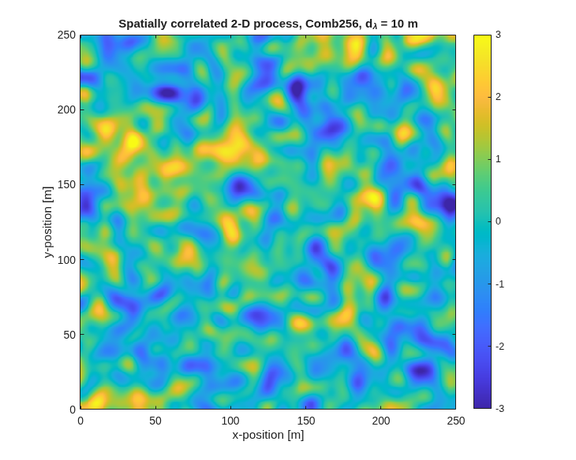
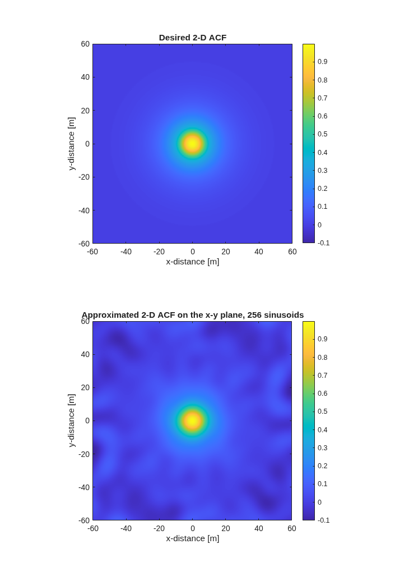
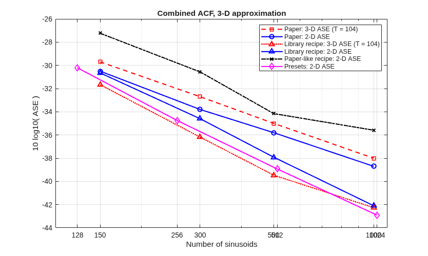
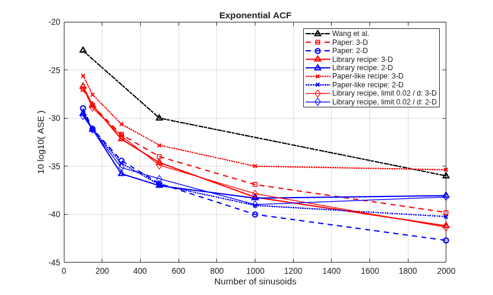
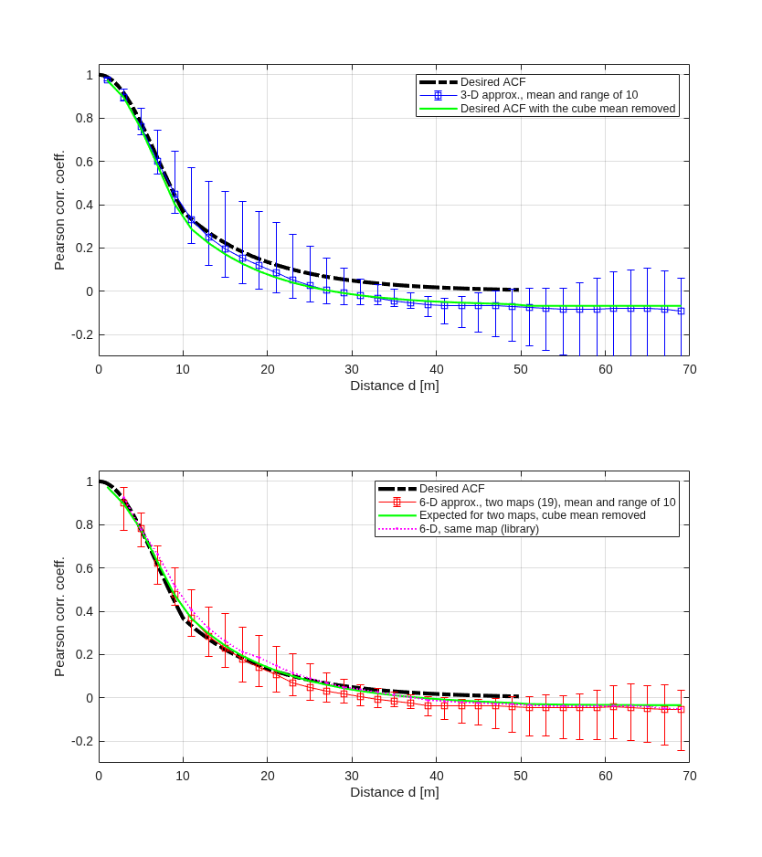
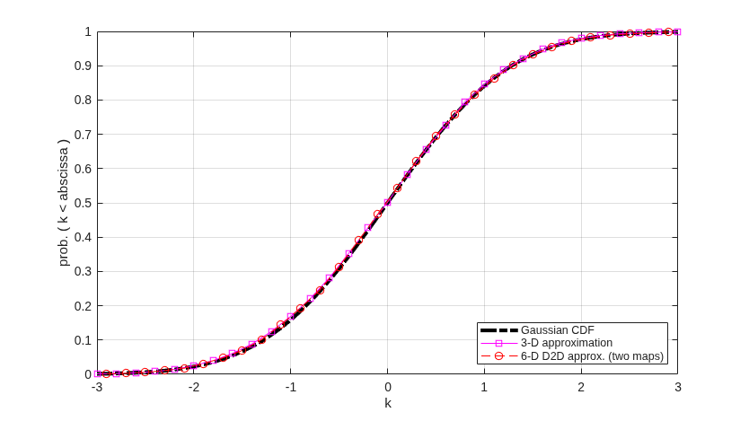
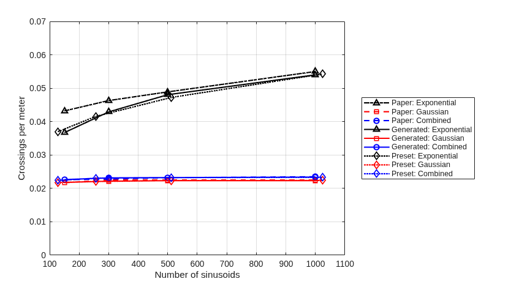
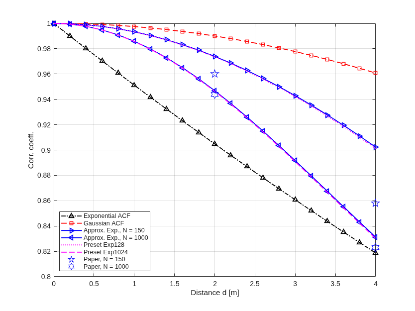

# Re-creation of the 2018 sum-of-sinusoids paper with quadriga-lib

Paper: S. Jaeckel, L. Raschkowski, F. Burkhardt, L. Thiele, "Efficient Sum-of-Sinusoids-Based Spatial
Consistency for the 3GPP New-Radio Channel Model", 2018
(`html_docu/publications/2018_sum_of_sinusoids.md`).

This folder re-runs the numeric results of the paper (section V) with the sum-of-sinusoids functions of
quadriga-lib (`include/quadriga_sos.hpp`) and compares them with the paper. Run on 2026-10-12 in MATLAB
R2024a through the MEX interface.

## Summary

- **The paper's error measure is reproduced exactly.** `sos_calc_mse`, applied to the frequency tables of
  the MATLAB class `qd_sos` (the tables behind the paper), returns the ASE values of Fig. 3 and Fig. 6
  within 0.05 dB.
- **3-D tables are as good as or better than in the paper.** Combined ACF: equal at 150 sinusoids, 0.8 dB
  better at 300, 2.1 dB at 500, 3.4 dB at 1000. The gain per doubling of the sinusoids is about 4 dB here,
  3 dB in the paper. Exponential ACF: within 0.3 dB up to 150, 0.5 to 1.4 dB better from 300 to 2000.
- **2-D tables fall short of the paper for many sinusoids.** Exponential ACF: equal up to 500 sinusoids,
  0.9 to 1.7 dB worse at 1000, 2.5 to 4.7 dB worse at 2000. The cause is not established.
- **Generated values behave as in the paper.** The estimated ACF (Fig. 4), the Gaussian CDF (Fig. 5) and
  the zero-crossing rates of the Gaussian and combined ACF (Fig. 7) agree with the paper.
- **Fig. 4 has an explanation the paper does not give.** The estimate lies below the desired ACF beyond
  10 m and turns negative. This is not an approximation error. The Pearson coefficient removes the mean of
  the 56 m cube, and a field with this ACF has a cube mean with a variance of 0.063. An exact Gaussian field
  shows the same dip.
- **The exponential ACF near the origin is flatter than in the paper for few sinusoids.** With 150
  sinusoids the zero-crossing rate is 0.037 per meter against 0.043 in the paper.
- **The cost picture of Table I changes.** One call evaluates many generators that share the frequencies;
  each further generator costs N multiply-adds instead of N cosines.

## How to run

```
cd tools/sos_port
matlab -batch run_all        % or: octave --eval run_all
```

Requires the MEX files in `+quadriga_lib` (`make matlab=ON` or `make octave=ON`). Results are written to
`results/` as CSV and PNG. The frequency tables are cached in `results/tables/` (192 files); with the cache
`run_all` takes a few minutes, without it about 40 minutes on one core. The lines of `results/jobs.txt`
are the arguments of `gen_tables` and can be started as parallel jobs. The Octave run was not tried.

| File | Content |
|---|---|
| `run_all.m` | runs everything |
| `sos_port_table.m`, `gen_tables.m`, `sos_port_best.m` | generation, caching and selection of frequency tables |
| `sos_port_acf.m`, `sos_port_paper_values.m`, `sos_port_init.m` | target ACFs, values of the paper, paths |
| `fig1_fig2_maps.m` | Fig. 1 and Fig. 2 |
| `fig3_ase_comb.m` | Fig. 3 |
| `fig4_acf_estimate.m`, `fig4b_exact_field_check.m` | Fig. 4 and the cross-check with an exact Gaussian field |
| `fig5_cdf.m` | Fig. 5 |
| `fig6_ase_exp.m` | Fig. 6 |
| `fig7_fig8_zcr.m` | Fig. 7 and Fig. 8 |
| `tab1_complexity.m` | timing for Table I |

## Set-up and conventions

- Target ACFs as in the paper: exponential (2), Gaussian, combined (22); 200 samples from 0 to 49.75 m,
  decorrelation distance 10 m.
- Paper values come from the text where it gives numbers and are otherwise read from the figures, to about
  0.1 dB (`sos_port_paper_values.m`).
- ASE values are written as in the paper, `10·log10(ASE)`, negative; `sos_calc_mse` returns the same
  number with the opposite sign.
- "3-D ASE (T = 104)": error along 104 test directions. "2-D ASE": error on the coordinate planes inside
  the disc covered by the ACF (`mse_core`), averaged over the three planes for a 3-D table.
- Three sets of frequency tables are used:

| Set | How it was made |
|---|---|
| Presets | the tables shipped with the library: 128, 256, 512, 1024 sinusoids |
| Library recipe | `sos_generate` with the settings of the presets, for the sizes of the paper: regular directions, 300 test directions, lower frequency limit `0.05 / d` |
| Paper-like recipe | `sos_generate` with settings close to the paper: random directions, 28 test directions, no lower limit |

- Each generated configuration was run with 4 seeds and the best table (by 2-D ASE) is reported. The paper
  repeated each estimation 5000 times and reports the best.

## Check of the error measure on the paper's own tables

The tables of `qd_sos` in QuaDRiGa (`set_acf.m`) are the ones the paper describes. Measured with
`sos_calc_mse` during the port (md/LOG_QD_SOS.md, WI-5):

| Table | `mse_core` | Paper | | Table | `mse_core` | Paper |
|---|---|---|---|---|---|---|
| Comb150  | -30.49 | -30.5 (Fig. 3) | | Exp150  | -28.71 | -28.7 (Fig. 6, 3-D) |
| Comb300  | -33.78 | -33.8 | | Exp300  | -31.74 | -31.7 |
| Comb500  | -35.85 | -35.8 | | Exp500  | -34.02 | -34.0 |
| Comb1000 | -38.73 | -38.7 | | Exp1000 | -36.86 | -36.9 |

The directional values of the same tables are -29.3, -32.4, -34.5, -37.3 dB with 100 lattice directions,
against -29.7, -32.7, -35.0, -38.0 dB in Fig. 3. The difference of 0.3 to 0.7 dB comes from the test
directions: the paper used 104 directions of a sphere packing, the library a spiral lattice on the
hemisphere.

## Fig. 1 and Fig. 2: example process and 2-D ACF



Preset Comb256 on 250 m × 250 m with 0.5 m spacing, z = 0 (paper: 300 sinusoids).

| Quantity | Value |
|---|---|
| Mean, standard deviation of the map | 0.029, 0.978 |
| Minimum, maximum | -3.53, 3.37 |
| Standard deviation of the map mean over 200 phase sets | 0.098 |
| Same, expected from the target ACF | 0.094 |



| Quantity, x-y plane, Comb256 | Value |
|---|---|
| ASE inside the disc | -36.0 dB |
| Largest absolute error inside the disc | 0.069 |
| Largest absolute value outside the disc, up to twice the range | 0.135 |

The paper shows the two images without numbers. The pattern is the same: a clean disc with a ripple of a
few percent around it.

## Fig. 3: ASE against the number of sinusoids, combined ACF



| Sinusoids | Paper 3-D ASE | Paper 2-D ASE | Library recipe 3-D ASE | Library recipe 2-D ASE | Paper-like recipe 2-D ASE |
|---|---|---|---|---|---|
| 150  | -29.7 | -30.5 | -31.7 | -30.7 | -27.2 |
| 300  | -32.7 | -33.8 | -36.2 | -34.6 | -30.6 |
| 500  | -35.0 | -35.8 | -39.5 | -37.9 | -34.2 |
| 1000 | -38.0 | -38.7 | -42.3 | -42.1 | -35.6 |

| Preset | 3-D ASE (T = 104) | 2-D ASE |
|---|---|---|
| Comb128  | -31.0 | -30.2 |
| Comb256  | -35.4 | -34.8 |
| Comb512  | -39.0 | -38.9 |
| Comb1024 | -42.2 | -42.9 |

- Paper: "when doubling the number of coefficients, the ASE improves by roughly 3 dB". Here the gain is
  about 4 dB per doubling (presets: 4.6, 4.2, 4.0 dB), so the advantage over the paper grows with the size.
- The paper-like recipe with 4 seeds is 1.6 to 3.3 dB worse than the paper. That is the price of 4 runs instead of
  5000, and of 28 test directions: with few directions the search fits those directions and is worse in
  others (found during the port, md/LOG_QD_SOS.md, WI-5).
- All tables of the library recipe have no sinusoid below `abs(f)·d = 0.01`; the paper-like tables have 4,
  13, 16 and 30, as the tables of the paper do (1 to 31).

## Fig. 6: ASE against the number of sinusoids, exponential ACF



2-D ASE of 2-D tables:

| Sinusoids | Wang et al. | Paper | Library recipe | Library recipe, limit `0.02 / d` | Paper-like recipe |
|---|---|---|---|---|---|
| 100  | -23 | -29.0 | -29.5 | -29.7 | -29.4 |
| 150  |     | -31.1 | -31.2 | -31.2 | -31.2 |
| 300  |     | -34.4 | -35.8 | -35.1 | -34.7 |
| 500  | -30 | -36.8 | -37.0 | -36.3 | -36.9 |
| 1000 |     | -40.0 | -38.3 | -39.0 | -39.1 |
| 2000 | -36 | -42.7 | -38.1 | -38.2 | -40.2 |

2-D ASE (planes) of 3-D tables:

| Sinusoids | Paper | Library recipe | Library recipe, limit `0.02 / d` | Paper-like recipe |
|---|---|---|---|---|
| 100  | -27.0 | -26.7 | -26.8 | -25.6 |
| 150  | -28.7 | -28.6 | -28.9 | -27.6 |
| 300  | -31.7 | -32.2 | -31.8 | -30.6 |
| 500  | -34.0 | -34.6 | -34.9 | -32.8 |
| 1000 | -36.9 | -38.2 | -37.8 | -35.0 |
| 2000 | -39.8 | -41.2 | -41.3 | -35.4 |

Claims of the paper:

| Claim | Paper | Here |
|---|---|---|
| 2-D ASE for 100, 500, 2000 sinusoids | -29, -36.8, -42.7 dB | -29.5, -37.0, -38.1 dB (library recipe); -29.4, -36.9, -40.2 dB (paper-like recipe) |
| Mean improvement over Wang et al. | 6.5 dB | 5.2 dB (library recipe), 5.8 dB (paper-like recipe) |
| Loss of 3-D against 2-D | 2.7 dB on average | 2.8 dB on average up to 500 sinusoids; 0.1 dB at 1000; at 2000 the 3-D table is 3.1 dB better |

- Up to 500 sinusoids all 2-D results agree with the paper within 0.5 dB, except 300 (1.4 dB better).
- At 1000 and 2000 sinusoids the 2-D tables stop improving. The lower frequency limit is part of it: the
  paper-like recipe without a limit reaches -40.2 dB at 2000, with 107 of 2000 sinusoids at almost zero
  frequency. A smaller limit (`0.02 / d`) does not recover the difference. The remaining 2.5 dB to the
  paper is not explained; 4 runs against 5000 is one candidate.
- The explanation of the 2.7 dB loss in the paper's footnote 6 does not carry over: with the library recipe
  the difference between 2-D and 3-D depends on the size and changes sign.

## Fig. 4: ACF estimated from generated values



Preset Comb256, 3000 + 3000 positions in a cube of 55.2 m edge length, groups of 2 m, 10 initialisations.
"Expected" is the desired ACF with the mean of the cube removed, `(R - v) / (1 - v)`, where `v` is the mean
of the desired ACF over all position pairs of the cube (`v = 0.063`).

| Distance | Desired | 3-D estimate | 3-D expected | 6-D estimate, two maps (19) | 6-D expected | 6-D estimate, same map |
|---|---|---|---|---|---|---|
| 5 m  | 0.779 | 0.759  | 0.752  | 0.781  | 0.777  | 0.779  |
| 11 m | 0.333 | 0.333  | 0.287  | 0.369  | 0.366  | 0.405  |
| 21 m | 0.123 | 0.087  | 0.064  | 0.105  | 0.126  | 0.149  |
| 31 m | 0.045 | -0.018 | -0.019 | 0.005  | 0.032  | 0.039  |
| 41 m | 0.017 | -0.067 | -0.049 | -0.036 | -0.008 | -0.015 |

- The curves have the shape of the paper's Fig. 4: on the desired ACF up to the decorrelation distance,
  below it from 10 m to 50 m, with a minimum of about -0.07 near 40 m for 3-D (paper: about -0.07) and
  about -0.04 for 6-D (paper: about -0.03).
- The paper reads this as "the given ACF can be approximated with good accuracy". The dip is not part of
  the approximation: the removal of the cube mean alone predicts it. The cross-check
  (`results/fig4b_exact_field_check.csv`) draws an exact Gaussian field with the exponential ACF from its
  covariance matrix at 1500 positions in the same cube: its estimate is 0.054 at 21 m and -0.050 at 41 m,
  against a desired 0.123 and 0.017, and the preset Exp256 gives 0.041 and -0.042 at the same positions.
- The spread between initialisations is larger here than in the paper (at 11 m: 0.22 to 0.57 here, about
  0.19 to 0.40 in the paper). The exact field has a standard deviation of 0.075 at 11 m over 40
  realisations, the preset 0.056, so the spread is a property of the field. The tables of the paper put
  part of the slow variation into sinusoids of almost zero frequency, which the Pearson coefficient removes.
- The 6-D estimate with two maps follows the paper's equation (19). The library also offers one map for
  both devices, normalised with the ACF of their distance; it is shown as the dotted curve and lies
  slightly higher.

## Fig. 5: CDF of the output values



Preset Comb256, 10,000 positions in 1000 m × 1000 m × 50 m, 20 runs.

| Quantity | 3-D | 6-D, two maps |
|---|---|---|
| Largest CDF deviation from the Gaussian CDF, worst single run | 0.019 | 0.021 |
| Largest CDF deviation, mean CDF of 20 runs | 0.002 | 0.001 |
| Mean kurtosis (Gaussian: 3) | 3.003 | 2.985 |
| Mean skewness | 0.001 | 0.001 |
| rms of the sample mean | 0.019 | 0.019 |

As in the paper there is no notable difference from the Gaussian CDF. The deviation of a single run is the
statistical error of 10,000 samples.

## Fig. 7 and Fig. 8: zero-crossing rate and ACF close to the origin



Decorrelation distance 20 m. The rate is computed from the frequencies, `2·sqrt( mean (f_n·u)^2 )` averaged
over 2000 directions, which is `sqrt(-R''(0)) / pi` of the sum of sinusoids. For the presets it is also
counted on generated values (lines of 5 km, 0.1 m steps, 10 phase sets, 3 directions).

| ACF | Sinusoids | Paper | Library recipe | | Preset | From frequencies | Counted |
|---|---|---|---|---|---|---|---|
| Exponential | 150  | 0.0432 | 0.0367 | | Exp128   | 0.0370 | 0.0378 |
| Exponential | 300  | 0.0463 | 0.0429 | | Exp256   | 0.0415 | 0.0409 |
| Exponential | 500  | 0.0489 | 0.0481 | | Exp512   | 0.0472 | 0.0494 |
| Exponential | 1000 | 0.0550 | 0.0540 | | Exp1024  | 0.0542 | 0.0554 |
| Gaussian    | 150  | 0.0217 | 0.0218 | | Gauss128 | 0.0218 | 0.0218 |
| Gaussian    | 300  | 0.0225 | 0.0222 | | Gauss256 | 0.0221 | 0.0217 |
| Gaussian    | 500  | 0.0225 | 0.0223 | | Gauss512 | 0.0223 | 0.0229 |
| Gaussian    | 1000 | 0.0225 | 0.0223 | | Gauss1024| 0.0224 | 0.0226 |
| Combined    | 150  | 0.0226 | 0.0226 | | Comb128  | 0.0224 | 0.0225 |
| Combined    | 300  | 0.0228 | 0.0231 | | Comb256  | 0.0231 | 0.0235 |
| Combined    | 500  | 0.0232 | 0.0232 | | Comb512  | 0.0232 | 0.0233 |
| Combined    | 1000 | 0.0235 | 0.0234 | | Comb1024 | 0.0233 | 0.0235 |

- Gaussian and combined ACF: agreement within 0.0003 per meter; the rate does not depend on the number of
  sinusoids and equals the analytic value `sqrt(2) / (pi·d) = 0.0225` of the Gaussian ACF. Same finding as
  in the paper.
- Exponential ACF: the rate grows with the number of sinusoids, as in the paper. With 1000 sinusoids it
  matches (0.0540 against 0.0550). With 150 it is 15 % lower (0.0367 against 0.0432).



Approximated exponential ACF, averaged over the directions:

| Distance | Exponential | Gaussian | Paper, N = 150 | Here, N = 150 | Paper, N = 1000 | Here, N = 1000 | Exp128 | Exp1024 |
|---|---|---|---|---|---|---|---|---|
| 2 m | 0.905 | 0.990 | 0.960 | 0.974 | 0.944 | 0.947 | 0.974 | 0.946 |
| 4 m | 0.819 | 0.961 | 0.858 | 0.902 | 0.823 | 0.831 | 0.901 | 0.830 |

The picture of the paper holds: the approximation starts with zero slope and approaches the exponential
ACF as the number of sinusoids grows. For 150 sinusoids the library tables are flatter near the origin
than the paper's (0.902 against 0.858 at 4 m), although their ASE over the whole range is the same
(-28.6 against -28.7 dB). The fit spends its sinusoids differently: less at high frequencies.

## Table I and the complexity discussion

| Item | Paper | Library |
|---|---|---|
| Memory for the frequencies | `(D+1)·N` elements; 3.6 kB for N = 300, D = 2, single precision | 6.1 kB for 256 sinusoids in 3-D, double precision; 2 kB of phases per generator |
| Initialisation | about N operations per variable | 4.5 ms for the 2288 variables of the paper's example (256 sinusoids each) |
| Output generation | about `N·(2D+15)` operations, 5700 for N = 300, D = 2 | see below |
| Placement | no restriction | no restriction; the AVX2 kernel keeps its accuracy at any distance from the origin (tested to 1000 km) |

Measured time per output value, 256 sinusoids, positions on a plane (double kernel, 16 threads; the
build used for this run had AVX2 switched off):

| Positions | Generators | Time per call | Time per output value |
|---|---|---|---|
| 100,000 | 1    | 46 ms  | 463 ns |
| 10,000  | 20   | 6.8 ms | 34 ns  |
| 1,000   | 2288 | 75 ms  | 33 ns  |
| 100,000 (1024 sinusoids) | 1 | 181 ms | 1807 ns |

With the AVX2 kernel (md/LOG_QD_SOS.md, WI-7; 300 sinusoids, 5000 positions): 397 ns per value for one
generator on one thread, 36 ns on 16 threads, and 3.9 ns per value for 400 generators.

- The paper names the output generation as the downside of the method, because every value needs N
  cosines. For generators that share the frequencies this no longer holds per generator: the cosines are
  computed once per position, and each further generator adds N multiply-adds. Per position, the 2288 variables of
  the paper's example cost 163 times one variable (75 µs against 0.46 µs), not 2288 times.
- "Doubling the coefficients doubles the computation time" is confirmed: 1024 sinusoids take 3.9 times
  as long as 256.

## Deviations

### In the findings

| Topic | Paper | Here |
|---|---|---|
| ASE gain per doubling of the sinusoids (3-D) | about 3 dB | about 4 dB |
| 3-D combined ACF, 300 / 500 / 1000 sinusoids | -33.8 / -35.8 / -38.7 dB | -34.6 / -37.9 / -42.1 dB |
| 2-D exponential ACF, 1000 / 2000 sinusoids | -40.0 / -42.7 dB | -38.3 / -38.1 dB (library recipe), -39.1 / -40.2 dB (paper-like recipe) |
| Improvement over Wang et al. | 6.5 dB | 5.2 to 5.8 dB, lower because of the 2000-sinusoid result |
| Loss of 3-D against 2-D | 2.7 dB, explained by the extra dimension | 2.8 dB up to 500 sinusoids, none at 1000, reversed at 2000 |
| Estimated ACF below the desired one (Fig. 4) | not commented | caused by the removal of the cube mean; an exact field shows it too |
| Spread of the estimated ACF between initialisations | about ±0.1 at 11 m | 0.22 to 0.57 at 11 m; in line with an exact field |
| Zero-crossing rate, exponential ACF, 150 sinusoids | 0.0432 / m | 0.0367 / m |
| ACF beyond the fitted range | not examined | paper-type tables keep 0.03 to 0.09 (3 to 5 % of the sinusoids at almost zero frequency); the 3-D library tables stay near 0.01 |
| Cost of output generation | N cosines per value and variable | N cosines per value, N multiply-adds per further variable |

### In the implementation

| Topic | Paper (section III, IV) | Library |
|---|---|---|
| Residual for the update (13), (14) | along the coordinate axis closest to the direction of the sinusoid; mean of the other N-1 sinusoids | along the direction of the sinusoid itself; exact, sum of the other sinusoids divided by N |
| Directions of the sinusoids | random, new in each of the 5000 repetitions | regular spiral lattice on the hemisphere (random is an option) |
| Test directions | 28 during the search, 104 for the evaluation, sphere packing | 300 during the search for the presets, spiral lattice on the hemisphere |
| Repetitions | 5000, best result kept | presets: best of 48 seeds; this study: best of 4 |
| Frequency limits | search range ±15 periods per fitted range, no lower limit | same upper limit; lower limit `0.05 / d` for the presets |
| Stop criterion | no further improvement | additionally a gain below a factor of 1e-6 per pass, and at most 1000 passes |
| Precision | single | double; the AVX2 evaluation kernel uses single-precision sine and cosine after a range reduction in double |
| Table sizes | 150, 300, 500, 1000 | 128, 256, 512, 1024 |
| Two devices (19) | two independent processes, divided by sqrt(2) | the same as "two maps"; in addition "same map": one process for both devices, divided by `sqrt(2 + 2·R(D))`, symmetric under a swap of the devices |
| Uniform distribution | `0.5·erfc(-k/sqrt(2))` | the same |
| Sample mean over an area | not discussed | `sos_remove_bias` removes it in closed form; documented as conditioning the field |
| Random numbers | MATLAB `rand` | seeded stream, identical on all platforms |

## Limits of this re-creation

- 4 seeds per configuration instead of 5000 repetitions. The paper-like recipe therefore shows what a
  few runs give, not the best the paper's settings can reach.
- Values of the paper's figures were read from the plots.
- The paper's tables for 100 and 2000 sinusoids and its 2-D tables are not available; only the eight
  3-D tables of `qd_sos` could be checked directly.
- The timing was taken with a build without AVX2; the AVX2 numbers are quoted from the port log.
- Run in MATLAB only.
